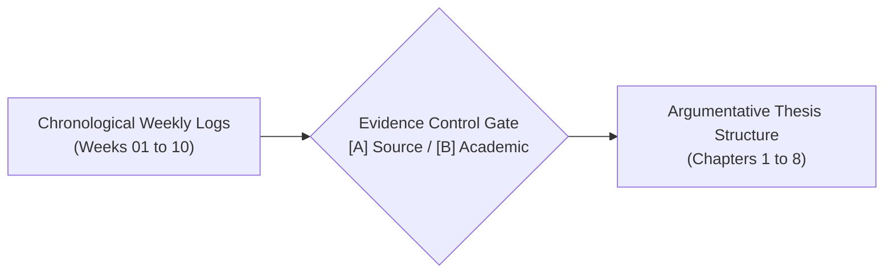
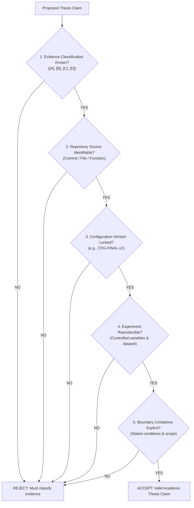

# 98 — Thesis Synthesis Matrix, Chapter Argument Mapping, and Final Claim Gate

<!-- CURRENT-BP26 -->
> **Hiện trạng 23/10/2026:** [Bản sửa Rust/UI và mô hình toán hiện tại](../BasicProject_Current_Math_and_Design.md) là điểm đọc cho source local và gate/evidence mới. Các đoạn cũ bên dưới là snapshot/lịch nghiên cứu trước đó: không dùng các nhãn COMPLETE/PASS, số FPS/speedup/tournament, TS↔Rust parity, TT/ID hay zero-copy cũ như kết quả đã xác nhận lại. App hiện dùng React19/PixiJS7; source game, reference core và WASM là các tầng evidence riêng. Chỉ Markdown tuần1–7 được cập nhật trong lượt này; Word/PDF/Drive/mirror cũ chưa đồng bộ.

**Project Title:** Research, Design, and Implementation of an Optimized Gomoku Game Engine with Artificial Intelligence  
**Academic Module:** Basic Project (Đồ Án Cơ Sở) — Software Engineering & AI Track  
**Document Standard:** Standard 00 (IMRaD & Evidence Specification for Software Systems)  
**Control Layer ID:** `SYN-THESIS-98`  
**Authoritative Repository:** [GitHub – tducn110/caro](https://github.com/tducn110/caro) (commit `cb6fd6f`)  
**Language:** English  
**Status:** Complete Synthesis Specification  

---

## 1. Purpose & Structural Bridge

While weekly research logs document the chronological process of investigation, the final university thesis dissertation must be organized by argumentative and structural coherence. This synthesis matrix provides the formal bridge mapping empirical findings, architectural decisions, and verified test evidence into the final thesis chapters.

---

## 2. Thesis Chapter Mapping Matrix

| Thesis Chapter | Chapter Focus | Source Research Logs | Canonical Evidence / Artifacts | Key Arguments & Findings |
| :--- | :--- | :--- | :--- | :--- |
| **Ch. 1: Introduction & Problem Scope** | Problem Motivation, Research Questions | Week 01, Section 00 | `RQ-W1-01` to `RQ-W10-04` | Formal combinatorial game definition; intractability of unconstrained search ($10^{105}$); thesis goals. |
| **Ch. 2: Literature & Theoretical Foundations** | Game Theory, Adversarial Search, Pruning | Week 01, Week 05, Week 06 | Allis (1994), Knuth & Moore (1975), Shannon (1950) | Proof of first-player win; theoretical branching bounds ($\mathcal{O}(b^{d/2})$); Zobrist hash theory. |
| **Ch. 3: System Architecture & Design** | Multi-tier Architecture, Concurrency, WASM | Week 02, Week 03, Section 01 | `ADR-ARCH-01`, Migration Decision Gates | Decoupled Web Worker isolation; PixiJS WebGL 60 FPS rendering; zero-copy WASM memory buffer. |
| **Ch. 4: Algorithmic Modeling** | Heuristics, Search Trees, Candidate Policies | Week 04, Week 07, Week 08, Week 09 | `CFG-EVAL-v1`, `CFG-CAND-v1`, `CFG-ORDER-v1` | 7-shape pattern taxonomy; Chebyshev $r=2$ candidate window; dynamic move ordering; Zobrist TT. |
| **Ch. 5: Implementation & Verification** | Core Engine, Test Suites, Equivalence Proof | Week 02, Week 06, Section 07 | `caro-core-reference` tests (9/9), `10_caro` tests (18/18) | In-place move rollback; search equivalence ($\text{AB} \equiv \text{MM}$); 100% test gate passing. |
| **Ch. 6: Experimental Evaluation** | Empirical Scaling, Benchmarks, Tournaments | Week 05, Week 07, Week 08, Week 10 | `EXP-W5-01` to `EXP-W10-02` | $92.9\%$ node pruning at depth 4; $100\%$ tactical recall; round-robin tournament validation (96% win rate). |
| **Ch. 7: Discussion & Limitations** | Engineering Trade-offs, Edge Cases | All Weeks | Horizon Effect analysis, Mobile context loss | Memory limits in WASM; defense multiplier tuning; first-player advantage mitigation. |
| **Ch. 8: Conclusion & Future Scope** | Summary of Findings, Future Roadmap | Section 98, Roadmap | Final DoD checklist | Delivery of production-ready engine; prospective deep reinforcement learning extensions. |

---

## 3. Final Claim Gate & Quality Assurance Protocol

Before any scientific claim or performance figure is accepted into the final thesis document, it must pass through the six-stage verification gate:

---

## 4. Synthesis Conclusion
By enforcing this bidirectional trace between weekly logs and thesis chapters, every assertion in the thesis is rooted in verifiable empirical evidence, eliminating unverified claims and speculative prose.
