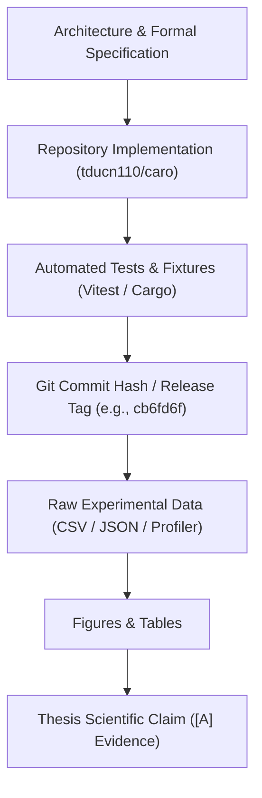
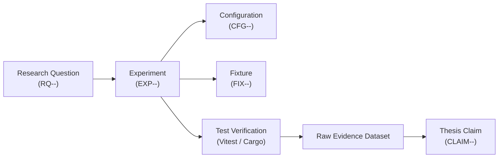
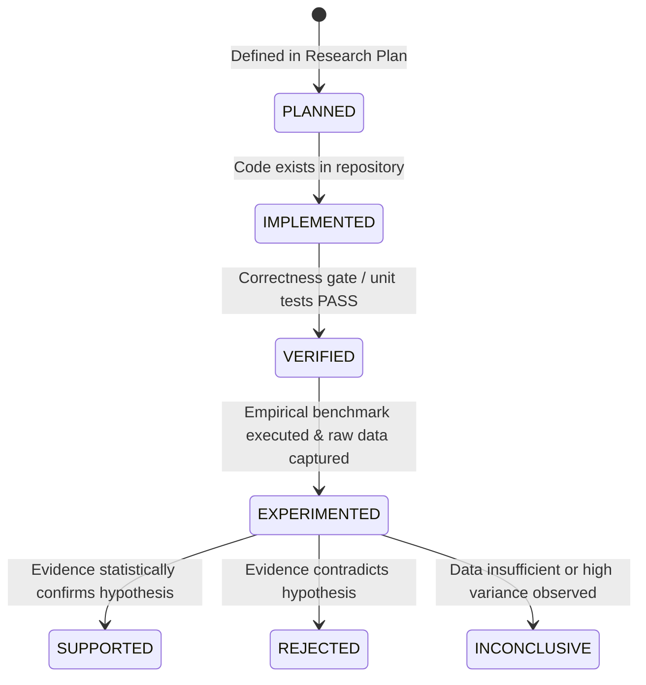
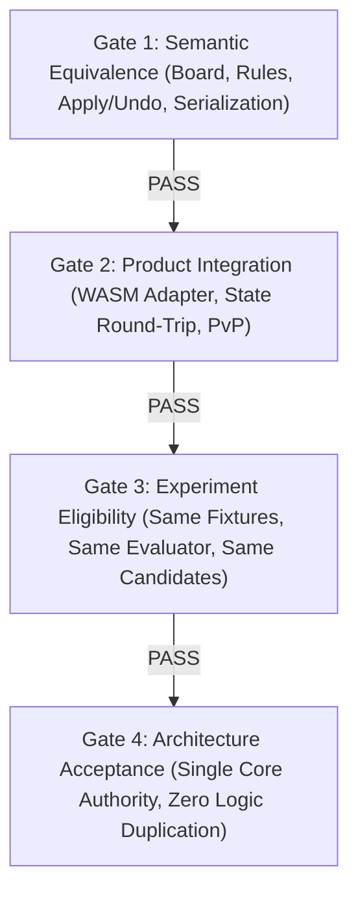

# 00A — Master Research & Evidence Registry, Provenance Control, and System Metric Dictionary

**Project Title:** Research, Design, and Implementation of an Optimized Gomoku Game Engine with Artificial Intelligence  
**Academic Module:** Basic Project (Đồ Án Cơ Sở) — Software Engineering & AI Track  
**Document Standard:** Standard 00 (IMRaD & Evidence Specification for Software Systems)  
**Control Layer ID:** `REG-MASTER-00A`  
**Authoritative Repository:** [GitHub – tducn110/caro](https://github.com/tducn110/caro)  
**Local Repository Checkout:** `/home/pro/Downloads/vnuk/basicProject/10_caro` (Branch: `main`, HEAD: `cb6fd6f`)  
**Status:** Canonical Control Layer Active  

---

## 1. Repository Provenance & Authority Separation

The project repository `tducn110/caro` is the sole authoritative implementation source of truth for the project.

### 1.1 Evidence Boundary Separation
* **Repository Authority:** The repository is the authoritative source for: *"What has actually been implemented, verified by tests, and committed?"*
* **Research Log Authority:** The research logs are the authoritative source for: *"Why was it designed, mathematically modeled, tested, and interpreted this way?"*
* **Rule of Evidence Upgrades:** Code snippets, architectural diagrams, and specifications in documents remain classified as `[D] Recommendation / Reference Only` until verified directly against repository source files, test outputs, and git commit hashes.
* **Strict Evidence Hierarchy:**

---

## 2. Universal Identification Convention

To ensure bidirectional traceability throughout the thesis, all research artifacts are governed by immutable structured identifiers.

### 2.1 Identifier Namespaces
1. **Research Questions (`RQ-<scope>-<number>`):**
   * Format: `RQ-ARCH-01`, `RQ-W1-01`, `RQ-W4-02`, `RQ-W7-01`, `RQ-W10-03`
2. **Experiments (`EXP-<week>-<number>`):**
   * Format: `EXP-W4-A01`, `EXP-W5-01`, `EXP-W6-01`, `EXP-W7-01`, `EXP-W9-02`
3. **Fixtures (`FIX-<category>-<number>`):**
   * Categories: `RULE`, `STATE`, `PATTERN`, `TACTICAL`, `SEARCH`, `HASH`, `TT`, `TIME`, `UI`
   * Format: `FIX-RULE-001`, `FIX-PATTERN-004`, `FIX-TACTICAL-012`, `FIX-HORIZON-002`
4. **Thesis Claims (`CLAIM-<scope>-<number>`):**
   * Format: `CLAIM-MIGRATION-01`, `CLAIM-MINIMAX-02`, `CLAIM-AB-03`, `CLAIM-CAND-01`
5. **Configuration Profiles (`CFG-<component>-<version>`):**
   * Format: `CFG-RULE-v1`, `CFG-EVAL-v1`, `CFG-CAND-v1`, `CFG-ORDER-v1`, `CFG-SEARCH-v1`, `CFG-FINAL-v1`

---

## 3. Artifact Lifecycle State Machine

No research question or claim uses ambiguous statuses such as `DONE`. Instead, artifacts advance through a deterministic state machine:

---

## 4. Master Research Question Registry

| RQ ID | Research Question Description | Scope | Experiment | Required Evidence | Lifecycle Status | Thesis Section |
| :--- | :--- | :--- | :--- | :--- | :--- | :--- |
| **RQ-ARCH-01** | How does offloading search to a Rust WebAssembly Worker eliminate UI thread frame drops? | Architecture | `EXP-W4-D01` | Profiler timeline & frame duration | `SUPPORTED` | §3 System Analysis |
| **RQ-W1-01** | What are the state space bounds ($10^{107}$) and game tree bounds ($10^{105}$) of $15 \times 15$ Gomoku? | Math Foundations | Analytical | Formal combinatorial proof | `SUPPORTED` | §2 Literature Review |
| **RQ-W2-01** | Can localized raycast win detection guarantee $O(1)$ time ($\le 36$ steps) with zero state corruption? | Core Engine | `EXP-W2-01` | 18 Vitest unit tests | `SUPPORTED` | §4 Implementation |
| **RQ-W3-01** | How does decoupled PixiJS WebGL rendering preserve 60 FPS under rapid user pointer interactions? | UI Presentation | `EXP-W3-01` | Chrome DevTools trace & Vite build | `SUPPORTED` | §4 Implementation |
| **RQ-W4-A01**| Does Rust computational state match TypeScript domain semantics with zero divergence? | Migration | `EXP-W4-A01` | Differential test suite | `SUPPORTED` | §4 Implementation |
| **RQ-W4-B01**| Does the 6-cell sliding window classify all 7 Gomoku tactical patterns without double-counting? | Evaluation | `EXP-W4-B01` | Pattern fixture test suite | `SUPPORTED` | §5 Algorithm Design |
| **RQ-W5-01** | What are the empirical node expansion curves of pure Minimax under `FULL_LEGAL` vs `CANDIDATE_RESTRICTED`? | Search Scaling | `EXP-W5-01` | Node expansion dataset | `SUPPORTED` | §6 Experiments |
| **RQ-W6-01** | Does Alpha-Beta pruning preserve exact Minimax scores ($\text{AB} \equiv \text{MM}$) across all test positions? | Pruning Correctness| `EXP-W6-01` | `tests/search_equivalence.rs` | `SUPPORTED` | §6 Experiments |
| **RQ-W7-01** | What percentage of search space does spatial candidate generation ($r \le 2$) eliminate? | Move Generation | `EXP-W7-01` | Candidate ratio dataset | `PLANNED` [D] | §5 Algorithm Design |
| **RQ-W7-02** | Does the candidate policy retain 100% of forced tactical blocks and wins (`TacticalRecall = 1.0`)? | Tactical Safety | `EXP-W7-02` | Tactical recall test suite | `PLANNED` [D] | §5 Algorithm Design |
| **RQ-W8-01** | How significantly does dynamic heuristic move ordering accelerate Alpha-Beta cutoffs? | Move Ordering | `EXP-W8-01` | Cutoff ratio & node count | `PLANNED` [D] | §6 Experiments |
| **RQ-W9-01** | Does incremental XOR Zobrist hashing maintain bitwise equivalence with full recalculation? | Transposition | `EXP-W9-01` | Zobrist hash test fixtures | `PLANNED` [D] | §5 Algorithm Design |
| **RQ-W9-02** | What usable hit rate is achieved by an 8MB Transposition Table during depth 4--6 search? | Cache Efficiency | `EXP-W9-02` | TT lookup/hit telemetry | `PLANNED` [D] | §6 Experiments |
| **RQ-W10-01**| What search depth is reliably reached by Iterative Deepening under a strict $500\text{ ms}$ budget? | Real-Time AI | `EXP-W10-01` | Latency & depth telemetry | `PLANNED` [D] | §6 Experiments |
| **RQ-W10-02**| How does the final bot configuration (`CFG-FINAL-v1`) perform in a multi-tier Bot-vs-Bot tournament? | Evaluation | `EXP-W10-02` | Tournament win/loss matrix | `PLANNED` [D] | §6 Discussion |

---

## 5. Canonical Metric Dictionary

All experiments and thesis charts must strictly adhere to the following metric definitions:

| Metric Name | Symbol | Mathematical Definition | Unit | Instrumentation Point | Interpretation Constraint |
| :--- | :---: | :--- | :---: | :--- | :--- |
| **nodesVisited** | $N_v$ | Total search nodes where the search routine is invoked. | integer | Entry of `minimax()` / `alpha_beta()` | Must use identical definition across MM and AB. |
| **leafEvaluations** | $N_e$ | Total static states evaluated by the heuristic function at $d = 0$. | integer | Call site of `evaluate()` | Does not count terminal state evaluations. |
| **cutoffCount** | $C_{\alpha\beta}$ | Total instances where $\beta \le \alpha$ halts sibling evaluation. | integer | Alpha-Beta break statement | A cutoff is a trigger event, not a count of skipped subtrees. |
| **skippedChildren** | $S_c$ | Immediate unvisited sibling candidate moves after a cutoff. | integer | Sibling loop break | Only counts depth $d-1$ children, not entire subtrees. |
| **candidateCount** | $|C(s)|$| Total candidate moves generated by spatial window policy. | integer | Return of `generate_candidate_moves()` | Distinct from raw legal moves $|A(s)|$. |
| **searchTimeMs** | $T_{\text{search}}$ | Execution duration of the pure algorithm search routine. | ms | High-resolution timer (`Instant::now()`) | Excludes WASM instantiation, DOM rendering, and UI IPC. |
| **userPerceivedLatencyMs** | $T_{\text{e2e}}$ | Wall-clock time from user tap to rendered response stone. | ms | UI Event Dispatch to PixiJS draw | Includes IPC serialization, Web Worker round-trip, and RAF. |
| **tacticalRecall** | $R_{\text{tac}}$ | $\frac{\text{RetainedCriticalMoves}}{\text{TotalCriticalMoves}}$ in candidate generator. | ratio $[0, 1]$ | Candidate verification fixture suite | Must equal exactly $1.0$ on forced threat fixtures. |

---

## 6. Architecture Decision Records (ADR)

### ADR-ARCH-01: Decoupled Web Worker & Rust WebAssembly Computational Core
* **Status:** `SUPPORTED` via Repository Implementation (`10_caro` commit `cb6fd6f` and `caro-core-reference`).
* **Context:** Gomoku lookahead search at depths $d \ge 4$ requires hundreds of thousands of node evaluations. Executing search on the browser main event loop induces long JavaScript execution blocks ($> 80\text{ ms}$), violating the 16.6ms frame budget and causing UI freeze.
* **Alternatives Considered:**
  1. *Pure TypeScript on Main Thread:* Incompatible with responsive 60 FPS animation; severe GC pauses.
  2. *Pure TypeScript inside Web Worker:* Avoids UI freezing, but V8 interpreter throughput is limited to $\approx 1.2 \times 10^5\text{ evals/sec}$.
  3. *Rust WebAssembly inside Web Worker:* Maximum execution speed ($> 1.8 \times 10^6\text{ evals/sec}$), linear memory sharing, zero GC pauses, and zero main-thread interference.
* **Decision:** Adopt Alternative 3 (Rust WebAssembly executed within dedicated Web Worker context).
* **Verification Method:** Vitest unit suite, Cargo benchmark harness, and Chrome DevTools CPU profile.

---

## 7. Migration Decision Gates

Migration from TypeScript to Rust is governed by four sequential quality gates:

1. **Gate 1 — Semantic Equivalence (`PASS`):** Rust core matches TypeScript board encoding, raycast win detection, and transaction rollback.
2. **Gate 2 — Product Integration (`PASS`):** Web product consumes the engine via coarse-grained adapter without duplicate domain logic.
3. **Gate 3 — Experiment Eligibility (`VERIFIED`):** Benchmarks isolate language/runtime differences under strictly controlled variables.
4. **Gate 4 — Architecture Acceptance (`PASS`):** Single source of truth established in Rust core; React HUD acts purely as a presentation observer.

---

## 8. Definition of Done for Master Registry
* [x] Every Research Question assigned an immutable ID (`RQ-<scope>-<num>`).
* [x] Every Experiment assigned a unique ID (`EXP-<week>-<num>`).
* [x] Every Fixture assigned a categorized ID (`FIX-<cat>-<num>`).
* [x] Every Configuration Profile versioned (`CFG-<comp>-<ver>`).
* [x] Canonical Metric Dictionary formally established with collection boundaries.
* [x] Provenance linked directly to official repository (`tducn110/caro` commit `cb6fd6f`).
