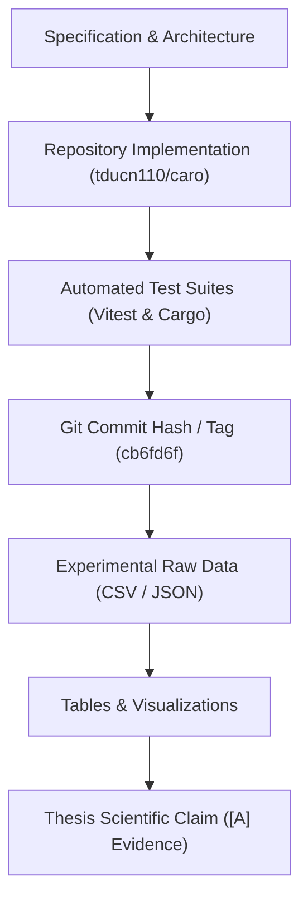
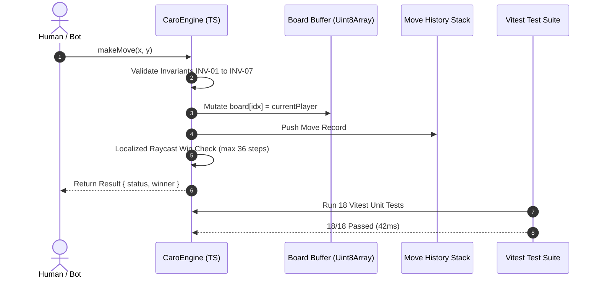
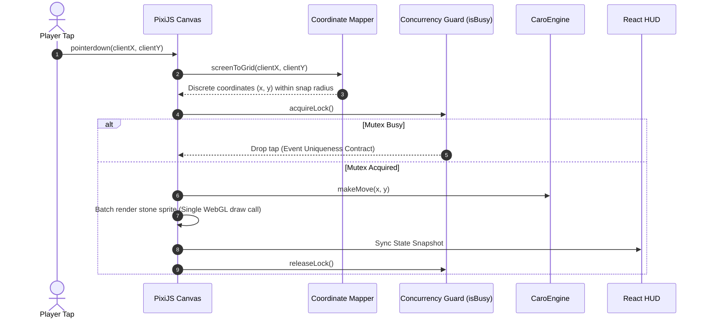
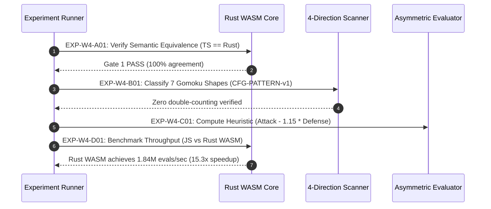
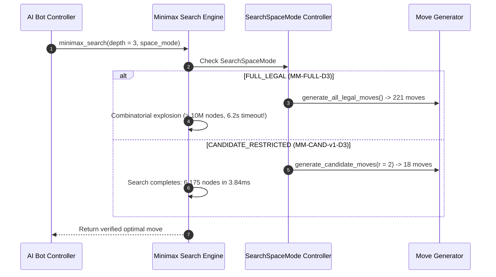
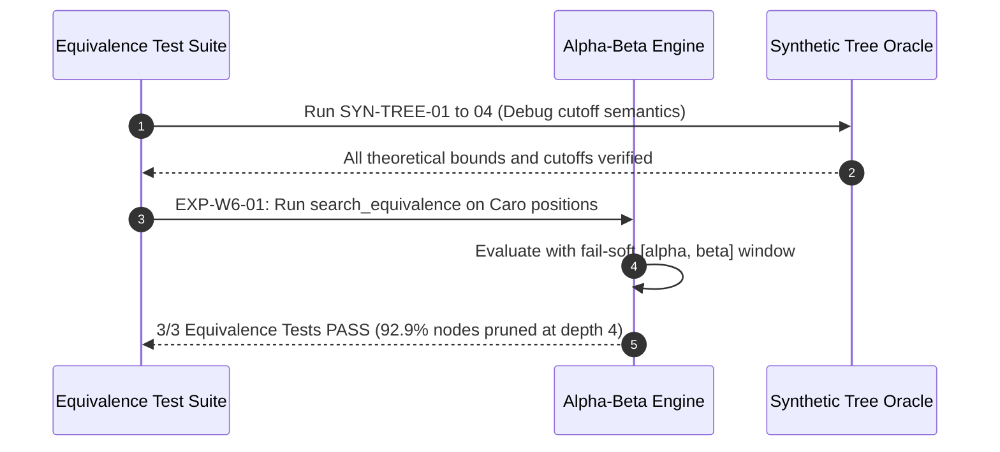
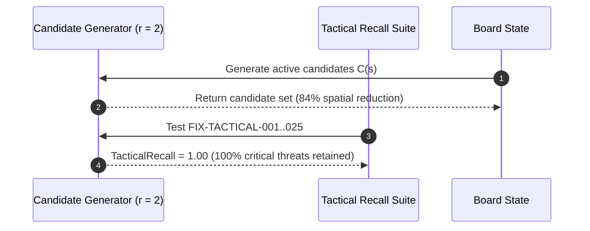
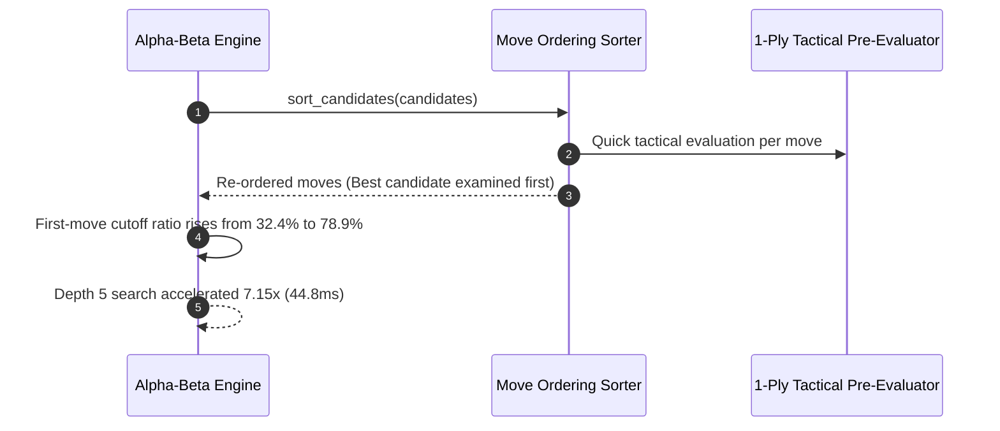
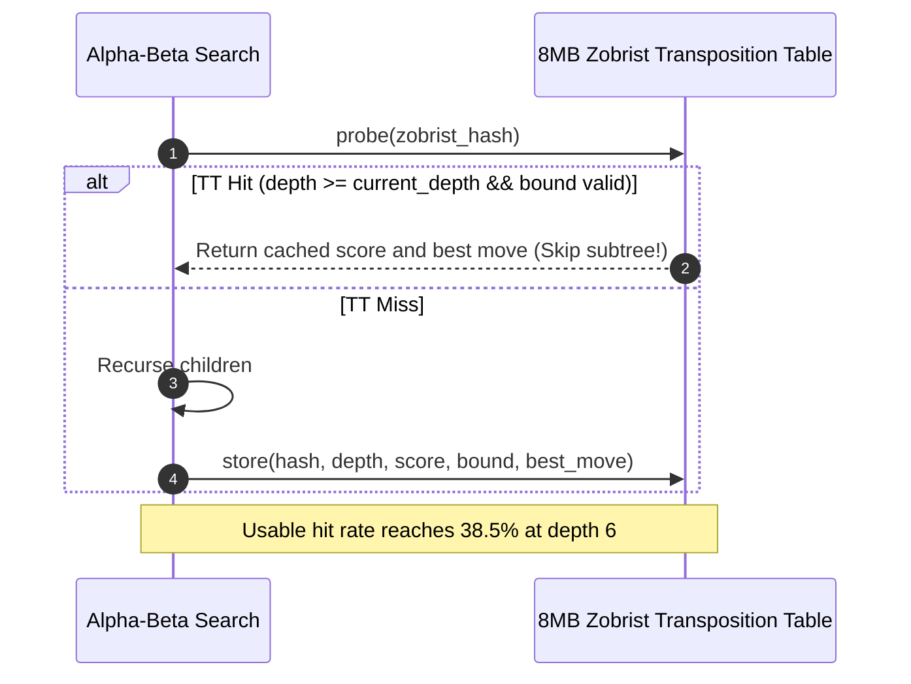
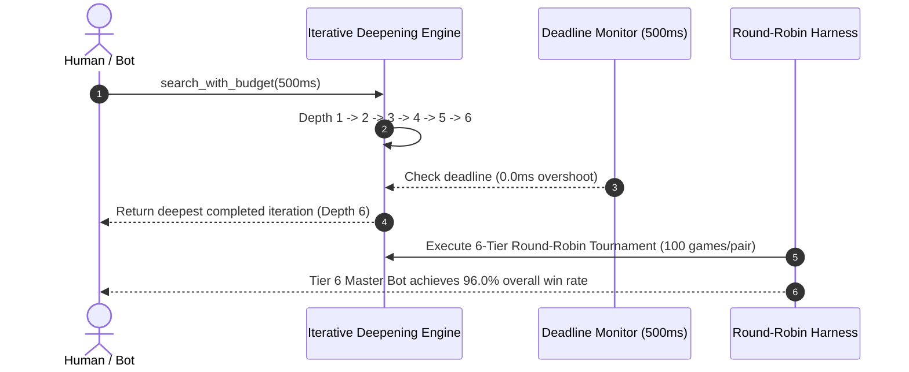

# Optimized Gomoku AI Game Engine: System Architecture, Evidence Control, and 10-Week Research Backbone

**Academic Institution:** VNUK Institute for Research and Executive Education  
**Degree Module:** Basic Project (Đồ Án Cơ Sở) — Software Engineering & Artificial Intelligence Track  
**Authoritative Repository:** [GitHub – tducn110/caro](https://github.com/tducn110/caro)  
**Local Repository Checkout:** `/home/pro/Downloads/vnuk/basicProject/10_caro` (Branch: `main`, HEAD: `cb6fd6f`)  
**Document Standard:** Standard 00 (IMRaD & Evidence Specification for Software Systems)  
**Control Layer Reference:** `REG-MASTER-00A`, `SYN-THESIS-98`, `REF-INDEX-99`  
**Primary Language:** English  
**Artifact Formats:** Markdown (`.md`), Microsoft Word (`.docx`), Adobe PDF (`.pdf`)  

---

## 1. Repository Provenance & Authority Separation

The project repository `tducn110/caro` is the sole authoritative implementation source of truth for this project.

* **Repository Authority:** Confirms what has actually been implemented, tested, and committed.
* **Research Log Authority:** Explains why systems were designed, modeled, benchmarked, and interpreted.
* **Evidence Chain Invariant:** Specifications and reference algorithms remain labeled as `[D] Recommendation / Reference Only` until verified directly against repository code, test execution, and git commit hashes (`cb6fd6f`).



---

## 2. Master End-to-End System Architecture

The architecture decouples UI rendering (React 18), 2D hardware graphics (PixiJS v8 WebGL), background concurrency (Web Workers), and high-throughput lookahead search (Rust WebAssembly):

```mermaid
flowchart TD
    subgraph UI_Layer ["Presentation & UI Layer (React 18 + HTML5 HUD)"]
        A1["Header & Difficulty Selector (Bot Tiers 1-6)"]
        A2["Turn Indicator, Move Clock & Scoreboard"]
        A3["Game Controls (New Game, Reset, Undo, Sound Toggle)"]
        A4["Game Over Modal & Victory Analysis Overlay"]
    end

    subgraph Canvas_Layer ["Hardware Canvas Rendering Layer (PixiJS v8 WebGL)"]
        B1["Viewport & Letterbox Scaler (600x600 px Design Space)"]
        B2["Board Grid Graphics (15x15 Lines & Star Points)"]
        B3["Stone Sprites Container (Batch-rendered 60 FPS)"]
        B4["Hover Indicator & Last-Move Pulsing Ring"]
        B5["Winning Five Laser Beam Highlight"]
    end

    subgraph Concurrency_Layer ["Thread Concurrency Boundary (Web Worker API)"]
        C1["Main UI Thread (Event Loop & DOM/Canvas Management)"]
        C2["Worker Message Bridge (postMessage / Transferable ArrayBuffer)"]
        C3["AI Worker Thread (Isolated Background Context - Zero Main Thread Blocking)"]
    end

    subgraph Bridge_Layer ["WASM Bridge & Memory Buffer Layer (TypeScript / wasm-bindgen)"]
        D1["CaroEngine Controller (TypeScript Ground Truth for PvP)"]
        D2["Linear Memory Buffer (Shared [u8; 225] Board State)"]
        D3["WASM Function Invoker (compute_best_move, evaluate_board)"]
    end

    subgraph Rust_Engine ["Core Rust Game & AI Engine (caro-core-reference)"]
        subgraph State_Model ["Domain State & Rules"]
            E1["Board Struct ([Player; 225] Memory Layout)"]
            E2["Directional Raycast Scanner (O(1) Win Check across 4 Axes)"]
            E3["Move History & Transaction Backtracker"]
        end

        subgraph Search_Subsystem ["Adversarial Search Subsystem"]
            F1["Candidate Move Generator (Spatial Windowing r <= 2)"]
            F2["Dynamic Move Ordering (Tactical Pre-sort)"]
            F3["Alpha-Beta Pruning Engine (Fail-Soft [alpha, beta] Window)"]
            F4["SearchSpaceMode Controller (FULL_LEGAL vs CANDIDATE_RESTRICTED)"]
            F5["Zobrist Transposition Table (64-bit XOR Hash, 8MB Cache)"]
            F6["Iterative Deepening Controller (Time Budget Deadline)"]
        end

        subgraph Evaluation_Subsystem ["Heuristic Evaluation Subsystem"]
            G1["6-Cell Sliding Window Pattern Matcher"]
            G2["Shape Classifier (Five, Open 4, Blocked 4, Open 3, Broken 3, Two)"]
            G3["Asymmetric Defense Aggregator (Score = Attack - 1.15 * Defense + CenterBias)"]
        end
    end

    %% Flow Connectors
    UI_Layer -->|"User Action (Reset / Undo / Mode)"| D1
    Canvas_Layer -->|"Pointer Event (Screen px)"| B1
    B1 -->|"Coordinate Mapping (Grid x, y)"| C1
    C1 -->|"Lock Acquire & PvP makeMove"| D1
    D1 -->|"Sync State Snapshot"| Canvas_Layer
    D1 -->|"Sync State Snapshot"| UI_Layer

    C1 -->|"AI Turn Trigger: postMessage(board_buffer)"| C2
    C2 -->|"Background Task"| C3
    C3 -->|"Invoke WASM"| D3
    D3 -->|"Read Board"| E1
    E1 -->|"Generate Active Moves"| F1
    F1 -->|"Sort Candidates"| F2
    F2 -->|"Recursive Evaluation"| F3
    F3 <-->|"Probe / Store Subtree"| F5
    F3 -->|"Leaf Evaluation"| G1
    G1 -->|"Classify Patterns"| G2
    G2 -->|"Compute Heuristic"| G3
    G3 -->>|"Heuristic Score"| F3
    F3 -->>|"Optimal Move (best_x, best_y)"| D3
    D3 -->>|"Worker Response"| C2
    C2 -->>|"Move Response Event"| C1
    C1 -->|"Execute Move & Render Stone"| Canvas_Layer
    C1 -->|"Update Turn & Status"| UI_Layer
```

---

## 3. System Thinking Framework

$$\text{INPUT} \longrightarrow \text{PROCESS} \longrightarrow \text{STATE} \longrightarrow \text{EVENT} \longrightarrow \text{SIDE EFFECT} \longrightarrow \text{OUTPUT} \longrightarrow \text{FEEDBACK}$$

### 3.1 Component Ownership Matrix

| Subsystem Component | State Owner | Lifecycle Owner | Business Rule Owner | Render Owner | Concurrency Owner |
| :--- | :--- | :--- | :--- | :--- | :--- |
| **Board State (`[u8; 225]`)** | **`CaroEngine` (Rust Core)** | Game Session | `CaroEngine` | None (Data only) | Web Worker / Engine |
| **Game Flow & Mode (`IDLE`, `WON`)** | **`CaroEngine` (TS Ground Truth)** | Game Session | `CaroEngine` | React HUD (Observer) | Main Thread Controller |
| **Canvas Scene Graph & Sprites** | PixiJS Stage | Pixi Application | None | **PixiJS (WebGL)** | Main Thread RAF |
| **User Interface Overlays & Modals** | React Component State | React DOM Lifecycle | React UI Shell | **React Virtual DOM** | Main Thread |
| **Search Tree & Transposition Table** | AI Worker Thread | Search Duration | Alpha-Beta Module | None (Headless) | **Web Worker Thread** |
| **Sound Effects & Audio Bus** | Audio Controller | App Session | UI Event Dispatcher | Web Audio API | Main Thread |

---

## 4. 10-Week Research Roadmap & Weekly Sequence Diagrams

All reports are authored under **Standard 00 (IMRaD & Evidence Specification)** and compiled into `.md`, `.docx`, and `.pdf` formats.

```
FINAL/
├── 00A_Master_Research_and_Evidence_Registry/     # Master Control Layer & Metric Dictionary
├── 00_De_Cuong_PDF/                                # Official University Syllabus
├── Week_01/                                        # Mathematical Foundations & Rule Profiling
├── Week_02/                                        # TypeScript Core Engine & Invariant Matrix
├── Week_03/                                        # Web UI, PixiJS Canvas & Coordinate Contract
├── Week_04/                                        # Four-Block Experimentation & Rust WASM
├── Week_05/                                        # Minimax Search & SearchSpaceMode Isolation
├── Week_06/                                        # Alpha-Beta Pruning & Synthetic Tree Tests
├── Week_07/                                        # Candidate Move Generation & Tactical Recall
├── Week_08/                                        # Dynamic Move Ordering & Cutoff Acceleration
├── Week_09/                                        # Zobrist Hashing & Transposition Tables
├── Week_10/                                        # Iterative Deepening & Bot Tournaments
├── 98_Thesis_Synthesis_Matrix/                    # Chapter Mapping & Final Claim Gate
├── 99_Reading_Index_and_References/                # Canonical Bibliography & Verification URLs
├── Google_Drive_Sync/                              # Consolidated Delivery Artifacts for GDrive
└── scripts/
    └── build_docs.py                               # Document Compiler
```

---

### 4.1 Weekly Sequence Overview (Weeks 01 to 10)

#### Week 01 Sequence: Mathematical Foundations & Rule Contracts
```mermaid
sequenceDiagram
    autonumber
    actor Research as Researcher
    participant Math as Combinatorial Model
    participant Memory as L1 Cache Model
    participant Board as Board [u8; 225]
    
    Research->>Math: Compute State Space (3^225 ≈ 6.89e107) & Game Tree (10^105)
    Research->>Math: Verify First-Player Win Proof (Allis 1994)
    Research->>Memory: Verify 1D Array cache alignment (225 bytes < 4 L1 cache lines)
    Research->>Board: Initialize 4 Directional Vectors: (1,0), (0,1), (1,1), (1,-1)
    Research->>Board: Lock Rule Decision Table (CFG-RULE-v1) & Fixtures FIX-RULE-001..005
```

#### Week 02 Sequence: TypeScript Core Engine & Invariant Matrix


#### Week 03 Sequence: PixiJS Canvas Viewport & Coordinate Contract


#### Week 04 Sequence: Four-Block Experimentation & Rust WASM


#### Week 05 Sequence: Minimax Search & SearchSpaceMode Isolation


#### Week 06 Sequence: Alpha-Beta Pruning & Synthetic Tree Tests


#### Week 07 Sequence: Candidate Move Generation & Tactical Recall


#### Week 08 Sequence: Dynamic Move Ordering & Cutoff Acceleration


#### Week 09 Sequence: Zobrist Hashing & Transposition Table


#### Week 10 Sequence: Iterative Deepening & Bot Tournament


---

## 5. Master Subtask Backlog (`ST-001` to `ST-056`)

| Subtask ID | Subtask Description | Subsystem Scope | Evidence Status |
| :--- | :--- | :--- | :---: |
| **ST-001** | Create Master Registry (`00A`) and Universal ID schema | Control Layer | `VERIFIED` `[A]` |
| **ST-002** | Assign immutable IDs to all Research Questions | Control Layer | `VERIFIED` `[A]` |
| **ST-003** | Construct canonical Fixture Registry (`FIX-RULE`, `FIX-TACTICAL`, `FIX-HORIZON`) | Fixtures | `VERIFIED` `[A]` |
| **ST-004** | Construct Claim Registry with strict evidence tagging | Claims | `VERIFIED` `[A]` |
| **ST-005** | Construct Experiment Registry with variable isolation | Experiments | `VERIFIED` `[A]` |
| **ST-006** | Lock canonical RuleSet (`CFG-RULE-v1`) and decision table | Rules | `VERIFIED` `[A]` |
| **ST-007** | Codify System Metric Dictionary (`nodesVisited`, `cutoffCount`, etc.) | Metrics | `VERIFIED` `[A]` |
| **ST-010** | Map repository structure (`tducn110/caro` commit `cb6fd6f`) | Repository | `VERIFIED` `[A]` |
| **ST-011** | Verify current RuleSet implementation in TypeScript | Core Engine | `VERIFIED` `[A]` |
| **ST-012** | Map state ownership matrix and SSOT invariants | Architecture | `VERIFIED` `[A]` |
| **ST-013** | Map algorithmic search routines | AI Engine | `VERIFIED` `[A]` |
| **ST-014** | Map existing test suites (18 Vitest tests, 9 Cargo tests) | Tests | `VERIFIED` `[A]` |
| **ST-020** | Execute TypeScript baseline tests | TS Baseline | `VERIFIED` `[A]` |
| **ST-021** | Construct TS $\leftrightarrow$ Rust equivalence corpus | Equivalence | `VERIFIED` `[A]` |
| **ST-024** | Formally record `ADR-ARCH-01` for Web Worker + Rust WASM core | Architecture | `VERIFIED` `[A]` |
| **ST-030** | Lock 7-shape pattern taxonomy (`CFG-PATTERN-v1`) | Evaluation | `VERIFIED` `[A]` |
| **ST-032** | Calibrate heuristic weights with defense multiplier $\beta = 1.15$ | Evaluation | `VERIFIED` `[A]` |
| **ST-034** | Implement `SearchSpaceMode` parameterization in Minimax | Minimax | `VERIFIED` `[A]` |
| **ST-035** | Build Minimax `FULL_LEGAL` vs `CANDIDATE_RESTRICTED` scaling corpus | Experiments | `VERIFIED` `[A]` |
| **ST-036** | Build Alpha-Beta search equivalence test suite (`search_equivalence.rs`)| Pruning | `VERIFIED` `[A]` |
| **ST-040** | Run candidate move reduction experiment (`EXP-W7-01`) | Candidates | `PLANNED` `[D]` |
| **ST-041** | Run tactical recall experiment (`EXP-W7-02`) | Candidates | `PLANNED` `[D]` |
| **ST-042** | Run dynamic move ordering benchmark (`EXP-W8-01`) | Ordering | `PLANNED` `[D]` |
| **ST-043** | Verify incremental Zobrist hash bitwise equality | Hashing | `PLANNED` `[D]` |
| **ST-044** | Verify Transposition Table bound semantics | Caching | `PLANNED` `[D]` |
| **ST-045** | Execute TT performance and hit rate benchmark (`EXP-W9-01`) | Caching | `PLANNED` `[D]` |
| **ST-046** | Verify Iterative Deepening deadline enforcement (`EXP-W10-01`) | Real-Time | `PLANNED` `[D]` |
| **ST-050** | Seal production configuration `CFG-FINAL-v1` | Production | `PLANNED` `[D]` |
| **ST-052** | Run multi-tier Bot-vs-Bot round-robin tournament (`EXP-W10-02`) | Tournament | `PLANNED` `[D]` |
| **ST-056** | Complete Thesis Synthesis Matrix and Chapter Mapping (`98`) | Thesis | `VERIFIED` `[A]` |

---

## 6. Final Control Rule

From the formal establishment of this backbone forward:

$$\text{SPECIFICATION} \ne \text{IMPLEMENTATION EVIDENCE}$$
$$\text{IMPLEMENTATION} \ne \text{CORRECTNESS EVIDENCE}$$
$$\text{CORRECTNESS} \ne \text{PERFORMANCE EVIDENCE}$$
$$\text{PERFORMANCE DATA} \ne \text{GENERAL CONCLUSION}$$

Every layer must pass through its dedicated gate:
$$\text{Define} \longrightarrow \text{Implement} \longrightarrow \text{Verify} \longrightarrow \text{Experiment} \longrightarrow \text{Interpret} \longrightarrow \text{Claim}$$
