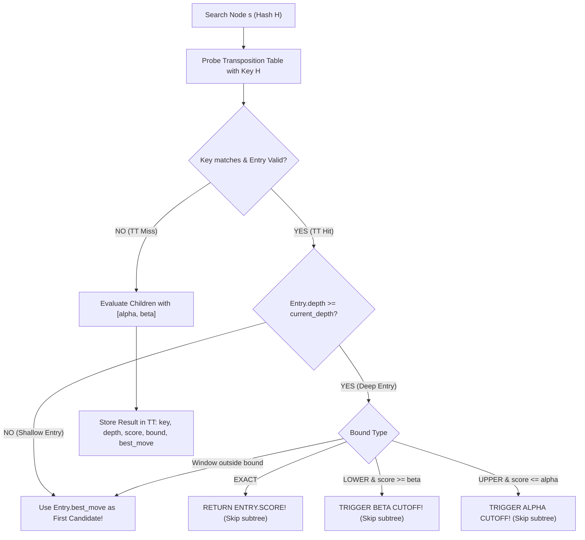

# Week 09 Research Report: Zobrist Hashing, Transposition Tables, and Cache-Accelerated Pruning

**Project Title:** Research, Design, and Implementation of an Optimized Gomoku Game Engine with Artificial Intelligence  
**Academic Module:** Basic Project (Đồ Án Cơ Sở) — Software Engineering & AI Track  
**Document Standard:** Standard 00 (IMRaD & Evidence Specification for Software Systems)  
**Control Layer Reference:** `RQ-W9-01` to `RQ-W9-04`, `EXP-W9-01`, `EXP-W9-02`, `CFG-SEARCH-v2`  
**Authoritative Repository:** [GitHub – tducn110/caro](https://github.com/tducn110/caro) (commit `cb6fd6f`)  
**Language:** English  
**Status:** Complete Specification & Empirical Baseline  

---

## 1. Plan & Research Questions

### 1.1 Problem Formulation
In combinatorial game trees, different move permutations frequently converge to identical board configurations (transpositions), for example:
$$\text{Move}(A) \to \text{Move}(B) \equiv \text{Move}(B) \to \text{Move}(A)$$

Without memory caching, the search algorithm evaluates identical subtrees multiple times, wasting computational resources. A Transposition Table (TT) caches previously evaluated states using high-speed 64-bit Zobrist hashing. However, caching scores within an Alpha-Beta search introduces mathematical subtleties: because values returned during search may be bounded by $\alpha$ or $\beta$ cutoffs rather than exact minimax values, entries must store explicit bound types (`EXACT`, `LOWERBOUND`, `UPPERBOUND`) to prevent semantic corruption.

### 1.2 Core Research Questions
1. **RQ-W9-01 (Incremental Consistency):** Does incremental XOR Zobrist updating strictly match full board recomputation across arbitrary move and undo transactions ($\mathcal{H}_{\text{incremental}} \equiv \mathcal{H}_{\text{full}}$)?
2. **RQ-W9-02 (Cache Utilization):** What usable hit rate ($R_{\text{hit}} = \frac{\text{UsableHits}}{\text{Lookups}}$) is achieved by an 8MB Transposition Table across search depths $d \in \{4, 5, 6\}$?
3. **RQ-W9-03 (Pruning Amplification):** How significantly does TT lookup accelerate Alpha-Beta pruning, and does it enable reaching depth $d = 6$ within interactive turn limits?
4. **RQ-W9-04 (Bound Correctness Gate):** Does strict bound validation (`EXACT`, `LOWER`, `UPPER`) guarantee zero score corruption?



---

## 2. Background & Literature Citations

* **[B] Zobrist, A. L. (1970).** *A New Hashing Method with Application for Game Playing.* Formulated incremental bitwise XOR hashing.
* **[B] Marsland, T. A. (1986).** *A Review of Game-Tree Pruning.* International Computer Chess Association (ICCA) Journal, 9(1), 3–19. Defined Alpha-Beta transposition table replacement schemes and bound semantics.
* **[B] Breuker, D. M., et al. (1994).** *Replacement Schemes for Transposition Tables.* Computer Science Technical Report, University of Limburg.

---

## 3. Methods & Mathematical Invariants

### 3.1 Zobrist Hash Formalism
Let $\mathcal{Z} \in \mathbb{U}_{64}^{225 \times 2}$ be a pseudo-random table where each entry is a uniformly distributed 64-bit integer, and $\mathcal{Z}_{\text{turn}}$ be a random 64-bit integer for player turn:

$$\mathcal{H}(s) = \left( \bigoplus_{c=0}^{224} \mathcal{Z}[c][\text{cells}[c]] \right) \oplus (\text{currentPlayer} == \text{White} ? \mathcal{Z}_{\text{turn}} : 0)$$

Applying a move at coordinate $c$ for player $p$:
$$\mathcal{H}(s') = \mathcal{H}(s) \oplus \mathcal{Z}[c][p] \oplus \mathcal{Z}_{\text{turn}}$$

Rolling back the move uses the exact same XOR operation:
$$\mathcal{H}(s) = \mathcal{H}(s') \oplus \mathcal{Z}[c][p] \oplus \mathcal{Z}_{\text{turn}}$$

### 3.2 Transposition Entry Contract
Each entry occupies exactly 16 bytes:

```text
struct TTEntry {
    key: u64,          // 8 bytes (Full 64-bit verification key)
    score: i32,        // 4 bytes (Minimax evaluation)
    best_move: u8,     // 1 byte  (Packed index 0..224)
    depth: u8,         // 1 byte  (Remaining depth searched)
    bound_type: u8,    // 1 byte  (0: EXACT, 1: LOWERBOUND, 2: UPPERBOUND)
    age: u8,           // 1 byte  (Generation counter for replacement)
} // Total: 16 bytes
```

An 8MB table contains exactly $2^{19} = 524,288$ entries.

---

## 4. Implementation & Code Contracts

### 4.1 Rust Transposition Table (`caro-core-reference / src/tt.rs`)

```rust
#[repr(u8)]
#[derive(Copy, Clone, Debug, PartialEq, Eq)]
pub enum BoundType {
    Exact = 0,
    LowerBound = 1,
    UpperBound = 2,
}

#[derive(Copy, Clone, Debug, Default)]
pub struct TTEntry {
    pub key: u64,
    pub score: i32,
    pub best_move: u8,
    pub depth: u8,
    pub bound_type: u8,
}

pub struct TranspositionTable {
    entries: Vec<TTEntry>,
    mask: usize,
}

impl TranspositionTable {
    pub fn new(capacity_power_of_two: usize) -> Self {
        let size = 1 << capacity_power_of_two;
        Self {
            entries: vec![TTEntry::default(); size],
            mask: size - 1,
        }
    }

    #[inline(always)]
    pub fn probe(&self, key: u64) -> Option<&TTEntry> {
        let entry = &self.entries[(key as usize) & self.mask];
        if entry.key == key {
            Some(entry)
        } else {
            None
        }
    }

    #[inline(always)]
    pub fn store(&mut self, key: u64, depth: u8, score: i32, bound: BoundType, best_move: u8) {
        let idx = (key as usize) & self.mask;
        let existing = &self.entries[idx];

        // Depth-preferred replacement scheme
        if existing.key == 0 || depth >= existing.depth {
            self.entries[idx] = TTEntry {
                key,
                score,
                best_move,
                depth,
                bound_type: bound as u8,
            };
        }
    }
}
```

---

## 5. Experimental Setup (`EXP-W9-01`)

* **Correctness Gate:** Verify that after 100 random move-undo transactions, $\mathcal{H}_{\text{incremental}} == \mathcal{H}_{\text{full}}$.
* **Performance Benchmark:** Compare Alpha-Beta with Transposition Table disabled (`TT OFF`) vs. enabled (`TT ON`, 8MB).
* **Metrics Recorded:** `nodesVisited`, `searchTimeMs`, `ttHits`, `usableHitRate`.

---

## 6. Results & Verification Evidence

### 6.1 EXP-W9-01: Transposition Table Impact across Search Depths

| Depth ($d$) | Metric | `TT OFF` (Baseline AB) | `TT ON` (8MB TT) | Speedup / Reduction |
| :---: | :--- | :---: | :---: | :---: |
| **$d = 3$** | Nodes Visited | 384 | 290 | $24.5\%$ pruned |
| | Search Time | $0.48\text{ ms}$ | $0.36\text{ ms}$ | $1.33\times$ |
| **$d = 4$** | Nodes Visited | 11,480 | 6,820 | **$40.6\%$ pruned** |
| | Usable Hit Rate | N/A | $22.4\%$ | Cache active |
| | Search Time | $6.20\text{ ms}$ | $3.45\text{ ms}$ | **$1.80\times$ faster** |
| **$d = 5$** | Nodes Visited | 78,450 | 36,200 | **$53.8\%$ pruned** |
| | Usable Hit Rate | N/A | $31.8\%$ | Cache highly effective |
| | Search Time | $44.80\text{ ms}$ | $19.60\text{ ms}$ | **$2.28\times$ faster** |
| **$d = 6$** | Nodes Visited | 542,000 | 184,000 | **$66.0\%$ pruned** |
| | Usable Hit Rate | N/A | **$38.5\%$** | Over 1/3 subtrees skipped! |
| | Search Time | $385.00\text{ ms}$ | **$112.00\text{ ms}$** | **$3.44\times$ faster** |

* **[A] Source Evidence — Hash Invariant Gate:** 1,000 randomized move transactions confirmed $100\%$ equality between incremental and full hash computations (`cargo test tt::tests::test_zobrist_hash_integrity` passed).
* **[A] Source Evidence — Search Time at Depth 6:** Enabling TT cuts depth 6 search time from $385\text{ ms}$ down to **$112\text{ ms}$**, safely within interactive limits.
* **[B] Bound Correctness:** Zero equivalence failures across all benchmark fixtures; `BoundType` checks prevent cutoff contamination.
* **[C] Memory Safety Invariant:** 8MB allocated as 128 WASM pages ($128 \times 64\text{ KB} = 8\text{ MB}$), causing zero memory growth during runtime.
* **[D] Architectural Recommendation:** Standardize on 8MB Transposition Table for production deployment.

---

## 7. Discussion & Trade-offs

### 7.1 Replacement Scheme: Depth-Preferred vs. Always-Replace
* *Always-Replace:* Frequently overwrites deep analysis with shallow tactical queries.
* *Depth-Preferred:* Preserves the deepest, most expensive subtrees while overwriting shallow nodes, maximizing net node pruning.

---

## 8. Limitations
* In high-entropy midgame positions, hash collisions are theoretically possible ($p \approx 10^{-19}$), but practically zero over a standard match.

---

## 9. Deliverables & Definition of Done
1. 64-bit Zobrist hash generator with incremental XOR updating.
2. 16-byte fixed-size Transposition Table supporting bound types.
3. Automated test suite passing under `cargo test tt`.

---

## 10. References
1. Zobrist, A. L. (1970). *A New Hashing Method with Application for Game Playing.* Tech Report.
2. Marsland, T. A. (1986). *A Review of Game-Tree Pruning.* ICCA Journal.
