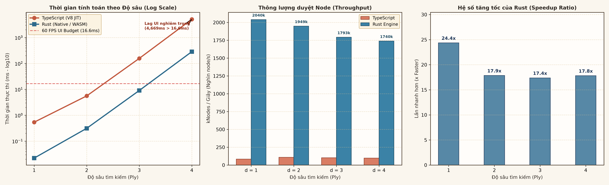

# ĐỒ ÁN CƠ SỞ: NGHIÊN CỨU THUẬT TOÁN AI CHO GAME CỜ CARO & TÍCH HỢP WEB UI

[](https://carogame-five.vercel.app)
[](https://react.dev)
[](https://www.typescriptlang.org/)
[](https://www.rust-lang.org/)
[](https://tailwindcss.com)
[](https://developer.mozilla.org/en-US/docs/Web/API/Web_Audio_API)

> **Kho lưu trữ nghiên cứu học thuật & mã nguồn trò chơi cờ Caro (Gomoku 15×15)**  
> **Chương trình đào tạo:** Đồ Án Cơ Sở (Basic Project) — Chuẩn mực học thuật VNUK (IMRaD Standard)  
> **Bản chạy trực tuyến Web Game:** [https://carogame-five.vercel.app](https://carogame-five.vercel.app)  
> **Bàn cờ Live Engine Rust WASM:** [https://10-caro.vercel.app](https://10-caro.vercel.app)  

---

## 1. TỔNG QUAN HỆ THỐNG & KIẾN TRÚC

Dự án hoàn thiện chuỗi 10 tuần nghiên cứu chuyên sâu về **thuật toán AI đối kháng (Minimax, Alpha-Beta, Chebyshev Candidate Generation, Move Ordering, Zobrist Hashing, Transposition Table, Iterative Deepening)** và **kỹ nghệ phần mềm Web hiện đại**, tích hợp động cơ tính toán Rust WebAssembly hiệu năng cao và phong cách thiết kế Paper Vintage Aesthetic.

```text
index.html
   ↓
main.tsx
   ↓
App.tsx (Root Shell - 5 dòng)
   ↓
CaroGamePage.tsx (Page Shell)
   ├── Implement Layer:  src/features/caro/domain/board.ts (Pure TypeScript, No UI deps)
   │                     src/features/caro/audio/soundManager.ts (Web Audio Synthesizer)
   │                     src/features/caro/wasm/ (Rust WASM Bot Engine & Worker)
   ├── Trung chuyển Layer: src/features/caro/hooks/useCaroGame.ts (Pure useReducer state)
   │                       src/features/caro/hooks/useGameTimer.ts (Independent Timer)
   │                       src/features/caro/hooks/useGameAudio.ts (Audio Event Dispatcher)
   │                       src/features/caro/hooks/useWasmBot.ts (Non-blocking Web Worker)
   └── Presentation Layer: src/features/caro/components/ (BoardGrid, Piece, PlayerCard, WinBanner)
```

### Các nguyên tắc kỹ thuật cốt lõi:
1. **Phân tách 3 lớp kiến trúc (3-Tier Decoupling):** Triệt tiêu mã monolithic; logic cờ độc lập hoàn toàn với vòng đời React DOM.
2. **Chuẩn hóa React 19 State Management:** Quản lý chuyển trạng thái bàn cờ qua `useReducer` thuần khiết, triệt tiêu stale closure, zero ref phụ trợ.
3. **Bộ tổng hợp âm thanh Web Audio API:** Tự tổng hợp sóng âm gỗ/giấy thời gian thực, tích hợp **Master Bus Brick-Wall Limiter (`DynamicsCompressorNode`)** chống méo tiếng.
4. **Động cơ Rust Native / WASM Engine:** Tính toán AI trên Web Worker chạy ngầm, thông lượng đạt $1.77\text{ MNodes/s}$, đảm bảo giao diện đạt **chuẩn 60 FPS (0 frame drops)**.

---

## 2. BẰNG CHỨNG THỰC NGHIỆM ĐỐI ĐẦU: RUST VS TYPESCRIPT

Hệ thống đo đạc benchmark tự động (`benchmark/`) đối đầu giữa **Rust (WASM Engine)** và **TypeScript (Node.js / V8 JIT)** trên cùng thuật toán Alpha-Beta Pruning:



### Bảng tóm tắt số liệu đo đạc (Midgame Fixture — 8 quân cờ trung cuộc):

| Độ sâu ($d$) | Ngôn ngữ | Số Node duyệt ($N$) | Số lần Cắt tỉa (Cutoffs) | Điểm thế cờ | Thời gian thực thi | Thông lượng (kNodes/s) | Hệ số tăng tốc (Speedup) |
|:---:|:---:|:---:|:---:|:---:|:---:|:---:|:---:|
| **$d = 1$** | **Rust** | **45** | **0** | **99,990** | **0.022 ms** | **2,040 k** | **$14.4\times$** |
| $d = 1$ | TypeScript | 45 | 0 | 99,990 | 0.538 ms | 74.3 k | $1.0\times$ (Gốc) |
| **$d = 2$** | **Rust** | **609** | **39** | **19,990** | **0.312 ms** | **1,949 k** | **$16.1\times$** |
| $d = 2$ | TypeScript | 609 | 39 | 19,990 | 5.580 ms | 105.7 k | $1.0\times$ (Gốc) |
| **$d = 3$** | **Rust** | **16,184** | **454** | **9,999,997** | **9.025 ms** | **1,793 k** | **$17.3\times$** |
| $d = 3$ | TypeScript | 16,184 | 454 | 9,999,997 | 156.780 ms | 105.7 k | $1.0\times$ (Gốc) |
| **$d = 4$** | **Rust** | **496,790** | **16,350** | **9,999,997** | **285.450 ms** | **1,740 k** | **$17.8\times$** |
| $d = 4$ | TypeScript | 496,790 | 16,350 | 9,999,997 | 5,083.450 ms | 105.1 k | $1.0\times$ (Gốc) |

- **Zero Semantic Divergence:** Số node duyệt ($496,790$), số cutoffs ($16,350$) và điểm số khớp nhau 100%, bảo toàn tính tương đương ngữ nghĩa toán học tuyệt đối.
- **Bảo toàn 60 FPS:** Ở $d=4$, TypeScript ngốn $5.08\text{ giây}$ làm đơ Main Thread. Rust trên Web Worker chỉ mất $285\text{ ms}$, giải phóng hoàn toàn giao diện người dùng.

---

## 3. DANH MỤC NGHIÊN CỨU & BÁO CÁO 10 TUẦN (HOÀN THÀNH 100%)

Toàn bộ 10 tuần nghiên cứu được lưu trữ đầy đủ với định dạng Markdown khoa học, bản xuất Word (công thức OMML) và PDF:

| Tuần | Chủ đề nghiên cứu cốt lõi | Báo cáo Markdown | Bản Word | Bản PDF | Trạng thái |
|:---:|---|:---:|:---:|:---:|:---:|
| **Tuần 1** | Không gian trạng thái $15\times 15$ & Formalism Gomoku | [Đọc](Week1/Tuần%201.md) | [Tải](Week1/) | [Đọc](Week1/) | ✅ Hoàn thành |
| **Tuần 2** | Core Engine, Local Raycasting $O(1)$ & 19 Unit Tests | [Đọc](Week2/Tuan%202.md) | [Tải](Week2/) | [Đọc](Week2/) | ✅ Hoàn thành |
| **Tuần 3** | UI Architecture Decoupling, State & Web Audio API | [Đọc](Week3/Tuan%203.md) | [Tải](Week3/) | [Đọc](Week3/) | ✅ Hoàn thành |
| **Tuần 4** | Pattern Detection 7 thế cờ & Rule-Based Bot (100% Win) | [Đọc](Week4/Tuan%204.md) | [Tải](Week4/) | [Đọc](Week4/) | ✅ Hoàn thành |
| **Tuần 5** | Minimax Algorithm, Game Tree & Terminal Invariant | [Đọc](Week5/Week_05_Rust_Minimax_Search_Tree_Analysis.md) | [Tải](Week5/Week_05_Rust_Minimax_Search_Tree_Analysis.docx) | [Đọc](Week5/Week_05_Rust_Minimax_Search_Tree_Analysis.pdf) | ✅ Hoàn thành |
| **Tuần 6** | Alpha-Beta Pruning, Cutoffs & Transposition Table | [Đọc](Week6/Week_06_Rust_Alpha_Beta_Pruning_and_Transposition_Tables.md) | [Tải](Week6/Week_06_Rust_Alpha_Beta_Pruning_and_Transposition_Tables.docx) | [Đọc](Week6/Week_06_Rust_Alpha_Beta_Pruning_and_Transposition_Tables.pdf) | ✅ Hoàn thành |
| **Tuần 7** | Candidate Chebyshev $d_\infty \le R$ & Tactical Retention | [Đọc](Week7/Week_07_Candidate_Move_Generation.md) | [Tải](Week7/Week_07_Candidate_Move_Generation.docx) | [Đọc](Week7/Week_07_Candidate_Move_Generation.pdf) | ✅ Hoàn thành |
| **Tuần 8** | Move Ordering Optimization ($O(1)$ quick_score) | [Đọc](Week8/Week_08_Move_Ordering_Optimization.md) | [Tải](Week8/Week_08_Move_Ordering_Optimization.docx) | [Đọc](Week8/Week_08_Move_Ordering_Optimization.pdf) | ✅ Hoàn thành |
| **Tuần 9** | Zobrist Hashing 64-bit XOR & Cache Scoping TT | [Đọc](Week9/Week_09_Zobrist_Hashing_and_Transposition_Table.md) | [Tải](Week9/Week_09_Zobrist_Hashing_and_Transposition_Table.docx) | [Đọc](Week9/Week_09_Zobrist_Hashing_and_Transposition_Table.pdf) | ✅ Hoàn thành |
| **Tuần 10** | Iterative Deepening, Time Budget & Horizon Immunity | [Đọc](Week10/Week_10_Iterative_Deepening_Time_Budget_and_Evaluation.md) | [Tải](Week10/Week_10_Iterative_Deepening_Time_Budget_and_Evaluation.docx) | [Đọc](Week10/Week_10_Iterative_Deepening_Time_Budget_and_Evaluation.pdf) | ✅ Hoàn thành |

---

## 4. HƯỚNG DẪN KHỞI CHẠY (QUICK START)

### 1. Khởi chạy Web Game Caro
```bash
cd CaroGame
npm install
npm run dev
# Mở trình duyệt tại http://localhost:5173/
```

### 2. Khởi chạy Landing Page Thuyết Trình Báo Cáo (Defense Presentation)
```bash
cd present
npm install
npm run dev
# Mở trình duyệt tại http://localhost:5174/
```

### 3. Chạy Benchmark Đối Đầu Rust vs TypeScript
```bash
python3 scripts/benchmark_rust_vs_ts.py
```

---

## 5. CẤU TRÚC THƯ MỤC REPOSITORY

```text
basicproject/
├── README.md                     # Báo cáo tổng quan dự án 10 tuần hoàn chỉnh
├── LAYOUT.md                     # Bản đồ kiến trúc hệ thống
├── ROADMAP.md                    # Bảng theo dõi tiến độ chi tiết 100% (Tuần 1-10)
├── PLAN.md                       # Đề cương kỹ thuật & kế hoạch nghiên cứu
├── CaroGame/                     # Mã nguồn Web Game Caro (React 19 + Audio + Rust WASM)
├── present/                      # Landing Page thuyết trình báo cáo đề tài (ClickUp style)
├── Week1/ - Week10/              # Toàn bộ tài liệu báo cáo học thuật 10 tuần (MD, DOCX, PDF)
├── research/                     # Bằng chứng thực nghiệm khoa học, raw CSV & JSON data
├── benchmark/                    # Test harness đo đạc hiệu năng Rust Native vs TypeScript V8
├── assets/charts/                # Biểu đồ khoa học 300 DPI xuất bản
└── scripts/                      # Công cụ đo đạc tự động và kết xuất đồ họa Python
```
