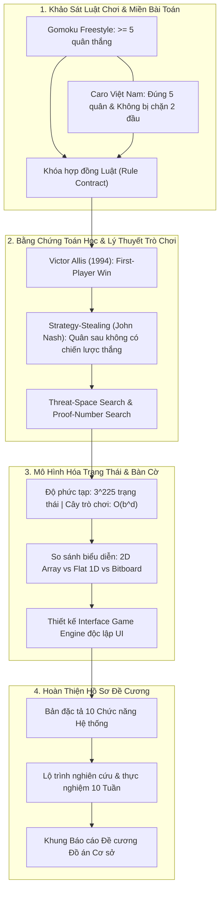

# 📑 TUẦN 01: TỔNG QUAN NGHIÊN CỨU LÝ THUYẾT, BẰNG CHỨNG TOÁN HỌC & KHUNG ĐỀ CƯƠNG

## 🎯 1. MỤC TIÊU TUẦN 1
1. **Làm rõ luật chơi (Rule Formulation):** Phân biệt rạch ròi giữa Gomoku tự do (Freestyle Gomoku), Gomoku chuẩn (Standard Gomoku) và Cờ Caro truyền thống Việt Nam (chặn 2 đầu không tính thắng).
2. **Cơ sở toán học (Mathematical Foundations):** Nghiên cứu luận án Victor Allis (1994) chứng minh Gomoku $15 \times 15$ tự do là First-Player Win; phân tích lập luận Strategy-Stealing của John Nash.
3. **Mô hình hóa không gian trạng thái (State Space Modeling):** Tính toán độ phức tạp không gian trạng thái ($3^{225}$) và độ phức tạp cây trò chơi ($225!$).
4. **Biểu diễn dữ liệu bàn cờ (Board Representation):** So sánh ma trận 2D, mảng phẳng 1D và Bitboard trên các tiêu chí: bộ nhớ, cache locality, tốc độ clone/undo.
5. **Hoàn thiện Khung Đề cương Đồ án cơ sở:** Chuẩn hóa toàn bộ cấu trúc theo văn bản [[00_De_Cuong_PDF/ĐỀ CƯƠNG ĐỒ ÁN CƠ SỞ .pdf|Bản gốc PDF Đề Cương]].

---

## 🗺️ 2. SƠ ĐỒ LUỒNG NGHIÊN CỨU TUẦN 1 (MERMAID)

---

## 📚 3. DANH MỤC TÀI LIỆU THAM KHẢO HỌC THUẬT (SOURCES)

* 📄 **[Allis 1994]** L. Victor Allis. *Searching for Solutions in Games and Artificial Intelligence*. Ph.D. Thesis, Department of Computer Science, University of Limburg, Maastricht, The Netherlands, 1994.  
  *(Cung cấp chứng minh toán học giải mã Gomoku $15 \times 15$ tự do bằng Victoria Engine)*.
* 📄 **[Allis, van den Herik, Huntjens 1996]** L. V. Allis, H. J. van den Herik, M. P. H. Huntjens. *Go-Moku Solved by New Search Techniques*. Computational Intelligence, 12(1):24–44, 1996. https://doi.org/10.1111/j.1467-8640.1996.tb00252.x
* 📄 **[Knuth & Moore 1975]** Donald E. Knuth, Ronald W. Moore. *An Analysis of Alpha-Beta Pruning*. Artificial Intelligence, 6(4):293–326, 1975. https://doi.org/10.1016/0004-3702(75)90019-3
* 📄 **[Gomocup]** Gomocup Official Tournament. *Rules & Detail Information*. https://gomocup.org/detail-information/
* 📄 **[Nash 1950]** John F. Nash. *Non-Cooperative Games*. Annals of Mathematics, 54(2):286–295, 1951. *(Cơ sở lập luận Strategy-Stealing trong đối kháng hữu hạn)*.

---

## 📑 4. DANH SÁCH BÀI VIẾT CHI TIẾT TRONG TUẦN 1

1. [[01_Nghien_Cuu_Luat_Co_Caro|01. Nghiên cứu luật Cờ Caro & Các biến thể quốc tế]]
2. [[02_Bang_Chung_Toan_Hoc_Gomoku_Va_10Caro|02. Bằng chứng toán học giải mã Gomoku & Cờ Caro (Allis 1994)]]
3. [[03_Cach_Bieu_Dien_Ban_Co|03. Các phương pháp biểu diễn bàn cờ (2D, 1D Flat, Bitboard)]]
4. [[04_State_Space_Va_Game_Tree|04. Phân tích Không gian trạng thái (State Space) & Cây trò chơi (Game Tree)]]
5. [[05_Xac_Dinh_Pham_Vi_De_Tai|05. Xác định phạm vi, giả định và ranh giới kỹ thuật đề tài]]
6. [[06_Khung_De_Cuong_Chuan|06. Khung đề cương đồ án cơ sở chuẩn theo PDF gốc]]
