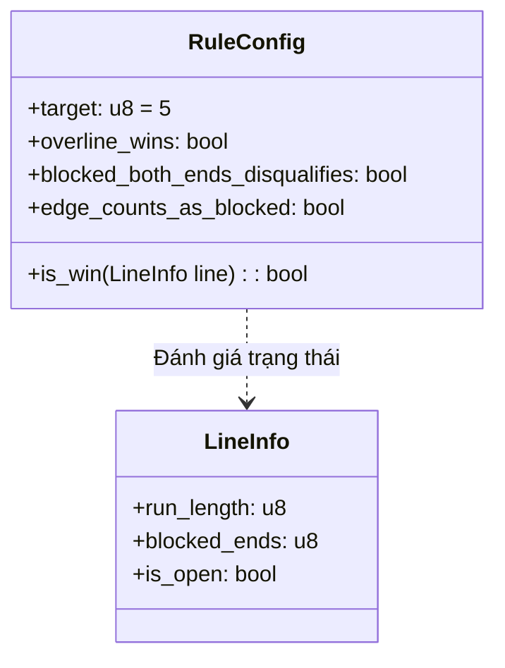

# 📜 NGHIÊN CỨU LUẬT CỜ CARO & CÁC BIẾN THỂ QUỐC TẾ

## 1. ĐẶT VẤN ĐỀ VỀ RANH GIỚI THUẬT NGỮ
Trong thực tế và tài liệu phổ thông, thuật ngữ **"Cờ Caro"** thường bị dùng lẫn lộn giữa nhiều tập luật khác nhau. Để một nghiên cứu Trí tuệ nhân tạo (AI Search) đạt độ chuẩn xác học thuật, luật chơi phải được toán học hóa thành các mệnh đề logic bất biến trước khi xây dựng hàm heuristic hay thuật toán tìm kiếm.

> **Quy tắc bất biến:** Một thuật toán tìm kiếm chỉ có ý nghĩa khi mục tiêu chiến thắng được định nghĩa nhất quán. Nếu đổi luật giữa chừng (ví dụ: chuyển từ Freestyle sang chặn 2 đầu), hàm lượng giá (evaluation function) và chuỗi nước đe dọa (threat sequences) sẽ bị sai lệch hoàn toàn.

---

## 2. BẢNG ĐỐI SOÁNH CÁC BIẾN THỂ LUẬT

| Đặc điểm quy tắc | Gomoku Tự Do (Freestyle Gomoku) | Gomoku Chuẩn (Standard Gomoku) | Cờ Caro Việt Nam (Caro Blocked-Ends) | Renju (Cờ Gomoku Nhật Bản) |
| :--- | :--- | :--- | :--- | :--- |
| **Kích thước bàn cờ** | $15 \times 15$ hoặc $19 \times 19$ | $15 \times 15$ | $15 \times 15$ (phổ biến) hoặc $10 \times 10$ | $15 \times 15$ |
| **Số quân thắng** | $\ge 5$ quân liên tiếp | Đúng 5 quân liên tiếp | Đúng 5 quân liên tiếp | Đen: Đúng 5 / Trắng: $\ge 5$ |
| **Quá 5 quân (Overline)** | **Thắng ngay** (6, 7 quân tính thắng) | **Không thắng** (tiếp tục chơi) | **Không thắng** | Đen: **Bị xử thua (Foul)** / Trắng: Thắng |
| **Chặn 2 đầu (Blocked Ends)** | Vẫn tính thắng | Vẫn tính thắng | **Bị triệt tiêu (Không tính thắng)** | Vẫn tính thắng |
| **Nước cấm (Foul Moves)** | Không có | Không có | Không có | Đen: Cấm nước 3-3, 4-4, Overline |
| **Lợi thế đi trước** | **Tuyệt đối (Đen thắng 100%)** | Rất lớn (Đen chiếm ưu thế lớn) | **Cân bằng hơn** (khó ép Four) | Cân bằng bằng luật mở cờ (Swap) |

---

## 3. MÔ HÌNH TOÁN HỌC CỦA ĐIỀU KIỆN THẮNG

Giả sử bàn cờ kích thước $N \times N$ ($N=15$), tọa độ $(x, y) \in \{0, \dots, N-1\}^2$. Gọi trạng thái ô cờ tại $(x, y)$ là $C(x, y) \in \{\text{Empty}, \text{Player}_1, \text{Player}_2\}$.

Xét một chuỗi quân đồng màu của người chơi $P$ đi qua điểm $(x_0, y_0)$ theo vector hướng $\vec{v} = (dx, dy)$ với $(dx, dy) \in \{(1, 0), (0, 1), (1, 1), (1, -1)\}$:
$$\mathcal{L}(x_0, y_0, \vec{v}) = \{ (x_0 + i \cdot dx, y_0 + i \cdot dy) \mid -k_1 \le i \le k_2 \}$$
Trong đó $k_1, k_2 \ge 0$ là số bước tối đa theo hai chiều mà tất cả các ô đều mang giá trị $P$. Tổng độ dài chuỗi là $L = k_1 + k_2 + 1$.

Hai đầu mút tiếp giáp của chuỗi là:
* Đầu trước: $E_1 = (x_0 + (k_2 + 1)dx, y_0 + (k_2 + 1)dy)$
* Đầu sau: $E_2 = (x_0 - (k_1 + 1)dx, y_0 - (k_1 + 1)dy)$

Một đầu mút $E$ được coi là **bị chặn (Blocked)** nếu $E$ nằm ngoài biên bàn cờ hoặc $C(E) = \text{Opponent}(P)$.



### Biểu thức Logic kiểm tra thắng:
1. **Freestyle Gomoku:**
   $$\text{Win}_{\text{Freestyle}} \iff L \ge 5$$
2. **Standard Gomoku (Gomocup Standard):**
   $$\text{Win}_{\text{Standard}} \iff L = 5$$
3. **Cờ Caro Việt Nam:**
   $$\text{Win}_{\text{Caro}} \iff (L = 5) \land (\text{BlockedEnds} < 2)$$

---

## 4. TÁC ĐỘNG CỦA LUẬT CHƠI LÊN CÂY TÌM KIẾM AI

1. **Luật Gomoku tự do:**
   * Cho phép tạo chuỗi nước ép buộc (Threat Sequence: Four, Open Three) có tính đơn hướng cực mạnh. AI chỉ cần tập trung tìm chuỗi **Four-Three (Tứ Tam)** là kết liễu được ván cờ.
2. **Luật Caro chặn 2 đầu (Việt Nam):**
   * Đòn ép Four thông thường (bị chặn 1 đầu) trở nên yếu hơn, vì khi lên 5 mà bị đối thủ chặn đầu còn lại thì **không thắng**. Do đó, AI bắt buộc phải tạo ra **Open Four (Tứ Mở - trống cả 2 đầu)** hoặc **Double Threat (Nước đôi: 4-3, 3-3)** mới có thể dứt điểm.
   * Điều này làm cho cây tìm kiếm sâu hơn, thế cờ phòng thủ kiên cố hơn và hạn chế đòn thắng áp đảo của người đi trước.

---

## 5. MÃ NGUỒN CẤU HÌNH LUẬT TRONG ENGINE NGHIÊN CỨU

Trong module tham chiếu [caro-core-reference/src/rules.rs](file:///home/pro/Downloads/vnuk/basicProject/caro-core-reference/src/rules.rs), luật chơi được đóng gói thành cấu trúc hướng cấu hình:

```rust
#[derive(Debug, Clone, Copy, PartialEq, Eq)]
pub struct RuleConfig {
    pub target: u8,
    pub overline_wins: bool,
    pub blocked_both_ends_disqualifies: bool,
    pub edge_counts_as_blocked: bool,
}

impl RuleConfig {
    /// Gomoku Tự Do: >= 5 quân là thắng
    pub const fn freestyle() -> Self {
        Self { target: 5, overline_wins: true, blocked_both_ends_disqualifies: false, edge_counts_as_blocked: false }
    }

    /// Caro Việt Nam: Đúng 5 quân, chặn 2 đầu không tính thắng
    pub const fn caro_vietnamese() -> Self {
        Self { target: 5, overline_wins: false, blocked_both_ends_disqualifies: true, edge_counts_as_blocked: true }
    }
}
```

---

## 📚 TÀI LIỆU THAM KHẢO
* [B1] Gomocup International Tournament Rules: https://gomocup.org/detail-information/
* [B2] Allis, L. V. (1994). *Searching for Solutions in Games and Artificial Intelligence*. Ph.D. Thesis.
