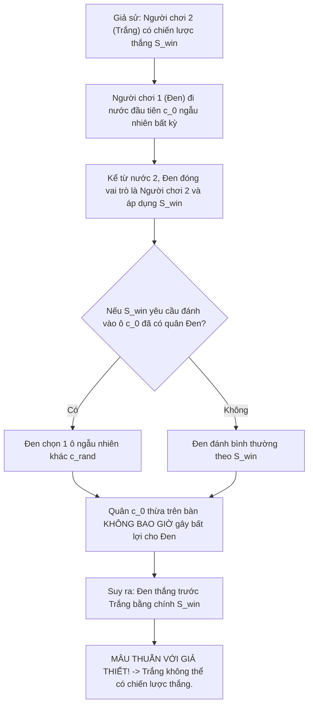
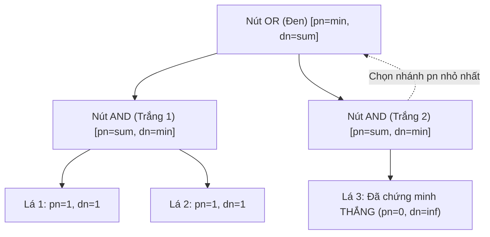

# 🧮 BẰNG CHỨNG TOÁN HỌC GIẢI MÃ GOMOKU & PHÂN TÍCH CỜ CARO 10x10

## 1. LẬP LUẬN CƯỚP CHIẾN THUẬT (STRATEGY-STEALING ARGUMENT)

Trong lý thuyết trò chơi tổ hợp (Combinatorial Game Theory), lập luận cướp chiến thuật do nhà toán học đoạt giải Nobel **John Forbes Nash Jr.** đề xuất ban đầu cho cờ Hex, sau đó được áp dụng phổ quát cho các trò chơi cờ đặt quân đối xứng (Positional Maker-Maker Games) như Tic-tac-toe, Gomoku và Cờ Caro.

### Định lý 1 (Bất đối xứng chiến lược)
> Trong trò chơi Gomoku / Cờ Caro trên bàn cờ bất kỳ, **Người chơi thứ hai (Trắng) KHÔNG THỂ có chiến lược thắng cuộc (Winning Strategy)**. Trò chơi chỉ có thể kết thúc ở 2 kịch bản lý thuyết: **Người chơi thứ nhất (Đen) thắng cuộc**, hoặc **Hòa cờ (Draw)**.

*Ý nghĩa học thuật:* Bằng chứng này triệt tiêu mọi nghi ngờ về việc Người đi sau có thể chiếm ưu thế tất thắng; toàn bộ trọng tâm tìm kiếm AI xoay quanh việc Người đi trước khai thác ưu thế khởi đầu và Người đi sau tìm kiếm đường hòa tối ưu.

---

## 2. CÔNG TRÌNH GIẢI MÃ GOMOKU CỦA L. VICTOR ALLIS (1994)

Năm 1994, tại Đại học Limburg (Maastricht), **L. Victor Allis** bảo vệ thành công luận án tiến sĩ kinh điển: *"Searching for Solutions in Games and Artificial Intelligence"*, chính thức chứng minh Gomoku $15 \times 15$ tự do là:
$$\text{Gomoku } 15 \times 15 \equiv \textbf{First-Player Win (Người đi trước thắng tuyệt đối)}$$

Để chứng minh điều này trong không gian trạng thái khổng lồ $10^{107}$, Allis đã phát minh ra hai kỹ thuật tìm kiếm đột phá:

### 2.1. Threat-Space Search (TSS - Tìm kiếm không gian đe dọa)
* Gomoku là trò chơi mang tính cục diện cao. Một chuỗi nước đi thắng cuộc luôn bắt đầu từ các nước **tạo đe dọa (Threat Moves)**:
  * **Straight Four (Tứ Mở):** Đe dọa đánh thắng ở 2 đầu $\rightarrow$ Đối thủ không thể cản cả hai.
  * **Four (Tứ Chặn 1 đầu):** Ép đối thủ phải đi đúng 1 ô duy nhất để chặn.
  * **Open Three (Tam Mở):** Đe dọa lên Tứ mở.
* Thuật toán TSS chỉ duyệt qua các nhánh có tồn tại nước ép buộc (Forcing Moves). Bằng cách này, hệ số phân nhánh bị thu hẹp từ $b \approx 200$ xuống chỉ còn $b_{threat} \le 5$, giúp công cụ **Victoria Engine** tính trước được các chuỗi kết liễu lên tới hơn 30 nước đi.

### 2.2. Proof-Number Search (PN-Search - Tìm kiếm số bằng chứng)
PN-Search là thuật toán tìm kiếm cây AND/OR ưu tiên nút triển vọng nhất dựa trên 2 tham số:
* $pn(n)$ (Proof Number): Số lượng nút lá tối thiểu cần chứng minh là TRUE để nút $n$ được chứng minh là TRUE.
* $dn(n)$ (Disproof Number): Số lượng nút lá tối thiểu cần chứng minh là FALSE để nút $n$ bị bác bỏ.

$$\begin{cases}
pn(n) = \min_{c \in children} pn(c) & \text{nếu } n \text{ là nút OR (Lượt Đen)} \\
dn(n) = \sum_{c \in children} dn(c) & \text{nếu } n \text{ là nút OR}
\end{cases}$$

$$\begin{cases}
pn(n) = \sum_{c \in children} pn(c) & \text{nếu } n \text{ là nút AND (Lượt Trắng)} \\
dn(n) = \min_{c \in children} dn(c) & \text{nếu } n \text{ là nút AND}
\end{cases}$$

---

## 3. PHÂN TÍCH ĐẶC BIỆT: BÀN CỜ $10 \times 10$ & LUẬT CHẶN 2 ĐẦU

Trong đề cương đồ án, kích thước bàn cờ được khảo sát ở $10 \times 10$ và $15 \times 15$:

### 3.1. Trường hợp bàn cờ $10 \times 10$
* Không gian ô cờ giảm xuống $100$ ô. Số trạng thái tối đa: $3^{100} \approx 5.15 \times 10^{47}$.
* Áp lực trung tâm cực lớn: Khi Đen đánh $(5, 5)$, bán kính kiểm soát bao phủ gần như toàn bộ bàn cờ. Không gian để Trắng phòng thủ phản công co hẹp nghiêm trọng $\rightarrow$ **Độ sâu cần thiết để tìm ra đòn thắng của Đen giảm xuống đáng kể so với bàn $15 \times 15$**.

### 3.2. Vai trò cân bằng của luật Cờ Caro Việt Nam (Chặn 2 đầu)
* Trong Gomoku tự do của Allis, đòn đánh tạo chuỗi Four (bị chặn 1 đầu) vẫn là nước ép buộc đối thủ.
* Tuy nhiên, theo luật **Caro Việt Nam**, chuỗi 5 quân bị chặn 2 đầu bị **vô hiệu hóa**.
* Điều này vô hiệu hóa các chuỗi ép buộc đơn giản, buộc AI phải chuyển sang tìm kiếm các đòn **Tấn công kép (Double Threat: 4-3, 3-3, 4-4)**. Đây là lý do Cờ Caro truyền thống mang tính cân bằng và giàu tính chiến thuật đối kháng hơn Gomoku tự do trên các bàn cờ cỡ vừa.

---

## 📚 TÀI LIỆU THAM KHẢO
* [1] Allis, L. V. (1994). *Searching for Solutions in Games and Artificial Intelligence*. Ph.D. thesis, University of Limburg.
* [2] Nash, J. F. (1951). *Non-Cooperative Games*. Annals of Mathematics, 54(2), 286-295.
* [3] Allis, L. V., van den Herik, H. J., & Huntjens, M. P. (1996). *Go-Moku Solved by New Search Techniques*. Computational Intelligence, 12(1), 24-44.
