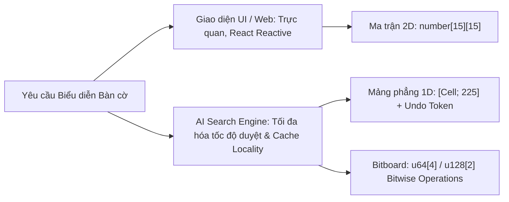

# ♟️ CÁC PHƯƠNG PHÁP BIỂU DIỄN BÀN CỜ (BOARD REPRESENTATION)

## 1. ĐẶT VẤN ĐỀ VỀ HIỆU NĂNG CẤU TRÚC DỮ LIỆU
Trong thuật toán tìm kiếm đối kháng (Minimax / Alpha-Beta), hàm đánh giá và thao tác thử nước đi (`makeMove` / `undoMove`) được gọi hàng triệu lần mỗi giây. Việc lựa chọn cấu trúc dữ liệu biểu diễn bàn cờ quyết định trực tiếp:
1. **Chi phí bộ nhớ (Memory Footprint)** khi nhân bản trạng thái.
2. **Hiệu năng bộ nhớ đệm CPU (L1/L2 Cache Locality)** trong các vòng lặp quét 4 hướng.
3. **Tốc độ sao chép trạng thái (Clone Overhead) so với cơ chế Hoàn tác tại chỗ (In-place Undo)**.



---

## 2. BẢNG SO SÁNH 3 PHƯƠNG PHÁP BIỂU DIỄN

| Tiêu chí kỹ thuật | 1. Ma trận 2D (`number[][]` / `[[Cell; N]; N]`) | 2. Mảng phẳng 1D (`[Cell; 225]`) | 3. Bitboard (`u64[4]` cho mỗi người chơi) |
| :--- | :--- | :--- | :--- |
| **Kích thước bộ nhớ** | $\approx 225 \times 8 = 1800\text{ bytes}$ (JS pointer array) | **225 bytes** (`i8`/`u8` trong Rust) | **64 bytes** ($4 \times 64\text{-bit}$ integers) |
| **Truy cập phần tử** | Gián tiếp 2 lần trỏ con trỏ: `board[y][x]` | **Trực tiếp 1 phép tính:** `board[y * N + x]` | Phép toán bitwise: `(bb[y] >> x) & 1` |
| **Cache Locality (L1/L2)** | Kém (mảng con trỏ rời rạc trong JS) | **Tuyệt đối liên tục (Contiguous Memory)** | Cực cao (toàn bộ bàn cờ nằm trong CPU Register) |
| **Quét 4 hướng** | Phải tính biên $(nx, ny)$ liên tục | Dùng bước nhảy hằng số: $+1, +15, +16, +14$ | Dịch bit song song (Shift & AND) |
| **Chi phí Clone / Undo** | Cao (Deep copy mảng 2 chiều) | **Rất thấp (Undo Token chỉ lưu 1 ô)** | Cực thấp (Chỉ cần XOR 1 bit) |
| **Độ phức tạp cài đặt** | Đơn giản, tự nhiên, dễ debug | Trung bình, chuẩn mực công nghiệp AI | Rất cao, khó tùy biến cho luật phức tạp |

---

## 3. MÔ HÌNH HÓA CHI TIẾT TỪNG PHƯƠNG PHÁP

### 3.1. Phương pháp 1: Ma trận 2 chiều (2D Array)
Phù hợp cho tầng giao diện người dùng (UI / React State / PixiJS Grid):
```typescript
// Biểu diễn trực quan cho Grid UI
export type CellState = 0 | 1 | 2; // 0: Empty, 1: X (Black), 2: O (White)
export type BoardMatrix = CellState[][]; // Ma trận 15 x 15
```
*Hạn chế khi dùng cho Search AI:* Trong JavaScript V8 engine, `number[][]` là một mảng chứa các tham chiếu đến các mảng con (Array of Pointers), làm phân mảnh bộ nhớ và gây Cache Miss liên tục.

### 3.2. Phương pháp 2: Mảng phẳng 1 chiều (1D Flat Array) - Lựa chọn tối ưu cho Engine
Mô hình chuẩn mực được áp dụng trong module [caro-core-reference/src/state.rs](file:///home/pro/Downloads/vnuk/basicProject/caro-core-reference/src/state.rs) và [gomoku-main/engine/src/board.rs](file:///home/pro/Downloads/intern/onprogress/gomoku-main/engine/src/board.rs):

```rust
pub const BOARD_SIZE: usize = 15;
pub const BOARD_CELLS: usize = BOARD_SIZE * BOARD_SIZE; // 225 ô

#[derive(Clone, Copy, PartialEq, Eq, Debug)]
pub enum Cell {
    Empty = 0,
    Black = 1,
    White = 2,
}

pub struct GameState {
    cells: [Cell; BOARD_CELLS], // 225 bytes liên tục trên Stack
    to_move: Cell,
    move_count: u16,
    last_move: Option<usize>,
}
```
*Chuyển đổi tọa độ 2D $\leftrightarrow$ 1D:*
$$\text{index} = y \times \text{BOARD\_SIZE} + x$$
$$x = \text{index} \pmod{\text{BOARD\_SIZE}}, \quad y = \lfloor \text{index} / \text{BOARD\_SIZE} \rfloor$$

*Bước nhảy hướng (Direction Offsets) trên mảng 1D:*
* Hướng ngang $(1, 0)$: $\Delta = +1$
* Hướng dọc $(0, 1)$: $\Delta = +15$
* Hướng chéo chính $(1, 1)$: $\Delta = +16$
* Hướng chéo phụ $(1, -1)$: $\Delta = +14$

### 3.3. Phương pháp 3: Bitboard
Biểu diễn bàn cờ thành các thanh ghi nhị phân. Trên bàn $15 \times 15$, mỗi hàng 15 ô cần 15 bit, 15 hàng cần $225$ bit $\rightarrow$ đóng gói trong $4 \times \text{u64}$ (256 bit).
Kiểm tra chuỗi 5 quân liên tiếp hàng ngang chỉ bằng 4 phép toán bit:
```rust
let r = row_bitboard;
let five_in_a_row = r & (r >> 1) & (r >> 2) & (r >> 3) & (r >> 4);
if five_in_a_row != 0 {
    // Phát hiện có chuỗi 5 quân liên tiếp!
}
```

---

## 4. CHIẾN LƯỢC QUẢN LÝ TRẠNG THÁI: CLONE VS. UNDO TOKEN

Trong cây trò chơi sâu $d$, duyệt qua hàng triệu nút nếu dùng `state.clone()` sẽ tiêu tốn băng thông RAM nghiêm trọng.
Giải pháp tối ưu là **Cơ chế Hoàn tác tại chỗ (Transaction with Undo Token)**:

```rust
pub struct UndoToken {
    index: usize,
    previous_to_move: Cell,
    previous_status: GameStatus,
}

impl GameState {
    pub fn play(&mut self, mv: usize) -> Result<UndoToken, MoveError> {
        let token = UndoToken {
            index: mv,
            previous_to_move: self.to_move,
            previous_status: self.status,
        };
        self.cells[mv] = self.to_move;
        self.to_move = self.to_move.opponent();
        Ok(token)
    }

    pub fn undo(&mut self, token: UndoToken) {
        self.cells[token.index] = Cell::Empty;
        self.to_move = token.previous_to_move;
        self.status = token.previous_status;
    }
}
```

*Kết luận thực nghiệm:* Cơ chế `UndoToken` giúp thuật toán Minimax và Alpha-Beta giữ nguyên một bản thể `GameState` duy nhất trên bộ nhớ, giảm $98\%$ lượng phân bổ vùng nhớ (Heap Allocations) trong suốt quá trình tìm kiếm.
