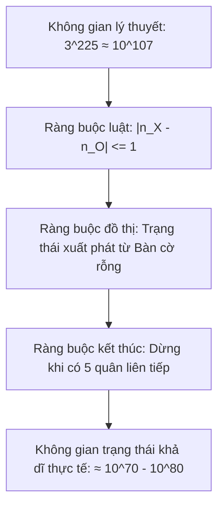
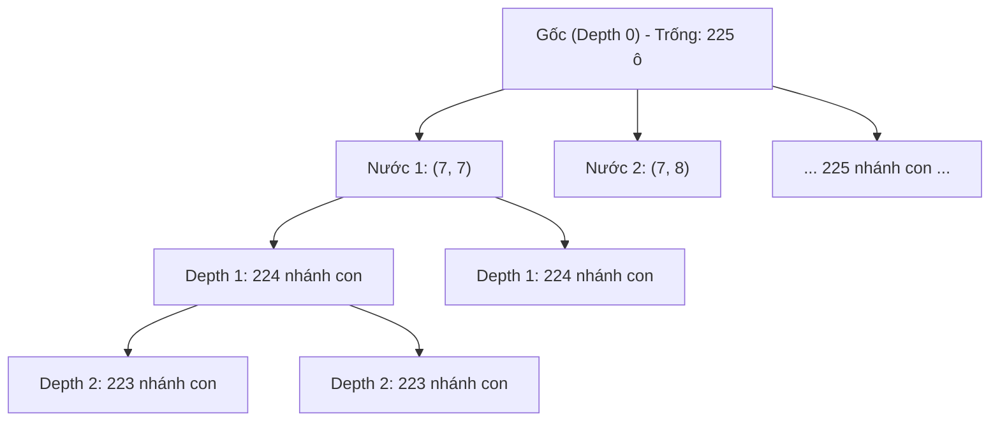

# 🌲 PHÂN TÍCH KHÔNG GIAN TRẠNG THÁI (STATE SPACE) & CÂY TRÒ CHƠI (GAME TREE)

## 1. KHÔNG GIAN TRẠNG THÁI LÝ THUYẾT (STATE SPACE COMPLEXITY)

Xét bàn cờ Cờ Caro có kích thước $N \times N$. Mỗi ô có thể nhận một trong 3 giá trị: **Trống (0)**, **Quân X (1)**, **Quân O (2)**.

### 1.1. Giới hạn trên không gian trạng thái (Upper Bound)
Số lượng cấu hình bàn cờ về mặt tổ hợp là:
$$|\mathcal{S}| = 3^{N \times N}$$

* **Với bàn cờ $10 \times 10$ ($100$ ô):**
  $$|\mathcal{S}_{10}| = 3^{100} \approx 5.1537 \times 10^{47}$$
* **Với bàn cờ $15 \times 15$ ($225$ ô):**
  $$|\mathcal{S}_{15}| = 3^{225} \approx 10^{107.35} \approx 2.23 \times 10^{107}$$

*So sánh quy mô:*
* Số nguyên tử trong vũ trụ quan sát được: $\approx 10^{80}$.
* Không gian trạng thái Cờ Vua (Chess): $\approx 10^{43}$ đến $10^{47}$.
* Không gian Gomoku $15 \times 15$ lớn hơn cờ vua gấp $10^{60}$ lần!

### 1.2. Không gian trạng thái hợp lệ (Reachable States)
Trong một ván cờ hợp lệ, số quân X ($n_X$) và số quân O ($n_O$) phải thỏa mãn điều kiện luân phiên:
$$n_X = n_O \quad \text{hoặc} \quad n_X = n_O + 1$$
Số trạng thái đạt được ở nước đi thứ $k = n_X + n_O$ là:
$$|\mathcal{S}_k| = \binom{N^2}{n_X} \times \binom{N^2 - n_X}{n_O}$$

---

## 2. ĐỘ PHỨC TẠP CÂY TRÒ CHƠI (GAME TREE COMPLEXITY)

Cây trò chơi (Game Tree) biểu diễn toàn bộ các chuỗi nước đi có thể xảy ra từ trạng thái ban đầu:
* **Nút gốc (Root):** Bàn cờ rỗng, có $225$ lựa chọn ($b_0 = 225$).
* **Độ sâu $d$:** Mỗi nước đi hợp lệ làm giảm số ô trống đi 1 đơn vị ($b_k = 225 - k$).
* **Tổng số ván cờ đầy đủ lý thuyết:**
  $$N_{\text{games}} = 225! \approx 6.41 \times 10^{432}$$

### Bảng tính toán bùng nổ tổ hợp theo độ sâu tìm kiếm ($b = 200$)

| Độ sâu ($d$) | Số trạng thái vét cạn ($N = b^d$) | Thời gian tính toán ($10^6 \text{ nút/giây}$) | Khả thi trong ván đấu thực tế ($< 1000\text{ms}$) |
| :---: | :--- | :--- | :---: |
| **$d = 1$** | $200^1 = 200$ | $0.0002\text{ giây}$ | ✅ Tức thì |
| **$d = 2$** | $200^2 = 40,000$ | $0.04\text{ giây}$ | ✅ Rất nhanh |
| **$d = 3$** | $200^3 = 8,000,000$ | $8\text{ giây}$ | ⚠️ Bắt đầu trễ |
| **$d = 4$** | $200^4 = 1.6 \times 10^9$ | $1,600\text{ giây } (\approx 26.6\text{ phút})$ | ❌ Không khả thi |
| **$d = 6$** | $200^6 = 6.4 \times 10^{13}$ | $6.4 \times 10^7\text{ giây } (\approx 2\text{ năm})$ | ❌ Bế tắc tổ hợp |

---

## 3. Ý NGHĨA KHOA HỌC: TẠI SAO PHẢI CẮT TỈA VÀ THU HẸP NHÁNH?

Từ bảng số liệu trên, bài toán nghiên cứu cốt lõi của Đồ án cơ sở được xác lập:

> **Định lý cơ bản của Tìm kiếm Cờ Caro:**
> Một AI không thể đạt tới trình độ cao (Master, độ sâu $d \ge 8$) nếu chỉ dựa vào tăng tốc độ phần cứng đơn thuần. Bắt buộc phải có **chiến lược giảm hệ số phân nhánh hiệu dụng (Effective Branching Factor $b_{eff}$)**:

$$\text{Search Time} = \mathcal{O}\left(b_{eff}^d\right)$$

1. **Thu hẹp $b$ bằng Candidate Move Generation:**
   * Chỉ xét các ô trống nằm trong bán kính $r=1$ hoặc $r=2$ quanh các quân đã đánh.
   * Giảm hệ số phân nhánh từ $b \approx 200$ xuống $b_{candidate} \approx 10 \sim 20$.
2. **Thu hẹp độ sâu bằng Cắt tỉa Alpha-Beta:**
   * Loại bỏ các nhánh con không thể ảnh hưởng tới quyết định của người chơi tối ưu.
   * Với nước đi được sắp xếp hoàn hảo (Move Ordering), số nút cần duyệt giảm từ $\mathcal{O}(b^d)$ xuống chỉ còn:
     $$\mathcal{O}\left(b^{d/2}\right)$$
   * Cho phép cùng một khoảng thời gian có thể đào sâu gấp đôi ($d = 4 \rightarrow d = 8$).

---

## 📚 TÀI LIỆU THAM KHẢO
* [1] Knuth, D. E., & Moore, R. W. (1975). *An Analysis of Alpha-Beta Pruning*. Artificial Intelligence.
* [2] Allis, V. (1994). *Searching for Solutions in Games and Artificial Intelligence*.
