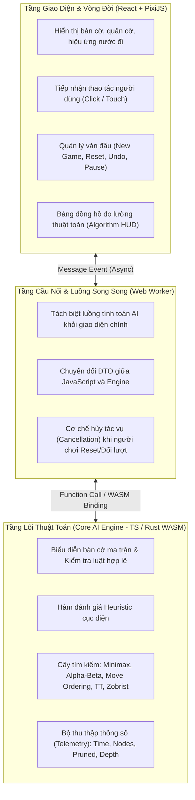

# 🎯 XÁC ĐỊNH PHẠM VI, GIẢ ĐỊNH & RANH GIỚI KỸ THUẬT ĐỀ TÀI

## 1. RANH GIỚI TRÁCH NHIỆM HỆ THỐNG (SYSTEM BOUNDARIES)

Để đảm bảo tính độc lập giữa nghiên cứu thuật toán học thuật và phát triển phần mềm ứng dụng, hệ thống được phân tách nghiêm ngặt thành 3 tầng:

---

## 2. PHẠM VI TRONG ĐỀ TÀI (IN SCOPE)

1. **Về trò chơi & Luật cờ:**
   * Kích thước bàn cờ: $15 \times 15$ chuẩn (và hỗ trợ bàn nhỏ $10 \times 10$).
   * Luật thi đấu: Nghiên cứu cả luật Gomoku tự do (Freestyle) và luật Cờ Caro Việt Nam (chặn 2 đầu).
2. **Về thuật toán AI:**
   * Xây dựng đủ bậc thang 6 mức độ khó: *Easy*, *Normal*, *Hard*, *Very Hard*, *Expert*, *Master*.
   * Triển khai đầy đủ các kỹ thuật: *Random*, *Rule-Based*, *Pattern Detection*, *Heuristic Evaluation*, *Minimax*, *Alpha-Beta Pruning*, *Candidate Move Generation* ($r=1, 2$), *Move Ordering*, *Iterative Deepening*, *Transposition Table (Zobrist Hashing)*.
3. **Về phần mềm & Giao diện:**
   * Website chạy trên nền tảng web hiện đại (React 19, TypeScript, PixiJS 7 / HTML5 Canvas, Tailwind CSS).
   * Chế độ chơi: Player vs Player (PvP trên cùng thiết bị) và Player vs Bot (PvBot).
   * Dashboard đo lường theo thời gian thực (HUD): Thời gian tìm kiếm (ms), số nút duyệt, số nút cắt, độ sâu đạt được.
4. **Về thực nghiệm học thuật:**
   * Chạy kịch bản đối đầu tự động Bot vs Bot giữa các thuật toán khác nhau.
   * Thu thập dữ liệu định lượng, xuất bảng biểu và biểu đồ so sánh hiệu năng.
   * Viết Báo cáo chuyên đề hoàn chỉnh (40 – 60 trang).

---

## 3. PHẠM VI NẰM NGOÀI ĐỀ TÀI (OUT OF SCOPE)

1. **Học sâu & Học tăng cường (Deep Learning / RL):**
   * Các mô hình MCTS kết hợp Mạng nơ-ron tích chập (như AlphaZero) được xếp vào **Hướng phát triển tương lai** (Mục 7 của đề cương), không phải là sản phẩm nghiệm thu chính của đồ án cơ sở này.
2. **Đấu online qua mạng Internet (Network Multiplayer):**
   * Đề tài tập trung vào AI Offline và PvP tại chỗ (Hotseat). Không triển khai WebSocket server phân tán hay hệ thống tài khoản người dùng trực tuyến.
3. **Luật thi đấu mở cờ phức tạp (Swap2 / Opening Rules):**
   * Không bắt buộc áp dụng các quy tắc bốc thăm mở cờ quốc tế như Renju Sakata hay Gomoku Swap2 trong phạm vi giao diện chơi đơn giản.

---

## 4. CÁC TIÊU CHÍ NGHIỆM THU THEO CẤP ĐỘ RỦI RO (RISK LEVELS)

* **Level 1 (Kiểm thử logic lõi thuần túy):** $100\%$ các bài kiểm tra logic bàn cờ, sinh nước đi hợp lệ, phát hiện thắng/thua 4 hướng, hash Zobrist phải pass trong Unit Test suite độc lập.
* **Level 2 (Tích hợp kiểu dữ liệu TypeScript & WASM):** Biên dịch không lỗi (`tsc --noEmit`), các interface DTO giữa Web Worker và Engine khớp $100\%$.
* **Level 3 (Tính năng & Vòng đời ván đấu):** AI tính toán không được khóa luồng UI (Non-blocking UI), bấm New Game / Reset phải lập tức hủy bỏ tác vụ AI đang tìm kiếm để tránh ghi đè sai ván cờ.
* **Level 4 (Trực quan hóa & Báo cáo):** Dữ liệu thống kê trên HUD phải phản ánh chính xác số nút và thời gian đo đạc từ trong thuật toán.
