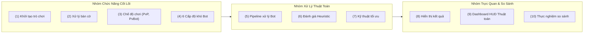

# 📑 KHUNG ĐỀ CƯƠNG ĐỒ ÁN CƠ SỞ CHUẨN (MASTER PROPOSAL)

> **Tài liệu gốc đính kèm:** [[00_De_Cuong_PDF/ĐỀ CƯƠNG ĐỒ ÁN CƠ SỞ .pdf|Xem bản gốc PDF tại đây]]  
> **Sinh viên:** Nguyễn Tâm Đức | **Lớp:** 24CSE | **Khoa:** Kỹ thuật & Khoa học Máy tính (VNUK)

---

## 1. TÊN ĐỀ TÀI
**XÂY DỰNG WEBSITE CỜ CARO ỨNG DỤNG CÁC THUẬT TOÁN TÌM KIẾM ĐỂ XÂY DỰNG BOT VỚI NHIỀU MỨC ĐỘ KHÓ**

---

## 2. MỤC TIÊU ĐỀ TÀI

### 2.1. Mục tiêu tổng quát
* Xây dựng một website trò chơi Cờ Caro hoàn chỉnh cho phép người dùng chơi với các bot có nhiều mức độ khó khác nhau.
* Ứng dụng các thuật toán tìm kiếm và kỹ thuật tối ưu để xây dựng cơ chế lựa chọn nước đi cho bot, đồng thời phân tích và so sánh hiệu quả của các thuật toán trong quá trình xử lý trạng thái bàn cờ.
* Website đóng vai trò là giao diện trực quan, cho phép người dùng chơi game, lựa chọn mức độ khó và quan sát kết quả hoạt động của các bot.

### 2.2. Mục tiêu cụ thể
1. **Nghiên cứu và triển khai các thuật toán cốt lõi:**
   * Random Move (Nước đi ngẫu nhiên).
   * Heuristic / Rule-Based (Hệ chuyên gia dựa trên luật và mẫu thế).
   * Minimax (Thuật toán tìm kiếm vét cạn hai người chơi tổng bằng không).
   * Alpha-Beta Pruning (Kỹ thuật cắt tỉa nhánh cây trò chơi).
2. **Nghiên cứu và áp dụng các kỹ thuật hỗ trợ và tối ưu:**
   * Pattern Detection (Bộ quét nhận diện mẫu quân chiến thuật).
   * Candidate Move Generation (Bộ sinh nước đi tiềm năng theo bán kính).
   * Move Ordering (Sắp xếp thứ tự nước đi ưu tiên).
   * Iterative Deepening (Tìm kiếm sâu dần có kiểm soát thời gian).
   * Transposition Table & Zobrist Hashing (Bảng chuyển vị và băm vị trí bàn cờ).
3. **Mô hình hóa dữ liệu bàn cờ:** Biểu diễn và xử lý bàn cờ dưới dạng ma trận.
4. **Xây dựng hàm đánh giá Heuristic:** Phân tích khả năng tấn công, phòng thủ, các mẫu quân liên tiếp và các tình huống cần chặn/thắng.
5. **Xây dựng hệ thống 6 mức độ khó của Bot:** Dựa trên sự kết hợp giữa thuật toán, độ sâu tìm kiếm và các kỹ thuật tối ưu.
6. **Đo lường và so sánh định lượng:** Thời gian xử lý, số trạng thái được duyệt, số trạng thái được cắt bỏ, độ sâu tìm kiếm đạt được, tỷ lệ thắng.

---

## 3. CHỨC NĂNG HỆ THỐNG (10 CHỨC NĂNG CHUẨN)



* **(1) Khởi tạo trò chơi:** Tạo bàn cờ, chọn quân X/O, chọn người đi trước, New Game, Reset.
* **(2) Xử lý bàn cờ:** Biểu diễn ma trận, kiểm tra tính hợp lệ, quản lý lượt chơi, kiểm tra điều kiện thắng/hòa 4 hướng (ngang, dọc, 2 đường chéo).
* **(3) Chế độ chơi:** Player vs Player (PvP) và Player vs Bot (PvBot).
* **(4) Lựa chọn 6 mức độ khó:**
  * *Easy:* Random Move.
  * *Normal:* Heuristic / Rule-Based.
  * *Hard:* Minimax.
  * *Very Hard:* Minimax + Alpha-Beta Pruning.
  * *Expert:* Alpha-Beta Pruning + Candidate Moves + Move Ordering.
  * *Master:* Alpha-Beta Pruning + Candidate Moves + Move Ordering + Iterative Deepening + Transposition Table.
* **(5) Xử lý nước đi của Bot:** Nhận trạng thái $\rightarrow$ xác định nước hợp lệ $\rightarrow$ sinh ứng viên $\rightarrow$ đánh giá heuristic $\rightarrow$ tìm kiếm sâu $\rightarrow$ chọn nước tối ưu.
* **(6) Đánh giá Heuristic:** Phân tích mẫu quân, tính điểm tấn công và phòng thủ theo công thức: $\text{Evaluation} = \text{Attack} - \text{Defense}$.
* **(7) Tối ưu tìm kiếm:** Giới hạn độ sâu, Candidate Moves, Move Ordering, Alpha-Beta, Iterative Deepening, Transposition Table.
* **(8) Hiển thị kết quả:** Bàn cờ, lượt chơi, độ khó, thuật toán, kết quả thắng/thua/hòa.
* **(9) Hiển thị thông số thuật toán (HUD):** Search Time, Search Depth, Nodes Visited, Nodes Pruned, Candidate Moves, Evaluation Score, Best Move.
* **(10) So sánh thuật toán:** Chạy nhiều bot trên cùng trạng thái, thi đấu tự động Bot vs Bot, xuất số liệu phân tích.

---

## 4. SẢN PHẨM ĐẦU RA

1. **Phần mềm (Website Cờ Caro AI):**
   * Công nghệ: React 19, TypeScript, HTML5, CSS3, Tailwind CSS (kèm PixiJS nếu cần tăng hiệu ứng rendering).
   * Chế độ PvP, PvBot 6 cấp độ, bảng HUD thời gian thực.
2. **Báo cáo chuyên đề Đồ án cơ sở:**
   * Độ dài dự kiến từ **40 đến 60 trang** trình bày chi tiết cơ sở lý thuyết, kiến trúc, cài đặt thuật toán, thực nghiệm và đánh giá.
3. **Video Demo:**
   * Thời lượng từ **5 đến 10 phút** minh họa các tính năng và trực quan hóa thuật toán.
4. **Bộ Slide thuyết minh bảo vệ:** Trình bày kết quả nghiên cứu trước hội đồng.

---

## 5. KẾ HOẠCH THỰC HIỆN (LỘ TRÌNH 10 TUẦN)

```mermaid
gantt
    title LỘ TRÌNH TRIỂN KHAI 10 TUẦN ĐỒ ÁN CƠ SỞ
    dateFormat  YYYY-MM-DD
    section Giai đoạn 1: Nền tảng & Engine
    Tuần 1: Nghiên cứu Luật, State Space & Đề cương  :w1, 2026-09-01, 7d
    Tuần 2: Xây dựng Board Matrix & Game Engine       :w2, after w1, 7d
    Tuần 3: Xây dựng Giao diện Web, Bàn cờ, PvP       :w3, after w2, 7d
    section Giai đoạn 2: Thuật toán Cốt lõi
    Tuần 4: Random, Rule-Based, Pattern & Heuristic   :w4, after w3, 7d
    Tuần 5: Triển khai Minimax & Game Tree             :w5, after w4, 7d
    Tuần 6: Triển khai Alpha-Beta Pruning              :w6, after w5, 7d
    section Giai đoạn 3: Tối ưu Nâng cao
    Tuần 7: Candidate Moves, Move Ordering & Cấp độ Bot:w7, after w6, 7d
    Tuần 8: Iterative Deepening, TT & Zobrist Hashing :w8, after w7, 7d
    section Giai đoạn 4: Thực nghiệm & Đóng gói
    Tuần 9: Thực nghiệm Bot vs Bot & Vẽ biểu đồ       :w9, after w8, 7d
    Tuần 10: Kiểm thử toàn diện, Báo cáo (40-60 trang), Video & Slide :w10, after w9, 7d
```

---

## 6. KẾT QUẢ DỰ KIẾN & 7. HƯỚNG PHÁT TRIỂN
* Hoàn thành trọn vẹn 11 tiêu chí nghiệm thu phần mềm và báo cáo.
* Hướng phát triển: Lưu trữ lịch sử đấu $\rightarrow$ xây dựng dataset $\rightarrow$ huấn luyện mô hình Deep Learning / Reinforcement Learning (Self-Play) để so sánh với thuật toán cây tìm kiếm truyền thống.
