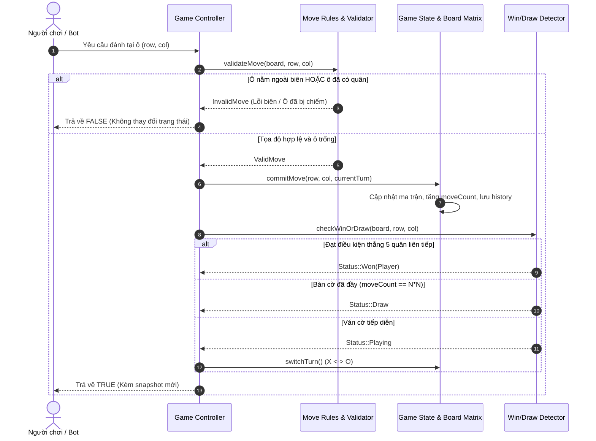

# 📦 TUẦN 02: TỔNG QUAN XÂY DỰNG CORE GAME ENGINE & BỘ KIỂM THỬ

## 🎯 1. MỤC TIÊU TUẦN 2
1. **Thiết kế cấu trúc Board Matrix:** Biểu diễn bàn cờ $15 \times 15$ ($225$ ô) và $10 \times 10$ ($100$ ô) độc lập với giao diện web.
2. **Xây dựng máy trạng thái ván cờ (Game State Machine):** Quản lý trạng thái `READY`, `PLAYING`, `WON`, `DRAW`, lượt chơi luân phiên `PLAYER_X` và `PLAYER_O`, lịch sử nước đi `history`.
3. **Hiện thực hóa giao dịch nước đi (Move Transaction):** Kiểm tra tính hợp lệ (`isValidMove`), thực thi nước đi (`makeMove`), cơ chế hoàn tác (`undo`) với `UndoToken`.
4. **Thuật toán quét thắng 4 hướng:** Quét hàng ngang, hàng dọc, đường chéo chính và đường chéo phụ theo cả 2 quy tắc: Freestyle ($\ge 5$) và Caro Việt Nam (đúng 5 và không bị chặn 2 đầu).
5. **Kiểm thử đơn vị tự động (Unit Test Suite):** Xây dựng bộ test suite $100\%$ độc lập với DOM/UI, kiểm chứng toàn diện các biên bàn cờ và trường hợp hòa/thắng.

---

## 🗺️ 2. SƠ ĐỒ GIAO DỊCH NƯỚC ĐI (MOVE TRANSACTION WORKFLOW)

---

## 📚 3. TÀI LIỆU CHI TIẾT TRONG TUẦN 2

1. [[01_Xay_Dung_Board_Matrix|01. Xây dựng Board Matrix & Hệ tọa độ]]
2. [[02_Quan_Ly_Game_State|02. Quản lý Game State & Máy trạng thái]]
3. [[03_Xu_Ly_Nuoc_Di_MakeMove|03. Xử lý nước đi makeMove & Cơ chế hoàn tác Undo]]
4. [[04_Kiem_Tra_Nuoc_Di_Hop_Le|04. Kiểm tra tính hợp lệ của nước đi (Validation Rules)]]
5. [[05_Kiem_Tra_Thang_Hoa_4_Huong|05. Thuật toán quét thắng 4 hướng & Luật chặn 2 đầu]]
6. [[06_Hoan_Thien_Core_Engine_Va_Test_Suite|06. Đóng gói Core Engine & Bộ kiểm thử tự động (Unit Tests)]]
