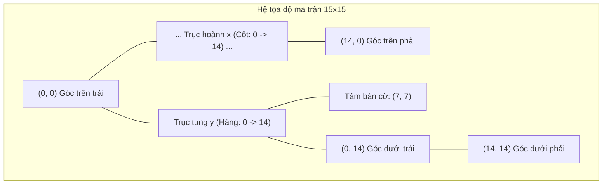

# 📐 XÂY DỰNG BOARD MATRIX & HỆ TỌA ĐỘ BÀN CỜ

## 1. THIẾT KẾ HỆ TỌA ĐỘ VÀ BẢN ĐỒ Ô CỜ

Bàn cờ được mô hình hóa thành một ma trận vuông $N \times N$ với $N \in \{10, 15\}$ (mặc định chuẩn thi đấu là $N = 15$):
* **Trục tung (Hàng - Row / $y$):** Chỉ số từ $0$ đến $N - 1$, chạy từ trên xuống dưới.
* **Trục hoành (Cột - Column / $x$):** Chỉ số từ $0$ đến $N - 1$, chạy từ trái qua phải.
* **Giá trị ô cờ:**
  $$C(x, y) \in \{0, 1, 2\} \iff \{\text{EMPTY} = 0, \text{PLAYER\_X} = 1, \text{PLAYER\_O} = 2\}$$



---

## 2. HIỆN THỰC HÓA BẰNG TYPESCRIPT

```typescript
export const BOARD_SIZE = 15;
export const TOTAL_CELLS = BOARD_SIZE * BOARD_SIZE; // 225

export enum Player {
  None = 0,
  X = 1,
  O = 2,
}

export type Board = Player[][];

/**
 * Khởi tạo ma trận bàn cờ rỗng 15x15
 */
export function createEmptyBoard(size: number = BOARD_SIZE): Board {
  return Array.from({ length: size }, () => Array(size).fill(Player.None));
}

/**
 * Chuyển đổi an toàn tọa độ 2D sang mảng 1D (phục vụ bộ nhớ tuần tự)
 */
export function to1DIndex(row: number, col: number, size: number = BOARD_SIZE): number {
  return row * size + col;
}

export function to2DCoord(index: number, size: number = BOARD_SIZE): { row: number; col: number } {
  return {
    row: Math.floor(index / size),
    col: index % size,
  };
}
```

---

## 3. HIỆN THỰC HÓA BẰNG RUST (CHO AI SEARCH PERFORMANCE)

Trong engine Rust [caro-core-reference/src/model.rs](file:///home/pro/Downloads/vnuk/basicProject/caro-core-reference/src/model.rs), mảng tĩnh được ưu tiên nhằm cấp phát trên Stack, tránh phân mảnh bộ nhớ Heap:

```rust
pub const BOARD_SIZE: usize = 15;
pub const BOARD_CELLS: usize = BOARD_SIZE * BOARD_SIZE;

#[repr(i8)]
#[derive(Debug, Clone, Copy, PartialEq, Eq, Default)]
pub enum Player {
    #[default]
    None = 0,
    X = 1,
    O = -1,
}

impl Player {
    #[inline(always)]
    pub fn opponent(self) -> Self {
        match self {
            Player::X => Player::O,
            Player::O => Player::X,
            Player::None => Player::None,
        }
    }
}
```

---

## 4. CÁC QUY ƯỚC BẤT BIẾN CỦA BOARD MATRIX
1. **Khởi tạo:** Mọi ô cờ khi tạo mới phải mang giá trị `Player::None` ($0$).
2. **Tính bất biến kích thước:** Kích thước ma trận cố định sau khi khởi tạo ván đấu ($N=15$), không cho phép co giãn động trong lúc ván đấu đang diễn ra.
3. **Độ an toàn truy cập (Bounds Safety):** Luôn kiểm tra điều kiện $0 \le x < N$ và $0 \le y < N$ trước khi đọc hoặc ghi vào ô cờ để tránh lỗi truy cập ngoài mảng.
