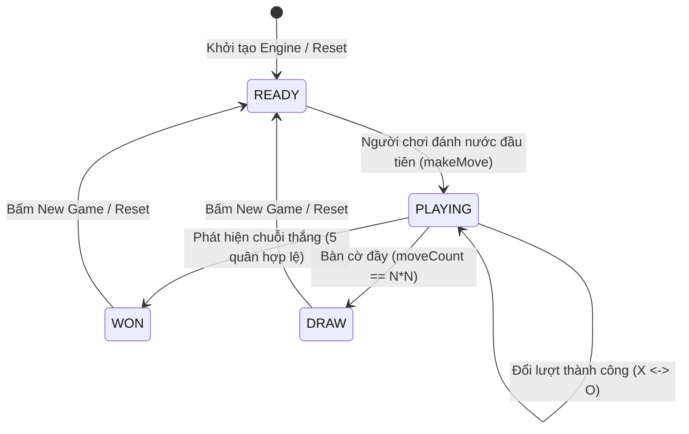

# 🔄 QUẢN LÝ GAME STATE & MÁY TRẠNG THÁI HỮU HẠN (FSM)

## 1. MÔ HÌNH MÁY TRẠNG THÁI (FINITE STATE MACHINE - FSM)

Vòng đời của một ván cờ Caro tuân theo một máy trạng thái tất định nghiêm ngặt:



### Các trạng thái:
* **`READY`:** Bàn cờ rỗng, sẵn sàng nhận nước đi đầu tiên từ người đi trước (mặc định quân X/Đen).
* **`PLAYING`:** Ván cờ đang diễn ra, luân phiên nhận nước đi hợp lệ và chuyển đổi `currentTurn`.
* **`WON`:** Đã xác định được người chiến thắng. Mọi yêu cầu đánh thêm nước mới bị **chặn tuyệt đối**.
* **`DRAW`:** Toàn bộ $225$ ô đã được đánh kín mà không có người chiến thắng. Trạng thái kết thúc hòa.

---

## 2. CẤU TRÚC DỮ LIỆU GAME STATE SNAPSHOT

Để UI và AI có thể nắm bắt trạng thái tức thời mà không gây xung đột dữ liệu (Side Effects), Game State cung cấp các bản chụp bất biến (Immutable Snapshots):

```typescript
export type GamePhase = 'READY' | 'PLAYING' | 'WON' | 'DRAW';

export interface MoveRecord {
  row: number;
  col: number;
  player: Player;
  moveNumber: number;
  timestamp: number;
}

export interface GameStateSnapshot {
  board: Board;
  currentTurn: Player;
  phase: GamePhase;
  winner: Player | null;
  winningLine: { row: number; col: number }[] | null;
  history: MoveRecord[];
  moveCount: number;
  lastMove: { row: number; col: number } | null;
}
```

---

## 3. NGUYÊN TẮC DUY NHẤT CHỦ THỂ SỞ HỮU TRẠNG THÁI (SINGLE SOURCE OF TRUTH)

* **Tầng lõi Engine:** Là chủ thể độc quyền sở hữu trạng thái ván cờ (Authoritative State Owner).
* **Tầng UI / React:** Chỉ sở hữu trạng thái trình diễn (Derived / Presentation State). React **không được phép tự ý thay đổi lượt chơi hay ma trận cờ** mà bắt buộc phải gửi yêu cầu thông qua API của Controller/Engine.
* **Tầng AI / Worker:** Hoạt động trên bản sao độc lập của trạng thái để tính toán tìm kiếm, không gây ảnh hưởng đến trạng thái bàn cờ thực của người chơi.
