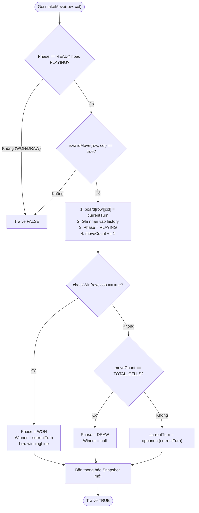

# ♟️ XỬ LÝ NƯỚC ĐI makeMove & CƠ CHẾ HOÀN TÁC UNDO

## 1. NGUYÊN TẮC GIAO DỊCH NƯỚC ĐI (MOVE TRANSACTION ATOMICITY)

Một nước đi trong Cờ Caro phải thỏa mãn tính chất **nguyên tử (Atomic)**:
* Nếu nước đi hợp lệ: Cập nhật chính xác $1$ ô cờ, ghi nhận $1$ bản ghi lịch sử, đánh giá kết quả và đổi lượt.
* Nếu nước đi không hợp lệ: Bàn cờ giữ nguyên $100\%$ hiện trạng, không thay đổi lượt, không ghi lịch sử.



---

## 2. HIỆN THỰC HÓA BẰNG TYPESCRIPT

```typescript
export class CaroEngine {
  private board: Board;
  private currentTurn: Player = Player.X;
  private phase: GamePhase = 'READY';
  private winner: Player | null = null;
  private history: MoveRecord[] = [];

  constructor(private size: number = BOARD_SIZE) {
    this.board = createEmptyBoard(size);
  }

  public makeMove(row: number, col: number): boolean {
    if (this.phase === 'WON' || this.phase === 'DRAW') return false;
    if (!this.isValidMove(row, col)) return false;

    // Giao dịch ghi nhận nước đi
    this.board[row][col] = this.currentTurn;
    this.history.push({
      row,
      col,
      player: this.currentTurn,
      moveNumber: this.history.length + 1,
      timestamp: Date.now(),
    });
    this.phase = 'PLAYING';

    // Kiểm tra kết quả
    const winResult = this.checkWin(row, col);
    if (winResult.won) {
      this.phase = 'WON';
      this.winner = this.currentTurn;
      return true;
    }

    if (this.history.length === this.size * this.size) {
      this.phase = 'DRAW';
      return true;
    }

    // Đổi lượt
    this.currentTurn = this.currentTurn === Player.X ? Player.O : Player.X;
    return true;
  }

  /**
   * Hoàn tác nước đi gần nhất (Undo)
   */
  public undo(): boolean {
    if (this.history.length === 0) return false;

    const lastMove = this.history.pop()!;
    this.board[lastMove.row][lastMove.col] = Player.None;
    this.currentTurn = lastMove.player;
    this.phase = this.history.length === 0 ? 'READY' : 'PLAYING';
    this.winner = null;
    return true;
  }
}
```

---

## 3. CƠ CHẾ HOÀN TÁC TRONG AI SEARCH (UNDO TOKEN RUST)

Trong thuật toán tìm kiếm Minimax, hàm `undo` được tối ưu hóa cực hạn thông qua cấu trúc `UndoToken`:

```rust
pub struct UndoToken {
    pub index: usize,
    pub previous_to_move: Player,
    pub previous_status: GameStatus,
}

impl GameState {
    #[inline(always)]
    pub fn play(&mut self, mv: usize) -> Result<UndoToken, MoveError> {
        let token = UndoToken {
            index: mv,
            previous_to_move: self.to_move,
            previous_status: self.status,
        };
        self.cells[mv] = self.to_move;
        self.move_count += 1;
        // Kiểm tra kết thúc và đổi lượt...
        Ok(token)
    }

    #[inline(always)]
    pub fn undo(&mut self, token: UndoToken) {
        self.cells[token.index] = Player::None;
        self.to_move = token.previous_to_move;
        self.status = token.previous_status;
        self.move_count -= 1;
    }
}
```

*Đặc tính kỹ thuật:* Không cần clone toàn bộ bàn cờ $225$ phần tử; thao tác undo chỉ mất **$3$ lệnh gán CPU**, đảm bảo tốc độ đạt hàng triệu nút duyệt mỗi giây.
