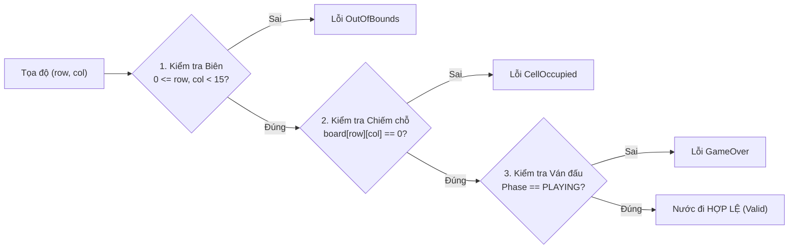

# 🛡️ KIỂM TRA TÍNH HỢP LỆ CỦA NƯỚC ĐI (MOVE VALIDATION RULES)

## 1. BA RÀNG BUỘC BẮT BUỘC CỦA MỘT NƯỚC ĐI HỢP LỆ

Để một yêu cầu đánh cờ tại tọa độ $(r, c)$ được chấp nhận, nó phải thỏa mãn đồng thời cả $3$ điều kiện:

$$\text{ValidMove}(r, c) \iff \mathcal{B}(r, c) \land \mathcal{O}(r, c) \land \mathcal{P}(\text{phase})$$

1. **Điều kiện biên bàn cờ ($\mathcal{B}$):**
   $$0 \le r < N \quad \text{và} \quad 0 \le c < N \quad (N = 15)$$
2. **Điều kiện ô chưa bị chiếm ($\mathcal{O}$):**
   $$\text{Board}[r][c] == \text{Player::None} \quad (0)$$
3. **Điều kiện trạng thái ván đấu ($\mathcal{P}$):**
   $$\text{GamePhase} \in \{\text{READY}, \text{PLAYING}\}$$



---

## 2. HIỆN THỰC HÓA BẰNG TYPESCRIPT

```typescript
export class MoveValidator {
  constructor(private size: number = 15) {}

  public isWithinBounds(row: number, col: number): boolean {
    return Number.isInteger(row) && 
           Number.isInteger(col) && 
           row >= 0 && row < this.size && 
           col >= 0 && col < this.size;
  }

  public isCellEmpty(board: Board, row: number, col: number): boolean {
    return board[row][col] === Player.None;
  }

  public isValidMove(board: Board, phase: GamePhase, row: number, col: number): boolean {
    if (phase === 'WON' || phase === 'DRAW') return false;
    if (!this.isWithinBounds(row, col)) return false;
    return this.isCellEmpty(board, row, col);
  }

  /**
   * Lấy toàn bộ danh sách các ô trống hợp lệ trên bàn cờ
   */
  public getAvailableMoves(board: Board): { row: number; col: number }[] {
    const moves: { row: number; col: number }[] = [];
    for (let r = 0; r < this.size; r++) {
      for (let c = 0; c < this.size; c++) {
        if (board[r][c] === Player.None) {
          moves.push({ row: r, col: c });
        }
      }
    }
    return moves;
  }
}
```

---

## 3. CÁC TRƯỜNG HỢP BIÊN (EDGE CASES) BẮT BUỘC KIỂM THỬ

| Trường hợp thử nghiệm | Dữ liệu đầu vào | Kết quả kỳ vọng | Ý nghĩa bảo vệ |
| :--- | :--- | :--- | :--- |
| **Góc trên - trái** | `(0, 0)` khi bàn cờ trống | `true` | Kiểm tra biên nhỏ nhất |
| **Góc dưới - phải** | `(14, 14)` khi bàn cờ trống | `true` | Kiểm tra biên lớn nhất |
| **Âm tọa độ** | `(-1, 5)` hoặc `(5, -1)` | `false` | Chống truy cập chỉ số âm |
| **Vượt biên ngoài** | `(15, 7)` hoặc `(7, 15)` | `false` | Chống tràn mảng (IndexOutOfBounds) |
| **Số thực / NaN** | `(3.5, 7)` hoặc `(NaN, 5)` | `false` | Chống sai kiểu dữ liệu JS |
| **Đánh đè ô đã có quân** | `(7, 7)` khi ô đã có quân X | `false` | Bảo vệ tính toàn vẹn ván cờ |
| **Đánh khi ván cờ đã thắng**| Bất kỳ khi `phase === 'WON'` | `false` | Đảm bảo kết thúc ván đóng băng |
