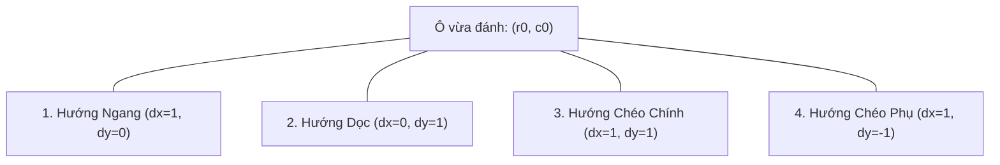

# 🔍 THUẬT TOÁN QUÉT THẮNG 4 HƯỚNG & LUẬT CHẶN 2 ĐẦU

## 1. NGUYÊN LÝ QUÉT TIA 4 TRỤC TỌA ĐỘ (RAYCASTING 4 AXES)

Sau khi một quân cờ được đặt tại vị trí $(r_0, c_0)$, điều kiện thắng chỉ có thể xuất hiện trên các đường thẳng đi qua chính điểm $(r_0, c_0)$. Do đó, thuật toán **chỉ cần quét cục bộ 4 hướng** xung quanh $(r_0, c_0)$ với bán kính tối đa $4$ bước mỗi chiều, thay vì phải quét lại toàn bộ bàn cờ:



### Thuật toán đếm hai chiều trên trục $(dx, dy)$:
1. **Chiều tiến (Forward):** Duyệt $i = 1, 2, 3, 4$ theo hướng $(r_0 + i \cdot dy, c_0 + i \cdot dx)$ cho tới khi gặp ô khác màu, ô trống hoặc chạm biên bàn cờ.
2. **Chiều lùi (Backward):** Duyệt $j = 1, 2, 3, 4$ theo hướng $(r_0 - j \cdot dy, c_0 - j \cdot dx)$ cho tới khi gặp ô khác màu, ô trống hoặc chạm biên bàn cờ.
3. **Tổng độ dài chuỗi:**
   $$L = \text{count}_{\text{forward}} + \text{count}_{\text{backward}} + 1$$
4. **Trạng thái chặn 2 đầu:**
   * Đầu mút tiến bị chặn nếu nằm ngoài biên hoặc là quân đối phương.
   * Đầu mút lùi bị chặn nếu nằm ngoài biên hoặc là quân đối phương.

---

## 2. HIỆN THỰC HÓA BẰNG TYPESCRIPT (HỖ TRỢ CẢ 2 LUẬT)

```typescript
export interface WinResult {
  won: boolean;
  winner: Player | null;
  line: { row: number; col: number }[] | null;
}

const DIRECTIONS: [number, number][] = [
  [0, 1],   // Hàng ngang
  [1, 0],   // Hàng dọc
  [1, 1],   // Đường chéo chính (trên-trái xuống dưới-phải)
  [1, -1],  // Đường chéo phụ (dưới-trái lên trên-phải)
];

export function checkWinAt(
  board: Board, 
  row: number, 
  col: number, 
  rule: 'FREESTYLE' | 'CARO_VN' = 'FREESTYLE',
  size: number = 15
): WinResult {
  const player = board[row][col];
  if (player === Player.None) return { won: false, winner: null, line: null };

  for (const [dy, dx] of DIRECTIONS) {
    const lineCoords: { row: number; col: number }[] = [{ row, col }];

    // Quét chiều tiến
    let forwardBlocked = false;
    for (let step = 1; step <= 5; step++) {
      const nr = row + dy * step;
      const nc = col + dx * step;
      if (nr < 0 || nr >= size || nc < 0 || nc >= size) {
        forwardBlocked = true;
        break;
      }
      if (board[nr][nc] === player) {
        lineCoords.push({ row: nr, col: nc });
      } else {
        if (board[nr][nc] !== Player.None) forwardBlocked = true;
        break;
      }
    }

    // Quét chiều lùi
    let backwardBlocked = false;
    for (let step = 1; step <= 5; step++) {
      const nr = row - dy * step;
      const nc = col - dx * step;
      if (nr < 0 || nr >= size || nc < 0 || nc >= size) {
        backwardBlocked = true;
        break;
      }
      if (board[nr][nc] === player) {
        lineCoords.unshift({ row: nr, col: nc });
      } else {
        if (board[nr][nc] !== Player.None) backwardBlocked = true;
        break;
      }
    }

    const length = lineCoords.length;

    // Đánh giá theo luật tương ứng
    if (rule === 'FREESTYLE') {
      if (length >= 5) {
        return { won: true, winner: player, line: lineCoords };
      }
    } else if (rule === 'CARO_VN') {
      const isBlockedBothEnds = forwardBlocked && backwardBlocked;
      // Luật Caro Việt Nam: Đúng 5 quân và KHÔNG bị chặn 2 đầu
      if (length === 5 && !isBlockedBothEnds) {
        return { won: true, winner: player, line: lineCoords };
      }
    }
  }

  return { won: false, winner: null, line: null };
}
```

---

## 3. BẢNG KIỂM CHỨNG TÍNH ĐÚNG ĐẮN CÁC MẪU THẾ CHIẾN THUẬT

| Ký hiệu chuỗi | Trạng thái hai đầu | Chiều dài ($L$) | Kết quả Gomoku Freestyle | Kết quả Caro Việt Nam |
| :---: | :---: | :---: | :---: | :---: |
| `_ X X X X X _` | Trống 2 đầu (Open Five) | $5$ | **THẮNG** | **THẮNG** |
| `O X X X X X _` | Bị chặn 1 đầu bởi O | $5$ | **THẮNG** | **THẮNG** (Vẫn được tính) |
| `O X X X X X O` | Bị chặn 2 đầu bởi O | $5$ | **THẮNG** | ❌ **KHÔNG THẮNG (Bị triệt tiêu)** |
| `| X X X X X O` | 1 đầu mép bàn cờ, 1 đầu O | $5$ | **THẮNG** | ❌ **KHÔNG THẮNG** |
| `_ X X X X X X _`| Quá 5 quân (Overline) | $6$ | **THẮNG** | ❌ **KHÔNG THẮNG** |
| `_ X X X X _` | Bốn quân mở (Open Four) | $4$ | Chưa thắng | Chưa thắng |
