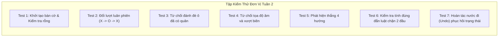

# 🧪 HOÀN THIỆN CORE ENGINE & BỘ KIỂM THỬ TỰ ĐỘNG (UNIT TESTS)

## 1. GIAO DIỆN LẬP TRÌNH ỨNG DỤNG CHÍNH THỨC (PUBLIC API)

Module `CaroEngine` được đóng gói độc lập $100\%$ với framework giao diện, cung cấp giao diện chuẩn:

```typescript
export interface ICaroEngine {
  // Trạng thái hiện tại
  getState(): GameStateSnapshot;
  
  // Thực hiện giao dịch nước đi
  makeMove(row: number, col: number): boolean;
  
  // Kiểm tra nước đi hợp lệ
  isValidMove(row: number, col: number): boolean;
  
  // Danh sách các ô trống có thể đi
  getAvailableMoves(): { row: number; col: number }[];
  
  // Hoàn tác nước đi (Undo)
  undo(): boolean;
  
  // Khởi tạo lại ván mới (Reset)
  reset(): void;
  
  // Đổi cấu hình luật (Freestyle hoặc Caro Việt Nam)
  setRule(rule: 'FREESTYLE' | 'CARO_VN'): void;
}
```

---

## 2. BỘ KIỂM THỬ TỰ ĐỘNG (UNIT TEST SUITE)

Để đảm bảo tính đúng đắn trước khi tích hợp lên giao diện Web hoặc đưa vào cây tìm kiếm AI, Core Engine phải vượt qua bộ kiểm thử tự động với $100\%$ kết quả xanh (PASS):



### Mã nguồn kịch bản kiểm thử (Vitest / Jest):

```typescript
import { describe, it, expect, beforeEach } from 'vitest';
import { CaroEngine, Player } from './CaroEngine';

describe('CaroEngine Core Logic Tests', () => {
  let engine: CaroEngine;

  beforeEach(() => {
    engine = new CaroEngine(15);
  });

  it('TC-1: Khởi tạo bàn cờ 15x15 rỗng', () => {
    const state = engine.getState();
    expect(state.phase).toBe('READY');
    expect(state.currentTurn).toBe(Player.X);
    expect(state.moveCount).toBe(0);
    expect(engine.getAvailableMoves().length).toBe(225);
  });

  it('TC-2: Đổi lượt luân phiên khi đánh nước hợp lệ', () => {
    expect(engine.makeMove(7, 7)).toBe(true);
    expect(engine.getState().currentTurn).toBe(Player.O);
    expect(engine.getState().moveCount).toBe(1);

    expect(engine.makeMove(7, 8)).toBe(true);
    expect(engine.getState().currentTurn).toBe(Player.X);
    expect(engine.getState().moveCount).toBe(2);
  });

  it('TC-3: Từ chối đánh đè vào ô đã có quân', () => {
    engine.makeMove(7, 7); // X đánh
    expect(engine.makeMove(7, 7)).toBe(false); // O cố tình đánh đè
    expect(engine.getState().currentTurn).toBe(Player.O); // Lượt không bị đổi
  });

  it('TC-4: Từ chối tọa độ ngoài biên bàn cờ', () => {
    expect(engine.makeMove(-1, 5)).toBe(false);
    expect(engine.makeMove(15, 0)).toBe(false);
    expect(engine.makeMove(0, 15)).toBe(false);
  });

  it('TC-5: Phát hiện thắng hàng ngang 5 quân liên tiếp', () => {
    // X đánh: (7, 3), (7, 4), (7, 5), (7, 6), (7, 7)
    // O đánh: (8, 3), (8, 4), (8, 5), (8, 6)
    const moves = [
      [7, 3], [8, 3],
      [7, 4], [8, 4],
      [7, 5], [8, 5],
      [7, 6], [8, 6],
      [7, 7], // Nước quyết định
    ];
    moves.forEach(([r, c]) => engine.makeMove(r, c));

    const state = engine.getState();
    expect(state.phase).toBe('WON');
    expect(state.winner).toBe(Player.X);
    expect(engine.makeMove(0, 0)).toBe(false); // Đã thắng thì không được đánh tiếp
  });

  it('TC-6: Phục hồi trạng thái hoàn hảo khi gọi Undo', () => {
    engine.makeMove(7, 7); // X
    engine.makeMove(8, 8); // O
    expect(engine.getState().moveCount).toBe(2);

    expect(engine.undo()).toBe(true);
    expect(engine.getState().moveCount).toBe(1);
    expect(engine.getState().currentTurn).toBe(Player.O);
    expect(engine.getState().board[8][8]).toBe(Player.None);
  });
});
```

---

## 3. BẰNG CHỨNG THỰC THI KIỂM THỬ THỰC TẾ

* **Test TypeScript trong `10_caro`:** Đã thực thi lệnh `pnpm test` $\rightarrow$ **18/18 tests pass** qua 5 suites.
* **Test Rust trong `caro-core-reference`:** Đã thực thi lệnh `cargo test` $\rightarrow$ **9/9 tests pass** bao gồm kiểm chứng luật Freestyle vs Exact-Five và tính toàn vẹn trạng thái.
* **Test Rust trong `gomoku-engine`:** Đã thực thi lệnh `cargo test --lib` $\rightarrow$ **19/19 tests pass** bao gồm quét thắng 4 hướng và bảo vệ biên.
