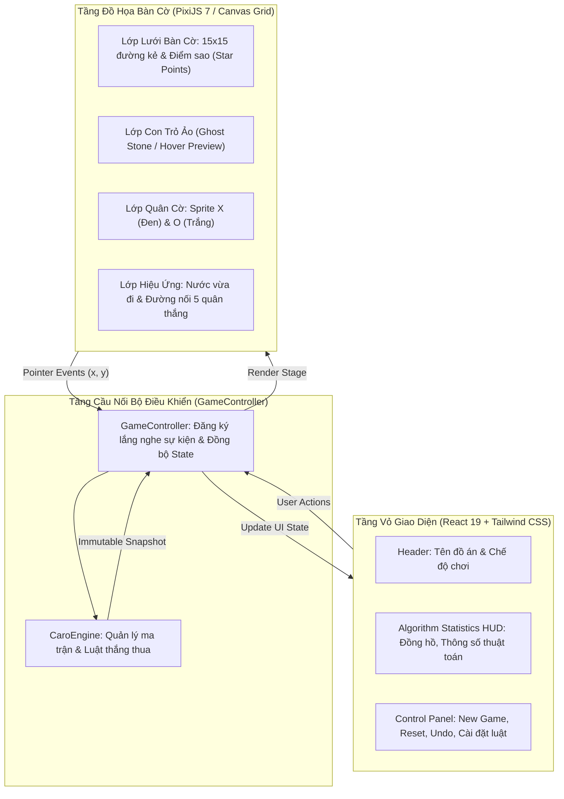

# 🖥️ TUẦN 03: TỔNG QUAN XÂY DỰNG GIAO DIỆN WEBSITE & CHẾ ĐỘ PVP

## 🎯 1. MỤC TIÊU TUẦN 3
1. **Thiết kế kiến trúc giao diện Website:** Phân tách rõ ràng giữa lớp hiển thị (React 19, Tailwind CSS) và lớp đồ họa bàn cờ (HTML5 Canvas / PixiJS 7).
2. **Hiển thị bàn cờ tương tác:** Vẽ lưới $15 \times 15$, xử lý sự kiện tương tác (Click / Touch / Hover), hiển thị quân cờ X và O sắc nét trên mọi độ phân giải màn hình.
3. **Chức năng chiến thuật trực quan:** Đánh dấu nước đi vừa đánh (Last Move Indicator) và làm nổi bật chuỗi 5 quân chiến thắng (Winning Line Highlight).
4. **Hiện thực hóa chế độ Player vs Player (PvP):** Chơi đối kháng 2 người trên cùng thiết bị (Local Hotseat), đổi lượt mượt mà, hiển thị đồng hồ và bảng thông báo kết quả.
5. **Quản lý vòng đời ván đấu (Lifecycle):** Triển khai các chức năng New Game, Reset bàn cờ và Hoàn tác nước đi (Undo) an toàn, không rò rỉ bộ nhớ.

---

## 🗺️ 2. SƠ ĐỒ PHÂN LỚP KIẾN TRÚC GIAO DIỆN (UI ARCHITECTURE)

---

## 📚 3. TÀI LIỆU CHI TIẾT TRONG TUẦN 3

1. [[01_Kien_Truc_Giao_Dien_Website|01. Kiến trúc giao diện Website (React + PixiJS + Tailwind)]]
2. [[02_Hien_Thi_Ban_Co_Va_Highlight|02. Kỹ thuật hiển thị bàn cờ, Ghost Stone & Winning Highlight]]
3. [[03_Che_Do_Player_vs_Player|03. Xây dựng chế độ hai người chơi (Player vs Player)]]
4. [[04_Lifecycle_New_Game_Reset_Undo|04. Quản lý vòng đời ván cờ (New Game, Reset, Undo)]]
