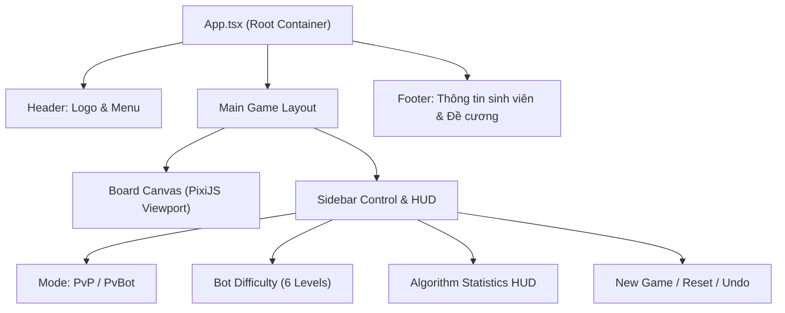

# 🏗️ KIẾN TRÚC GIAO DIỆN WEBSITE (REACT + PIXIJS + TAILWIND)

## 1. NGUYÊN TẮC THIẾT KẾ PHÂN LỚP HIỂN THỊ

Theo chuẩn kỹ thuật phát triển game web hiện đại, việc đẩy toàn bộ các thao tác render từng frame vào React State sẽ gây ra hiện tượng **Rerender Thrashing** (React phải cập nhật DOM liên tục làm giảm FPS).

Do đó, đồ án áp dụng nguyên tắc **Tách rời tuyệt đối giữa Presentation Shell và Render Canvas**:
1. **React 19 + Tailwind CSS sở hữu:**
   * Giao diện khung (Application Shell), Menu thanh điều hướng, Modal cấu hình luật cờ.
   * Bảng thông số đo lường thuật toán theo thời gian thực (Algorithm Statistics HUD).
   * Các nút điều khiển tác vụ: New Game, Reset, Undo, Lựa chọn mức độ khó.
2. **PixiJS 7 sở hữu:**
   * Khởi tạo WebGL Canvas, quản lý Ticker và Stage.
   * Render lưới bàn cờ $15 \times 15$ đạt chuẩn $60\text{ FPS}$.
   * Quản lý Sprite quân cờ X/O, hiệu ứng đặt quân và đường vẽ chuỗi thắng.
   * Tiếp nhận tương tác con trỏ chuột (`pointerdown`, `pointermove`).



---

## 2. QUY CHUẨN THIẾT KẾ ĐÁP ỨNG (RESPONSIVE VIEWPORT)

Bàn cờ Caro có tỷ lệ vuông $1:1$. Khi hiển thị trên các thiết bị khác nhau:
* **Màn hình máy tính để bàn (Desktop Widescreen):** Bàn cờ nằm ở trung tâm hoặc bên trái, bảng điều khiển và HUD nằm ở cột bên phải.
* **Màn hình di động (Mobile Portrait):** Bàn cờ chiếm trọn chiều rộng màn hình ($100\text{vw}$ trừ padding lề an toàn), bảng HUD và các nút điều khiển được xếp dọc bên dưới bàn cờ.

### Công thức tính kích thước ô cờ động (Cell Size):
$$\text{CellSize} = \frac{\min(\text{ViewportWidth} - 32, \text{MaxBoardPixel})}{N}$$
Với $N = 15$ và $\text{MaxBoardPixel} = 600\text{px}$.

---

## 3. KẾT NỐI SỰ KIỆN GIỮA REACT VÀ ENGINE

Giao tiếp giữa React và Core Engine tuân thủ mô hình **Observer Pattern (Đăng ký nhận thông báo)**:

```typescript
export function useCaroGame(engine: ICaroEngine) {
  const [snapshot, setSnapshot] = useState<GameStateSnapshot>(engine.getState());

  useEffect(() => {
    // Đăng ký nhận snapshot mới mỗi khi Engine có thay đổi
    const unsubscribe = engine.subscribe((newSnapshot) => {
      setSnapshot(newSnapshot);
    });
    return () => unsubscribe();
  }, [engine]);

  return {
    snapshot,
    playMove: (r: number, c: number) => engine.makeMove(r, c),
    reset: () => engine.reset(),
    undo: () => engine.undo(),
  };
}
```
