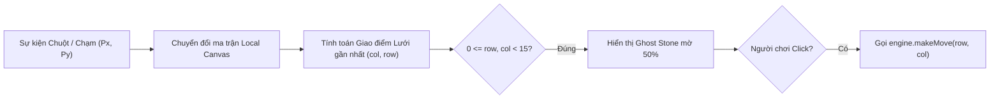

# 🎨 KỸ THUẬT HIỂN THỊ BÀN CỜ, GHOST STONE & WINNING HIGHLIGHT

## 1. HỆ TỌA ĐỘ PIXEL VÀ CHUYỂN ĐỔI Ô CỜ

Khi người chơi chạm hoặc nhấp chuột lên màn hình tại tọa độ pixel $(P_x, P_y)$, hệ thống phải chuyển đổi ngược về chỉ số hàng và cột $(r, c)$ trên ma trận cờ:

$$\begin{cases}
c = \left\lfloor \dfrac{P_x - \text{OffsetX}}{\text{CellSize}} \right\rceil \\
r = \left\lfloor \dfrac{P_y - \text{OffsetY}}{\text{CellSize}} \right\rceil
\end{cases}$$

Trong đó phép toán $\lfloor \cdot \rceil$ là làm tròn đến giao điểm lưới gần nhất (nếu chơi trên giao điểm) hoặc làm tròn xuống ô vuông (nếu chơi bên trong lòng ô).



---

## 2. CÁC THÀNH PHẦN HIỂN THỊ CHIẾN THUẬT

### 2.1. Điểm sao quy chuẩn (Star Points)
Trên bàn cờ Gomoku $15 \times 15$ tiêu chuẩn, có $5$ điểm sao đen được đánh dấu để định hướng tầm mắt của người chơi:
* Tâm bàn cờ: `(7, 7)` (Thiên nguyên - Tengen)
* 4 góc: `(3, 3)`, `(3, 11)`, `(11, 3)`, `(11, 11)`

### 2.2. Quân cờ xem trước (Ghost Stone / Hover Preview)
* Khi di chuột qua một ô trống hợp lệ, một quân cờ bán trong suốt (độ mờ `alpha = 0.45`) của lượt hiện tại sẽ xuất hiện.
* Giúp người chơi căn chỉnh chính xác tọa độ, loại bỏ tình trạng bấm nhầm ô cờ (Misclick) trên màn hình cảm ứng hoặc chuột máy tính.

### 2.3. Đánh dấu nước đi gần nhất (Last Move Indicator)
* Đặt một ký hiệu trực quan (vòng tròn viền đỏ hoặc chấm đỏ nhỏ có hiệu ứng rung nhẹ) ngay trên quân cờ vừa được đánh.
* Đặc biệt quan trọng khi chơi với Bot ở tốc độ xử lý nhanh, giúp người chơi dễ dàng nhận biết Bot vừa đánh vào đâu.

### 2.4. Đường nối quân chiến thắng (Winning Line Highlight)
* Khi phát hiện chuỗi 5 quân thắng cuộc từ `checkWinAt`, hệ thống nhận được danh sách tọa độ `line: { row, col }[]`.
* PixiJS vẽ một đường Line Graphics màu vàng kim (`#F59E0B`) hoặc đỏ rực rỡ xuyên qua tâm của 5 quân cờ, đồng thời làm sáng bóng các quân cờ thắng cuộc.

---

## 3. MÃ NGUỒN VẼ BÀN CỜ VÀ HIGHLIGHT (PIXIJS 7)

```typescript
import { Application, Graphics, Container } from 'pixi.js';

export class BoardView {
  public container: Container = new Container();
  private gridGraphics: Graphics = new Graphics();
  private highlightGraphics: Graphics = new Graphics();

  constructor(private cellSize: number = 40, private size: number = 15) {
    this.container.addChild(this.gridGraphics);
    this.container.addChild(this.highlightGraphics);
    this.drawGrid();
  }

  private drawGrid() {
    this.gridGraphics.clear();
    this.gridGraphics.lineStyle(1.5, 0x374151, 0.8);

    const totalLength = (this.size - 1) * this.cellSize;

    // Vẽ các đường kẻ ngang và dọc
    for (let i = 0; i < this.size; i++) {
      const pos = i * this.cellSize;
      // Đường ngang
      this.gridGraphics.moveTo(0, pos);
      this.gridGraphics.lineTo(totalLength, pos);
      // Đường dọc
      this.gridGraphics.moveTo(pos, 0);
      this.gridGraphics.lineTo(pos, totalLength);
    }

    // Vẽ 5 điểm sao (Star Points)
    const starPoints = [[3, 3], [3, 11], [7, 7], [11, 3], [11, 11]];
    this.gridGraphics.beginFill(0x1F2937, 1);
    for (const [r, c] of starPoints) {
      this.gridGraphics.drawCircle(c * this.cellSize, r * this.cellSize, 4);
    }
    this.gridGraphics.endFill();
  }

  /**
   * Vẽ đường kẻ sáng nối 5 quân chiến thắng
   */
  public drawWinningLine(line: { row: number; col: number }[]) {
    if (!line || line.length < 5) return;
    this.highlightGraphics.clear();
    this.highlightGraphics.lineStyle(4, 0xEF4444, 0.9);

    const start = line[0];
    const end = line[line.length - 1];

    this.highlightGraphics.moveTo(start.col * this.cellSize, start.row * this.cellSize);
    this.highlightGraphics.lineTo(end.col * this.cellSize, end.row * this.cellSize);
  }
}
```
