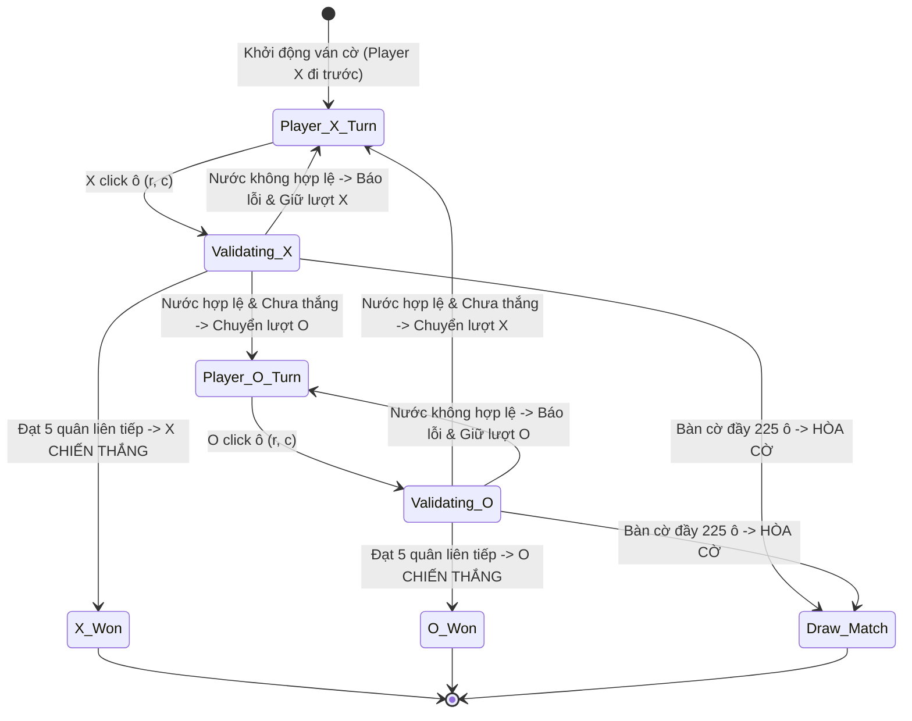

# 👥 XÂY DỰNG CHẾ ĐỘ HAI NGƯỜI CHƠI (PLAYER VS PLAYER - PVP)

## 1. BẢN ĐẶC TẢ CHẾ ĐỘ PVP (LOCAL HOTSEAT)

Chế độ **Player vs Player (PvP)** là chế độ nền tảng đầu tiên của hệ thống, cho phép hai người chơi đối kháng trực tiếp trên cùng một màn hình thiết bị:
* **Người chơi 1:** Cầm quân X (màu Đen), luôn luôn được ưu tiên đi trước nước đầu tiên.
* **Người chơi 2:** Cầm quân O (màu Trắng), đi nước thứ hai.
* **Cơ chế luân phiên:** Sau khi một bên đặt quân hợp lệ, hệ thống tự động khóa ô cờ và chuyển quyền điều khiển sang cho người đối diện.

---

## 2. CÁC THÀNH PHẦN GIAO DIỆN HỖ TRỢ PVP

1. **Thanh chỉ báo lượt chơi (Turn Indicator Banner):**
   * Hiển thị biểu tượng quân cờ X hoặc O to rõ kèm chữ *"Đến lượt Người chơi X"* hoặc *"Đến lượt Người chơi O"*.
   * Đổi màu nền tương ứng để tạo phản hồi thị giác tức thì cho hai người chơi.
2. **Đồng hồ bấm giờ (Turn & Match Timers):**
   * **Turn Timer:** Đếm ngược thời gian cho mỗi nước đi (ví dụ: $30\text{s}$ cho mỗi lượt). Nếu hết giờ có thể xử thua hoặc cảnh báo âm thanh.
   * **Match Timer:** Đếm tổng thời gian của cả ván đấu phục vụ mục đích thống kê.
3. **Bảng kết thúc ván cờ (Game Over Modal):**
   * Xuất hiện nhẹ nhàng (Fade-in Modal) khi có người chiến thắng hoặc hòa cờ.
   * Hiển thị số nước đi đã hoàn thành và thời lượng ván đấu.
   * Hai nút hành động: **"Chơi Lại (Rematch)"** (giữ nguyên cài đặt) hoặc **"Ván Mới (New Game)"**.

---

## 3. GIẢI QUYẾT XUNG ĐỘT TƯƠNG TÁC (CONCURRENCY SAFETY)

* Trong môi trường web, nếu người chơi click đúp (Double-click) hoặc chạm liên tục nhiều ngón tay trên màn hình cảm ứng, có thể phát sinh nhiều sự kiện song song.
* **Biện pháp bảo vệ:** Đặt một biến cờ `isProcessingMove` tại `GameController`. Khi một sự kiện click đang được kiểm tra tính hợp lệ và cập nhật state, mọi click khác trong khoảng thời gian $\Delta t < 50\text{ms}$ sẽ bị chặn lập tức, ngăn ngừa hiện tượng sinh 2 quân cờ cùng một lúc.
