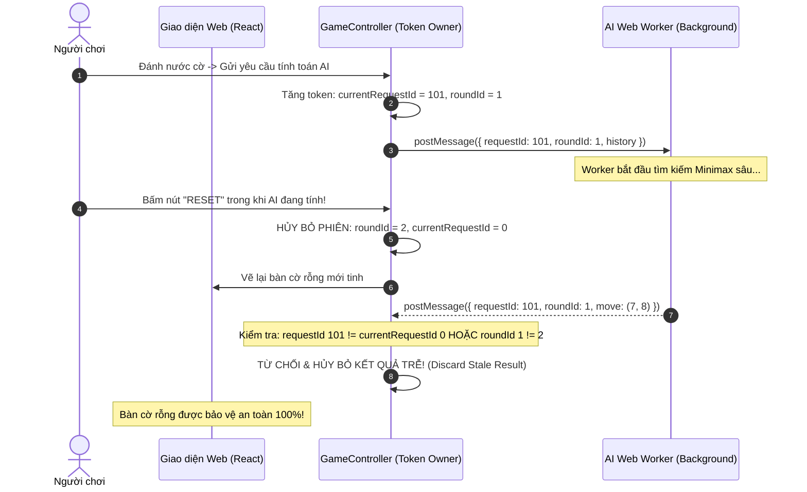

# 🔄 QUẢN LÝ VÒNG ĐỜI VÁN CỜ: NEW GAME, RESET & UNDO

## 1. PHÂN BIỆT RÕ RÀNG BA TÁC VỤ VÒNG ĐỜI

| Tác vụ | Hành vi trạng thái bàn cờ | Hành vi cấu hình ván cờ | Trạng thái AI tính toán ngầm |
| :--- | :--- | :--- | :--- |
| **Reset** | Xóa sạch bàn cờ về rỗng, xóa lịch sử `history = []`, đưa lượt về Player X. | **Giữ nguyên $100\%$:** Giữ chế độ chơi, giữ cấp độ Bot, giữ cấu hình luật. | **Hủy bỏ lập tức:** Vô hiệu hóa mọi tính toán AI đang chạy. |
| **New Game** | Xóa bàn cờ về rỗng, mở hộp thoại chọn lại cấu hình ban đầu. | Cho phép người chơi đổi quân (X/O), đổi luật (Freestyle / Caro VN), đổi cấp độ Bot. | **Hủy bỏ lập tức & Khởi tạo Worker mới**. |
| **Undo (PvP)** | Hoàn tác chính xác **$1$ nước đi** gần nhất, trả lượt về cho đối thủ vừa đánh. | Giữ nguyên cấu hình. | Không áp dụng trong PvP. |
| **Undo (PvBot)**| Hoàn tác **$2$ nước đi liên tiếp** (gồm $1$ nước của Bot và $1$ nước của Player). | Giữ nguyên cấu hình. | **Hủy bỏ tính toán AI hiện tại** nếu Bot đang suy nghĩ. |

---

## 2. CƠ CHẾ BẢO VỆ CHỐNG KẾT QUẢ AI TRỄ (STALE AI RESPONSE GUARD)

Trong chế độ Player vs Bot, thuật toán AI chạy trong Web Worker bất đồng bộ. Nếu người chơi bấm **Reset** hoặc **Undo** trong lúc Bot đang tính toán, kết quả tính toán của Bot có thể gửi về sau đó vài trăm mili-giây và ghi đè quân cờ cũ lên bàn cờ mới được xóa $\rightarrow$ **Lỗi phá hỏng ván cờ (Stale State Corruption)**.

Để triệt tiêu lỗi này, hệ thống áp dụng cơ chế **Thẻ định danh phiên (Turn Token & Round ID Guard)**:



---

## 3. MÃ NGUỒN BẢO VỆ GIAO DỊCH TẠI GAMECONTROLLER

Đoạn mã trích xuất từ [10_caro/src/app/GameController.ts](file:///home/pro/Downloads/intern/onprogress/10_caro/src/app/GameController.ts) thể hiện tính an toàn tuyệt đối của cơ chế này:

```typescript
export class GameController {
  private roundId: number = 1;
  private currentAiRequestId: number = 0;

  public resetGame(): void {
    // 1. Vô hiệu hóa toàn bộ yêu cầu AI trước đó bằng cách thay đổi roundId
    this.roundId += 1;
    this.currentAiRequestId = 0;

    // 2. Reset Engine về trạng thái rỗng ban đầu
    this.engine.reset();

    // 3. Cập nhật và phát tán Snapshot mới
    this.emitState();
  }

  public handleAiResponse(requestId: number, responseRoundId: number, bestMove: { row: number; col: number }): void {
    // Khóa bảo vệ: Nếu phiên đã bị Reset hoặc Request ID không khớp, lập tức bỏ qua
    if (responseRoundId !== this.roundId || requestId !== this.currentAiRequestId) {
      console.warn(`[GameController] Đã loại bỏ kết quả AI trễ (RequestId: ${requestId}, RoundId: ${responseRoundId})`);
      return;
    }

    // Cam kết nước đi nếu token hoàn toàn hợp lệ
    this.engine.makeMove(bestMove.row, bestMove.col);
    this.emitState();
  }
}
```

*Kết luận:* Việc áp dụng Turn Token giúp vòng đời ván đấu hoàn toàn miễn nhiễm với các lỗi bất đồng bộ và xung đột luồng khi chơi với AI.
