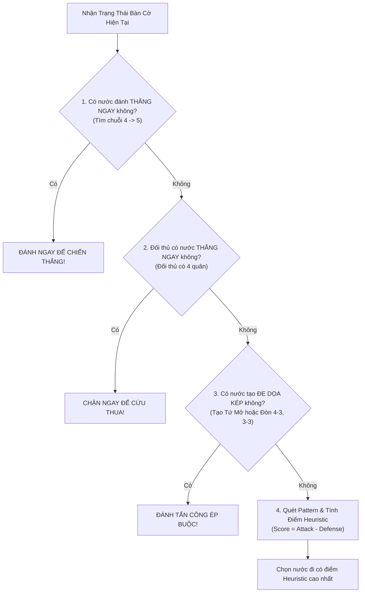

# 🤖 TUẦN 04: TỔNG QUAN XÂY DỰNG BOT CƠ BẢN, PATTERNS & HEURISTIC

## 🎯 1. MỤC TIÊU TUẦN 4
1. **Xây dựng Bot ngẫu nhiên (Random Bot - Easy Level):** Cơ chế chọn nước đi ngẫu nhiên từ tập ô trống hợp lệ, hỗ trợ Seed giả ngẫu nhiên phục vụ tái lập thực nghiệm khoa học.
2. **Xây dựng Bot theo luật chiến thuật tức thời (Rule-Based Bot - Normal Level):** Hệ luật chuyên gia ưu tiên $1\text{-ply}$: Đánh thắng ngay nếu có cơ hội $\rightarrow$ Chặn ngay nếu đối thủ chuẩn bị thắng $\rightarrow$ Đánh chiếm ô có lợi thế cục bộ.
3. **Phát triển Bộ quét nhận diện chuỗi quân (Pattern Detection Engine):** Tự động phát hiện và phân loại các chuỗi cờ chiến thuật: *Five*, *Straight Four (Tứ Mở)*, *Four (Tứ Chặn)*, *Open Three (Tam Mở)*, *Broken Three (Tam Cách)*, *Blocked Three*, *Two (Nhị)*.
4. **Xây dựng Hàm đánh giá thế cờ (Heuristic Evaluation Function):** Mô hình hóa điểm số thế trận theo công thức:
   $$\text{Evaluation Score} = \text{Attack Score} - \text{Defense Score}$$
   Đóng vai trò là "bộ não" đánh giá các trạng thái nút lá cho toàn bộ các thuật toán Minimax và Alpha-Beta ở các tuần tiếp theo.

---

## 🗺️ 2. THANG ĐO CHIẾN THUẬT BOT TẦNG NỀN TẢNG (MERMAID)

---

## 📚 3. TÀI LIỆU CHI TIẾT TRONG TUẦN 4

1. [[01_Xay_Dung_Random_Bot|01. Xây dựng Random Bot (Thuật toán chọn ngẫu nhiên có kiểm soát Seed)]]
2. [[02_Xay_Dung_Rule_Based_Bot|02. Xây dựng Rule-Based Bot (Hệ thống quy tắc ưu tiên chiến thuật 1-ply)]]
3. [[03_Xay_Dung_Pattern_Detection|03. Bộ quét nhận diện mẫu hình chiến thuật (Pattern Detection)]]
4. [[04_Xay_Dung_Heuristic_Evaluation|04. Xây dựng hàm đánh giá cục diện Heuristic (Attack vs Defense)]]
