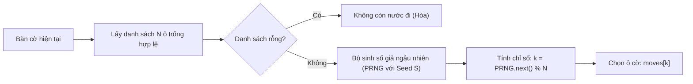

# 🎲 XÂY DỰNG RANDOM BOT (MỨC ĐỘ DỄ - BASELINE B0)

## 1. VAI TRÒ HỌC THUẬT CỦA RANDOM BOT
Trong nghiên cứu Trí tuệ nhân tạo, một tác tử ngẫu nhiên (Random Agent) không đơn thuần là "mức độ chơi dễ nhất cho người mới bắt đầu", mà nó đóng vai trò là **Mốc đối chiếu cơ sở (Baseline B0)**:
* Bất kỳ thuật toán AI có trí tuệ nào (Rule-based, Minimax, Alpha-Beta) bắt buộc phải đạt tỷ lệ thắng **$100\%$** trước Random Bot khi đi trước và tối thiểu **$\ge 95\%$** khi đi sau.
* Là công cụ kiểm tra độ bền hệ thống (Stress Testing): Cho 2 Random Bot tự động chơi hàng ngàn ván cờ với tốc độ cao để kiểm tra xem có phát sinh lỗi rò rỉ bộ nhớ hay vi phạm luật bàn cờ hay không.

---

## 2. NGUYÊN LÝ LỰA CHỌN NƯỚC ĐI VÀ TÍNH TÁI LẬP (REPRODUCIBILITY)

Để đảm bảo các thực nghiệm khoa học có thể tái lặp $100\%$ (Reproducible Experiments), thuật toán Random Bot phải hỗ trợ **Hạt giống giả ngẫu nhiên (PRNG Seed)** thay vì chỉ dùng `Math.random()` không thể kiểm soát:



---

## 3. HIỆN THỰC HÓA BẰNG RUST (SPLITMIX64 PRNG)

Trích xuất từ module [caro-core-reference/src/bot/random.rs](file:///home/pro/Downloads/vnuk/basicProject/caro-core-reference/src/bot/random.rs):

```rust
pub struct SplitMix64 {
    state: u64,
}

impl SplitMix64 {
    pub fn new(seed: u64) -> Self {
        Self { state: seed }
    }

    pub fn next_u64(&mut self) -> u64 {
        self.state = self.state.wrapping_add(0x9E3779B97F4A7C15);
        let mut z = self.state;
        z = (z ^ (z >> 30)).wrapping_mul(0xBF58476D1CE4E5B9);
        z = (z ^ (z >> 27)).wrapping_mul(0x94D049BB133111EB);
        z ^ (z >> 31)
    }
}

pub struct RandomBot {
    rng: SplitMix64,
}

impl RandomBot {
    pub fn new(seed: u64) -> Self {
        Self { rng: SplitMix64::new(seed) }
    }

    pub fn select_move(&mut self, state: &GameState) -> Option<usize> {
        let available = state.available_moves();
        if available.is_empty() {
            return None;
        }
        let index = (self.rng.next_u64() as usize) % available.len();
        Some(available[index])
    }
}
```

---

## 4. HIỆN THỰC HÓA BẰNG TYPESCRIPT

```typescript
export class RandomBot {
  constructor(private seed: number = Date.now()) {}

  // Bộ sinh số giả ngẫu nhiên LCG (Linear Congruential Generator)
  private nextRandom(): number {
    this.seed = (this.seed * 9301 + 49297) % 233280;
    return this.seed / 233280;
  }

  public getMove(board: Board): { row: number; col: number } | null {
    const availableMoves: { row: number; col: number }[] = [];
    const size = board.length;

    for (let r = 0; r < size; r++) {
      for (let c = 0; c < size; c++) {
        if (board[r][c] === Player.None) {
          availableMoves.push({ row: r, col: c });
        }
      }
    }

    if (availableMoves.length === 0) return null;

    // Nước đầu tiên nếu bàn cờ trống hoàn toàn: Ưu tiên chiếm tâm
    if (availableMoves.length === size * size) {
      const center = Math.floor(size / 2);
      return { row: center, col: center };
    }

    const randomIndex = Math.floor(this.nextRandom() * availableMoves.length);
    return availableMoves[randomIndex];
  }
}
```
