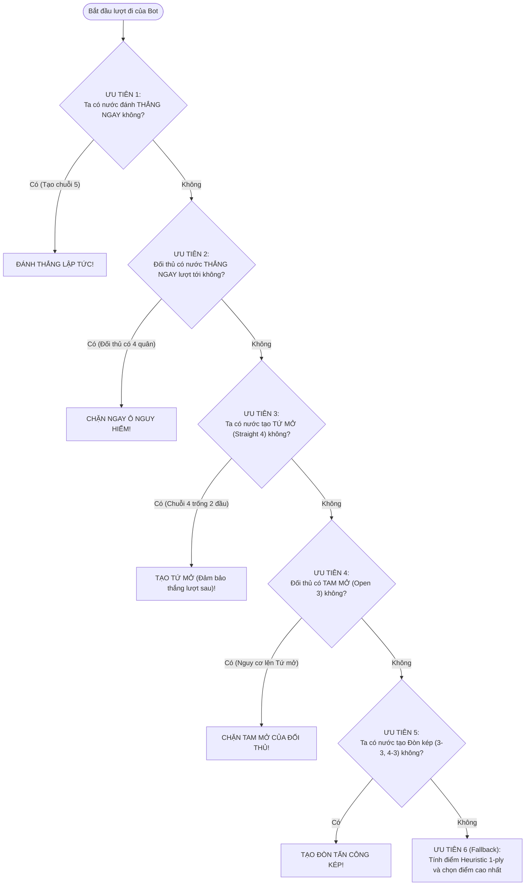

# 🛡️ XÂY DỰNG RULE-BASED BOT (MỨC ĐỘ TRUNG BÌNH - NORMAL)

## 1. NGUYÊN LÝ HỆ CHUYÊN GIA DỰA TRÊN LUẬT (RULE-BASED EXPERT SYSTEM)

Một người chơi Cờ Caro trung bình không cần phải tính toán sâu hàng chục nước đi mà dựa chủ yếu vào các **quy tắc phản xạ chiến thuật $1\text{-ply}$**.

Thuật toán Rule-Based Bot áp dụng một cây quyết định ưu tiên nghiêm ngặt (Strict Priority Hierarchy):



---

## 2. HIỆN THỰC HÓA BẰNG RUST

Trích xuất từ module chuẩn [caro-core-reference/src/bot/rule_based.rs](file:///home/pro/Downloads/vnuk/basicProject/caro-core-reference/src/bot/rule_based.rs):

```rust
pub struct RuleBasedBot;

impl RuleBasedBot {
    pub fn select_move(state: &mut GameState, rule: RuleConfig) -> Option<usize> {
        let me = state.to_move();
        let opponent = me.opponent();
        let candidates = state.candidate_moves(2);

        // 1. Kiểm tra nước thắng ngay của bản thân (Tự thắng)
        for &mv in &candidates {
            let undo = state.play(mv).ok()?;
            let won = state.status() == GameStatus::Won(me);
            state.undo(undo);
            if won {
                return Some(mv);
            }
        }

        // 2. Kiểm tra nước thắng của đối thủ (Chặn thua tức thời)
        for &mv in &candidates {
            // Giả lập đối thủ đánh vào ô mv
            state.set_player(opponent);
            let undo = state.play(mv).ok()?;
            let opponent_wins = state.status() == GameStatus::Won(opponent);
            state.undo(undo);
            state.set_player(me);

            if opponent_wins {
                return Some(mv); // Chặn ngay!
            }
        }

        // 3. Fallback: Chọn nước có điểm Heuristic cao nhất trong tập ứng viên
        heuristic_best_move(state, &candidates)
    }
}
```

---

## 3. HIỆU QUẢ VÀ GIỚI HẠN CỦA RULE-BASED BOT

* **Ưu điểm vượt trội:**
  * Tốc độ phản hồi cực nhanh: Chỉ cần duyệt $1\text{-ply}$ trên khoảng $10 \sim 25$ ô ứng viên $\rightarrow$ Thời gian tính toán $< 1\text{ms}$.
  * Chấm dứt hoàn toàn các sai lầm ngớ ngẩn (như không nhìn thấy nước 4 của đối thủ để bị thua lãng xẹt).
* **Nhược điểm cốt lõi (Tầm nhìn thiển cận - Horizon Effect):**
  * Rule-Based Bot không thể nhìn thấy các đòn phục kích từ xa (ví dụ: bẫy 3 bước, bẫy VCF - Victory of Continuous Fours).
  * Đây là lý do đòi hỏi sự ra đời của **Minimax và Alpha-Beta Pruning** ở Tuần 5 và Tuần 6 để đào sâu cây trò chơi.
