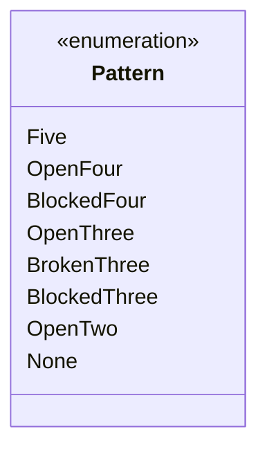

# 🔍 BỘ QUÉT NHẬN DIỆN MẪU HÌNH CHIẾN THUẬT (PATTERN DETECTION)

## 1. PHÂN LOẠI CÁC MẪU HÌNH CHIẾN THUẬT (TACTICAL PATTERNS)

Trong Cờ Caro, cục diện được cấu thành từ các chuỗi quân liên tiếp trên 4 trục. Bộ quét mẫu hình (Pattern Detector) phân loại các chuỗi cờ thành các mức độ đe dọa (Threat Levels):



### Bảng định nghĩa hình thái các mẫu hình:

| Mẫu hình (Pattern) | Chuỗi đại diện (`0`: Trống, `1`: Quân ta, `2`: Địch/Biên) | Mức độ nguy hiểm | Ý nghĩa chiến thuật |
| :--- | :---: | :---: | :--- |
| **1. Năm quân (Five)** | `1 1 1 1 1` | **Vô địch (Win)** | Đã chiến thắng ván cờ |
| **2. Tứ mở (Open Four / Straight 4)** | `0 1 1 1 1 0` | **Tuyệt đối (100% Win)** | Đe dọa 2 đầu $\rightarrow$ Chắc chắn thắng ở lượt sau |
| **3. Tứ chặn (Blocked Four)** | `2 1 1 1 1 0` hoặc `0 1 1 1 1 2` | **Rất cao (Forcing)** | Buộc đối thủ phải chặn ngay lập tức |
| **4. Tứ cách (Broken Four)** | `0 1 1 0 1 1 0` hoặc `0 1 0 1 1 1 0` | **Rất cao (Forcing)** | Tương đương Tứ chặn nhưng có khe trống ở giữa |
| **5. Tam mở (Open Three)** | `0 0 1 1 1 0` hoặc `0 1 1 1 0 0` | **Cao (Pre-Threat)** | Có thể phát triển lên Tứ mở nếu không bị chặn |
| **6. Tam cách (Broken Three)** | `0 1 0 1 1 0` hoặc `0 1 1 0 1 0` | **Cao (Pre-Threat)** | Đòn phục kích khó phát hiện |
| **7. Tam chặn (Blocked Three)** | `2 1 1 1 0 0` | **Trung bình** | Ít nguy hiểm hơn tam mở |
| **8. Nhị mở (Open Two)** | `0 0 1 1 0 0` hoặc `0 1 0 1 0 0` | **Thấp (Xây dựng)** | Nền tảng phát triển thế trận từ xa |

---

## 2. THUẬT TOÁN CỬA SỔ TRƯỢT (SLIDING WINDOW ALGORITHM)

Để nhận diện mẫu hình mà không bỏ sót và không tính trùng lặp, thuật toán trích xuất các dải ô có độ dài $6$ ô (chuỗi độ dài $6$ đủ để xác định trạng thái mở/chặn của chuỗi $4$ hoặc $5$ quân) dọc theo 4 hướng:

```rust
#[derive(Debug, Clone, Copy, PartialEq, Eq)]
pub enum PatternType {
    Five,
    OpenFour,
    BlockedFour,
    OpenThree,
    BlockedThree,
    OpenTwo,
    None,
}

pub fn classify_window_6(window: [i8; 6], player: i8) -> PatternType {
    let opponent = -player;
    // Kiểm tra Five
    let count = window.iter().filter(|&&c| c == player).count();
    if count == 5 {
        return PatternType::Five;
    }

    // Kiểm tra Open Four: 0 1 1 1 1 0
    if window == [0, player, player, player, player, 0] {
        return PatternType::OpenFour;
    }

    // Kiểm tra Blocked Four: 2 1 1 1 1 0 hoặc 0 1 1 1 1 2
    if (window[0] == opponent && window[1..5] == [player, player, player, player] && window[5] == 0)
        || (window[0] == 0 && window[1..5] == [player, player, player, player] && window[5] == opponent)
    {
        return PatternType::BlockedFour;
    }

    // Kiểm tra Open Three: 0 1 1 1 0 0 hoặc 0 0 1 1 1 0
    if window == [0, player, player, player, 0, 0] || window == [0, 0, player, player, player, 0] {
        return PatternType::OpenThree;
    }

    PatternType::None
}
```

---

## 3. Ý NGHĨA CHO THUẬT TOÁN TÌM KIẾM CÂY
Bộ nhận diện mẫu hình này cung cấp 2 giá trị cốt tử:
1. **Move Ordering:** Trong thuật toán Alpha-Beta, nếu một nước đi tạo ra `OpenFour` hoặc `OpenThree`, nước đó sẽ được gán trọng số ưu tiên cao nhất để được duyệt đầu tiên $\rightarrow$ Kích hoạt cắt tỉa Alpha-Beta sớm nhất có thể.
2. **Heuristic Evaluation:** Đếm số lượng mẫu hình của Ta và Địch để tính toán điểm số tổng quát của bàn cờ.
