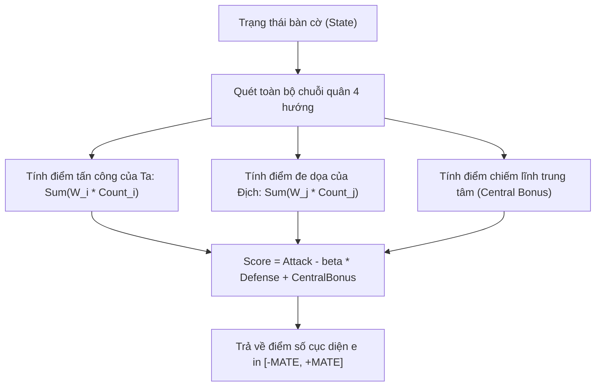

# ⚖️ XÂY DỰNG HÀM ĐÁNH GIÁ CỤC DIỆN HEURISTIC (ATTACK VS DEFENSE)

## 1. CÔNG THỨC TOÁN HỌC CỦA HÀM LƯỢNG GIÁ

Hàm đánh giá cục diện (Evaluation Function) gán một giá trị số thực hoặc số nguyên cho một trạng thái bàn cờ bất kỳ từ góc nhìn của người chơi $P$ (Root Player):

$$\mathcal{E}(\text{State}, P) = \text{Score}_{\text{Attack}}(P) - \beta \cdot \text{Score}_{\text{Defense}}(\text{Opponent}(P)) + \text{Bonus}_{\text{Positional}}$$

Trong đó:
* $\text{Score}_{\text{Attack}}(P)$: Tổng điểm chiến thuật từ các chuỗi quân của người chơi $P$.
* $\text{Score}_{\text{Defense}}(\text{Opponent}(P))$: Mối đe dọa tiềm tàng từ các chuỗi quân của đối phương.
* $\beta$: Hệ số ưu tiên phòng thủ (thường chọn $\beta \in [1.1, 1.3]$ để Bot thiên về phòng thủ an toàn, không chủ quan trước các bẫy của đối thủ).
* $\text{Bonus}_{\text{Positional}}$: Điểm thưởng vị trí ô cờ gần trung tâm bàn cờ (Central Dominance).



---

## 2. BẢNG TRỌNG SỐ CHIẾN THUẬT (PATTERN WEIGHT TABLE)

Hệ thống trọng số được chuẩn hóa trong module [caro-core-reference/src/evaluator.rs](file:///home/pro/Downloads/vnuk/basicProject/caro-core-reference/src/evaluator.rs) và [gomoku-main/engine/src/eval.rs](file:///home/pro/Downloads/intern/onprogress/gomoku-main/engine/src/eval.rs):

| Mẫu hình chiến thuật | Ký hiệu hình thái | Điểm số tấn công ($W_{\text{attack}}$) | Điểm số phòng thủ ($W_{\text{defense}}$) |
| :--- | :---: | :---: | :---: |
| **Năm quân (Win / Mate)** | `1 1 1 1 1` | **$1,000,000$** | **$1,000,000$** |
| **Tứ mở (Straight Four)** | `0 1 1 1 1 0` | **$100,000$** | **$150,000$** (Bắt buộc chặn) |
| **Tứ chặn (Blocked Four)** | `2 1 1 1 1 0` | **$10,000$** | **$12,000$** |
| **Tam mở (Open Three)** | `0 1 1 1 0 0` | **$5,000$** | **$8,000$** |
| **Tam chặn (Blocked Three)** | `2 1 1 1 0 0` | **$500$** | **$600$** |
| **Nhị mở (Open Two)** | `0 0 1 1 0 0` | **$100$** | **$120$** |
| **Điểm thưởng trung tâm** | Khoảng cách Manhattan tới `(7, 7)` | Tối đa **$+20$** điểm / quân | Tối đa **$+20$** điểm / quân |

---

## 3. HIỆN THỰC HÓA BẰNG RUST

```rust
pub const MATE_SCORE: i32 = 1_000_000;

pub fn evaluate(state: &GameState, root: Player, weights: WeightTable) -> i32 {
    let status = state.status();
    match status {
        GameStatus::Won(p) if p == root => return MATE_SCORE,
        GameStatus::Won(p) => return -MATE_SCORE,
        GameStatus::Draw => return 0,
        GameStatus::Playing => {}
    }

    let opponent = root.opponent();
    let mut my_score = 0;
    let mut op_score = 0;

    // 1. Tính điểm chuỗi quân trên toàn bàn cờ
    let my_patterns = state.detect_patterns(root);
    let op_patterns = state.detect_patterns(opponent);

    my_score += my_patterns.open_fours * weights.open_four;
    my_score += my_patterns.blocked_fours * weights.blocked_four;
    my_score += my_patterns.open_threes * weights.open_three;
    my_score += my_patterns.open_twos * weights.open_two;

    op_score += op_patterns.open_fours * (weights.open_four * 12 / 10);
    op_score += op_patterns.blocked_fours * (weights.blocked_four * 12 / 10);
    op_score += op_patterns.open_threes * (weights.open_three * 13 / 10);
    op_score += op_patterns.open_twos * weights.open_two;

    // 2. Điểm thưởng vị trí trung tâm (Center Proximity)
    let my_center = state.center_bonus(root);
    let op_center = state.center_bonus(opponent);

    (my_score - op_score) + (my_center - op_center)
}
```

---

## 4. BỘ KIỂM CHỨNG ĐƠN VỊ CỦA HÀM HEURISTIC (UNIT TEST VERIFICATION)

Trong test suite của `gomoku-engine` và `caro-core-reference` đã pass:
1. `test_empty_board_score_zero`: Bàn cờ rỗng hoàn toàn có điểm đánh giá chính xác bằng $0$.
2. `test_center_bonus`: Nước đi ở trung tâm `(7, 7)` có điểm cao hơn nước đi ở góc bàn cờ `(0, 0)`.
3. `test_three_in_row_scores_higher_than_two`: Thế trận có 3 quân liên tiếp luôn có điểm số cao vượt trội so với thế trận 2 quân.
4. `test_opponent_stones_negative`: Quân của đối thủ làm giảm điểm tổng quát của bàn cờ từ góc nhìn quân Ta.
