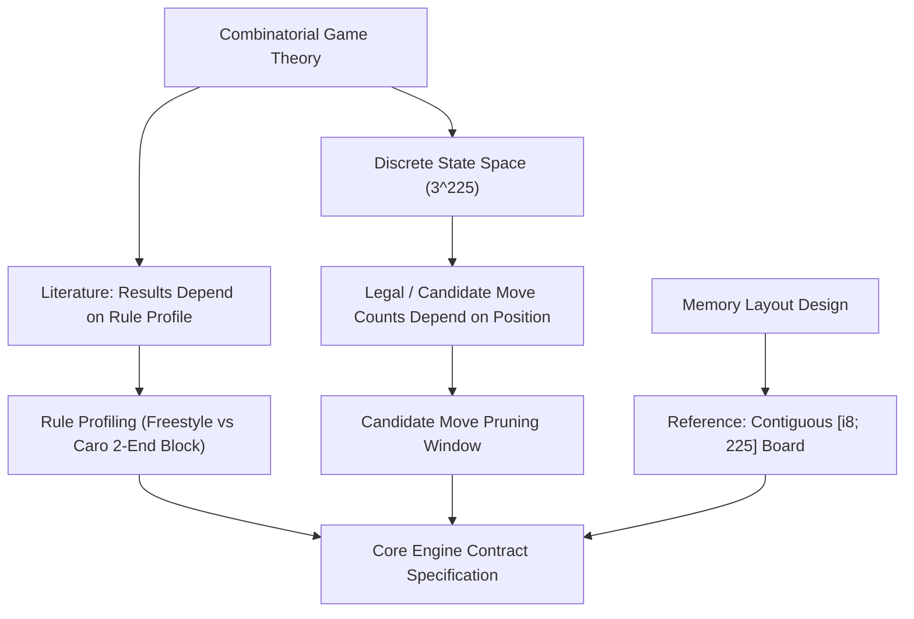

# Tuần 01 — Mô hình toán học, biểu diễn bộ nhớ và cấu trúc Rust

**Snapshot hiện tại: 23/10/2026.** Phần tiếng Việt này là bản cập nhật hiện trạng; phần báo cáo tiếng Anh bên dưới được giữ làm hồ sơ lịch sử. [A] là source hoặc kết quả thực chạy có log; [B] là tài liệu chính thức; [C] là suy luận có giả thiết; [D] là thiết kế/đề xuất chưa đủ evidence. Trạng thái test của lần cập nhật được chốt tại [GATES.md](../research/current_2026_10_23/GATES.md), không suy từ trạng thái của báo cáo cũ. [A] Bản cập nhật đã có native game tests, release experiment, package mới và real-browser Worker evidence; giới hạn từng môi trường ghi riêng. Phân tích liên tuần nằm trong [mô hình và quyết định hiện tại](../BasicProject_Current_Math_and_Design.md).

## 1. Yêu cầu và nguồn có thẩm quyền

Tuần này định nghĩa một bàn cờ hữu hạn, phép đổi tọa độ, trạng thái quân và điều kiện dùng một biểu diễn Rust. Source game là `../gomoku-main/engine/src/board.rs`; nguồn UI là `../10_caro/src/game/core/BoardBounds.ts`, `GameState.ts` và `WinRules.ts`. `caro-core-reference` là implementation nghiên cứu riêng. Một số đo của reference không phải số đo game Rust/WASM.

Lịch tuần hiện có hai cách phân nhóm. Bản kế hoạch và W7 Google Docs đã được đọc trực tiếp trong lần làm ngày 23/10; nó yêu cầu W7 gồm candidate, ordering và sáu mức khó. Mapping thuật toán sang sáu mức dưới đây là đề xuất triển khai của lần này, không phải số liệu sức mạnh đã được kế hoạch chứng nhận.

| Nội dung | Backbone `Week_XX` lịch sử | Kế hoạch/Google Docs đang đối chiếu | Cách ghi trong bản cập nhật |
| --- | --- | --- | --- |
| Nền tảng, core, UI, heuristic | W1–W4 | W1–W4 | Giữ tuần, sửa claim theo source hiện tại |
| Minimax; Alpha-Beta | W5; W6 | W5; W6 | Giữ tuần và cùng cây khi so sánh |
| Candidates, ordering, difficulty | W7; W8 ordering; difficulty phân tán | W7 gồm cả ba | Bản W7 hiện tại bao phủ cả ba; W8 cũ là nghiên cứu ordering riêng |
| Iterative Deepening, Zobrist, TT | W9 TT/Zobrist; W10 ID | W8 | Ghi khác lịch; không coi chúng là điều kiện code W7 đã đạt |
| Đánh giá, tournament, bảo vệ | W10 | W9–W10 | Chưa suy ra kết quả tournament từ native tests |

## 2. Bước 1 — Định nghĩa ma trận 15 × 15

Đặt tọa độ UI là `(row,col)` và tọa độ API Rust là `(x,y)=(col,row)`. Miền là

$$
\Omega=\{0,\ldots,14\}^2,\qquad |\Omega|=15\cdot15=225.
$$

Bàn cờ là hàm $B:\Omega\to\{0,1,2\}$ với `0=Empty`, `1=Black/X`, `2=White/O`. Dạng ma trận:

$$
B=\begin{bmatrix}
b_{0,0}&b_{0,1}&\cdots&b_{0,14}\\
b_{1,0}&b_{1,1}&\cdots&b_{1,14}\\
\vdots&\vdots&\ddots&\vdots\\
b_{14,0}&b_{14,1}&\cdots&b_{14,14}
\end{bmatrix}.
$$

[C] Có $3^{225}$ cách gán ba giá trị độc lập. Đây là cận trên raw configurations: nhiều ma trận sai số lượt, chứa hai bên cùng thắng hoặc chỉ đạt được sau một trạng thái vốn đã kết thúc. Không gọi $3^{225}$ là số ván hợp lệ.

## 3. Bước 2 — Đổi chỉ số, rồi mới suy ra địa chỉ

Duyệt từng hàng tạo ánh xạ song ánh:

$$
i=15y+x,\quad x=i\bmod15,\quad y=\lfloor i/15\rfloor,\quad0\le i<225.
$$

Ví dụ ô trung tâm `(x,y)=(7,7)` có $i=112$; ô `(14,14)` có $i=224$. Công thức giúp kiểm serialization/adapter, không tự thay đổi board 2D thành board 1D.

[B] Rust bảo đảm các phần tử array liên tiếp theo kích thước phần tử. Với `cells: [[Cell;15];15]`, địa chỉ **tương đối từ đầu array cells**, không phải từ đầu struct `Board`, là

$$
\operatorname{addr}(b_{y,x})=a+(15y+x)\operatorname{size\_of}(Cell).
$$

`Cell` dùng `#[repr(u8)]` với ba variant không có payload, nên một ô chiếm một byte; array chiếm 225 byte. `Board` còn `move_count` và padding/alignment, vì vậy không kết luận toàn `Board` có 225 byte hay nằm đúng bốn cache line. Offset của trường trong struct mặc định không phải ABI cố định. [Rust Reference: layout](https://doc.rust-lang.org/reference/type-layout.html#array-layout).

## 4. Bước 3 — Phân biệt số ô trống và số đường tìm kiếm

Sau $k$ quân hợp lệ, số ô trống là $A_k=225-k$. Nếu bỏ điều kiện thắng và mọi restriction, số chuỗi thêm $d$ nước phân biệt là

$$
L(k,d)=\prod_{j=0}^{d-1}(225-k-j)=\frac{(225-k)!}{(225-k-d)!}.
$$

Đây là cận cho cây search toàn bộ; terminal sớm, candidate và pruning có thể giảm nó. Một nước đi kiểm tra thắng tối đa 32 ô lân cận trong scanner hiện tại, nhưng search nhiều nước có thể xét hàng nghìn node. Hai số đo khác nhau: chi phí rule check cho **một** node và tổng node trong cây.

## 5. Pseudocode trước code

```text
EncodeCell(row, col)
  require 0 <= row < 15 and 0 <= col < 15
  return row * 15 + col
DecodeCell(index)
  require 0 <= index < 225
  return (row = index div 15, col = index mod 15)
ReadRustCell(row, col)
  map x = col, y = row
  return Board.get_checked(x, y)
```

Đây là mô tả contract; code array không cần tự tạo raw pointer để thực hiện phép tính.

## 6. Trích source và ý nghĩa OOP theo Rust

[A] Đoạn khai báo thật trong `gomoku-main/engine/src/board.rs`, `Cell`, `Board` và `Board::get_checked`:

```rust
#[repr(u8)]
pub enum Cell {
    Empty,
    Black,
    White,
}
```

```rust
pub struct Board {
    cells: [[Cell; SIZE]; SIZE],
    move_count: usize,
}
```

```rust
pub fn get_checked(&self, x: usize, y: usize) -> Option<Cell> {
    self.cells.get(y).and_then(|row| row.get(x)).copied()
}
```

`struct` giữ dữ liệu, `impl` giữ hành vi, field private bảo vệ invariant; `Game` chứa `Board` là composition. Rust không có class inheritance để một struct tự kế thừa field/method của struct cha. Nếu cần nhiều hành vi có cùng contract thì cân nhắc trait/generic; chưa có nhu cầu thì enum/match gọn hơn. [Rust Book: OOP](https://doc.rust-lang.org/book/ch18-01-what-is-oo.html).

`&Board` mượn để đọc và `&mut Board` mượn để sửa là cách biểu diễn ownership cần thiết cho search. Tính địa chỉ để hiểu layout không đồng nghĩa cần dereference raw pointer. [Rust Book: borrowing](https://doc.rust-lang.org/book/ch04-02-references-and-borrowing.html).

## 7. Vì sao chọn, phương án khác và mức khó

| Lựa chọn | Có ích | Hạn chế/khó khăn | Có nên apply |
| --- | --- | --- | --- |
| Giữ array 2D 15×15 | Hợp tọa độ và layout liên tục; thay đổi nhỏ | Adapter phẳng cần mapping rõ | Có, cho core hiện tại |
| Array 1D `[Cell;225]` | Serialization/index thống nhất | Mọi chỗ phải tuân thủ $15y+x$; chưa có benchmark so sánh | Chỉ đổi khi có nhu cầu hoặc bằng chứng |
| Map sparse | Hợp UI state và truy vấn theo cell | Key/allocation khác array; không suy tốc độ từ Big-O | Giữ ở UI nếu contract đang đúng |
| Bitboard | Thao tác bit có thể hỗ trợ nhiều ô | 225 bit cần ít nhất bốn word 64-bit mỗi tập; mask biên/phép dịch phức tạp | Hoãn đến khi profile chỉ ra bottleneck |
| Raw pointer/`unsafe` | Có thể cần cho FFI đặc biệt | Phải tự chứng minh bounds, aliasing, lifetime; không có số đo lợi ích ở đây | Không thêm cho scanner 225 ô hiện tại |

Độ khó kỹ thuật: **2/5** cho tọa độ/array/invariant; tăng lên **4/5** nếu thay ABI hoặc raw pointer. Đây là mức khó triển khai, không phải cấp Easy/Master của bot.

## 8. Gate và evidence cần đọc

Namespace mới `BP26-*` không kế thừa ý nghĩa `FIX-RULE-*` từng bị dùng khác nhau ở W1/W2 cũ. `BP26-COORD-ROUNDTRIP` yêu cầu 225 cặp encode/decode đúng; `BP26-CELL-LAYOUT` yêu cầu kiểm `size_of` trên target đang build nếu công bố kích thước; `BP26-RULE-FREESTYLE` giữ luật $\ge5$ đang có. Các tên này là ID traceability, không phải tự tạo thêm test count. [A] Lần chạy game native release hiện tại kiểm **225 offset địa chỉ** trong [engine_address_offsets.csv](../research/current_2026_10_23/engine_address_offsets.csv); [engine_native_layout.json](../research/current_2026_10_23/engine_native_layout.json) đo `Cell=1 byte`, `Board=240 byte`, `usize=8 byte` trên x86_64-linux. Nó không đo layout Wasm. [wasm_ts_parity.json](../research/current_2026_10_23/wasm_ts_parity.json) ghi 18 case PASS hữu hạn, trong đó tám rule fixtures có 291 accepted plies và sáu rejected moves, cùng Undo/reset/profile/terminal qua binary mới và adapter thật; không phải all-state equivalence. G1/G4/G6 và log thực tế được chốt ở [gate registry](../research/current_2026_10_23/GATES.md). TMB xem ownership; Ponytail xem abstraction dư; unit/package/browser kiểm hành vi ở đúng boundary.

---

## Hồ sơ lịch sử — báo cáo trước snapshot 23/10/2026

> Nội dung dưới đây giữ để truy nguyên. Commit, số test, claim hoặc trạng thái lịch sử không tự là kết quả hiện tại; ưu tiên phần cập nhật và gate registry ở trên. Không thay lịch sử bằng một lần nghiệm thu mới.

# Week 01 Research Report: Mathematical Foundations, Game Theory, and Discrete State Space Representation

**Project Title:** Research, Design, and Implementation of an Optimized Gomoku Game Engine with Artificial Intelligence  
**Academic Module:** Basic Project (Đồ Án Cơ Sở) — Software Engineering & AI Track  
**Document Standard:** Standard 00 (IMRaD & Evidence Specification for Software Systems)  
**Control Layer Reference:** `RQ-W1-01`, `CFG-RULE-v1`, `FIX-RULE-001` to `FIX-RULE-005`  
**Implementation Sources:** [GitHub – tducn110/caro](https://github.com/tducn110/caro), the local `10_caro` and `gomoku-main` checkouts, and the separately labelled `caro-core-reference` crate  
**Language:** English  
**Status:** Local source review; rule-profile parity and experiment gates remain pending  

**Current review:** [Caro rules, heuristic, Rust and Wasm guide](../Caro_Rules_Heuristic_Rust_WASM_Review.md). Source inspection establishes the behavior described below; it does not establish runtime parity, browser integration, or performance results.

---

## 1. Plan & Research Questions

### 1.1 Problem Formulation
Gomoku (Five-in-a-Row) on a $15 \times 15$ board is an adversarial, two-player, zero-sum, perfect-information combinatorial game. The rule profile must be specified before terminal-state detection or AI evaluation can be compared. The large state space motivates bounded search and candidate generation; a particular real-time budget still requires measurement on the intended runtime and hardware.

### 1.2 Core Research Questions
1. **RQ-W1-01 (Combinatorial Complexity):** What are the exact theoretical bounds of Gomoku's state space size, game tree complexity, and effective branching factor on a $15 \times 15$ grid, and how do they constrain real-time search?
2. **RQ-W1-02 (Game-Theoretic Solvability):** What do Allis's 1994 Gomoku results and the strategy-stealing argument establish for their precise rule assumptions, and how do those assumptions differ from exact-five, Renju, and a project-defined Caro blocked-ends profile?
3. **RQ-W1-03 (Memory Representation):** How does contiguous 1D array representation compare against 2D nested arrays and 64-bit Bitboards in terms of cache locality, L1 cache hit rate, coordinate translation speed, and WebAssembly linear memory interoperability?



---

## 2. Background & Literature Citations

* **Literature reference — Allis, L. V. (1994).** *Searching for Solutions in Games and Artificial Intelligence.* Ph.D. Thesis, University of Limburg, Maastricht. The thesis is relevant to Gomoku solving and search; a claim about a particular game's solved outcome must cite the exact rule variant and passage. No such result is used here to validate the project's rules.
* **Literature question — strategy stealing.** The argument requires assumptions about the effect of adding a stone and does not select a fair opening rule or prove that a given implementation follows a particular Caro profile. The earlier attribution to Nash's 1950 thesis has not been established by this local source review.
* **Literature reference — Shannon, C. E. (1950).** *Programming a Computer for Playing Chess.* Background for bounded game-tree search and heuristic evaluation, rather than evidence of this implementation's correctness or performance.

---

## 3. Methods & Mathematical Analysis

### 3.1 Combinatorial State Space Calculation
A standard Gomoku board has $N = 15 \times 15 = 225$ intersections. Each cell $c \in \{0, 1, \dots, 224\}$ assumes one of three discrete states:
$$\text{CellState} \in \{\text{Empty}, \text{X}, \text{O}\}$$
These are logical states. The local Rust reference encodes them as signed bytes `0`, `1`, and `-1`; the TypeScript adapter must explicitly map any different encoding.

The theoretical upper bound on raw board configurations is:
$$|\mathcal{S}_{\text{raw}}| = 3^{225} \approx 2.250517 \times 10^{107}$$

If X starts and turns alternate, let $k_X=\lceil k/2\rceil$ and $k_O=\lfloor k/2\rfloor$. Counting boards with these stone counts gives the tighter upper bound:
$$|\mathcal{S}_{\text{reachable}}| \le \sum_{k=0}^{225} \frac{225!}{k_X! \cdot k_O! \cdot (225-k)!} \approx 1.462493 \times 10^{106}$$
This sum does not exclude boards whose move histories should already have terminated after a win, so it is not an exact count of legal reachable states or game-tree nodes. The two numerical values were recomputed locally using Python integer arithmetic.

### 3.2 Canonical Rule Decision Table (`CFG-RULE-v1`)

The current baseline and a possible Caro profile must be kept distinct. The following table records source behavior and the decisions still required; it does not claim that every profile is integrated into the application.

| Rule Dimension | Decision / Specification | Evidence Class | Repository Ground Truth |
| :--- | :--- | :---: | :--- |
| **Board Geometry** | $15 \times 15$ grid ($N = 225$) | `[A]` | Reference `model.rs::BOARD_SIZE` and `BOARD_CELLS` |
| **Current freestyle win** | A maximal contiguous run has length $\ge 5$ on any of four axes | `[A]` | Current baseline; reference `RuleConfig::freestyle()` and `line_is_win()` |
| **Exact-five option** | A maximal contiguous run must have length exactly 5; an overline on that axis is not a win | `[A]` reference only | `RuleConfig::exact_five()`; application profile selection still requires integration |
| **Caro blocked-ends option** | A qualifying run is disqualified when both ends are blocked | `[A]` reference / `[D]` application decision | `RuleConfig::blocked_ends(overline_wins, edge_counts_as_blocked)`; choose overline policy explicitly |
| **Board edge** | Freestyle ignores blocked ends; the proposed blocked-ends profile must decide whether an off-board endpoint is blocked | `[D]` application decision | Reference exposes `edge_counts_as_blocked`; no universal Vietnamese-rule claim is made |
| **Draw Condition** | After a legal move, report a win first; otherwise report a draw when the board is full | `[A]` reference | `state.rs::GameState::play()` checks win before `move_count == BOARD_CELLS` |
| **Turn Alternation** | X starts and O follows; switch only after a nonterminal legal move | `[A]` reference | `GameState::new()` and `GameState::play()`; X/O to Black/White is a display mapping |

For an axis through the last move, scan both directions to obtain the complete contiguous length $L=1+n_-+n_+$ and the two endpoint states. The rule predicate is:
$$\text{win}=\bigl(\text{overline\_wins}\ ?\ L\ge5:\ L=5\bigr)\ \land\ \neg\bigl(\text{blocked\_both\_ends\_disqualifies}\land B=2\bigr).$$
Here $B$ counts opponent endpoints and, only when configured, board edges. A separate qualifying axis still wins even if another axis is an overline or is blocked at both ends.

### 3.3 Rule Verification Fixtures

| Fixture ID | Category | Board Configuration | Side to Move | Expected Result | Used By |
| :--- | :---: | :--- | :---: | :--- | :--- |
| **`FIX-RULE-001`** | `RULE` | Horizontal X stones at row 7, cols 3..6, with a legal nonterminal surrounding board | X | Play $(7,7)$ $\to$ win under freestyle | Proposed shared fixture |
| **`FIX-RULE-002`** | `RULE` | Diagonal O stones at $(3,3)..(6,6)$, with a legal nonterminal surrounding board | O | Play $(7,7)$ $\to$ win under freestyle | Proposed shared fixture |
| **`FIX-RULE-003`** | `RULE` | `XXXX.X`, with empty outer endpoints | X | Fill the gap $\to$ `XXXXXX`: win under freestyle; this axis is not a win under exact-five | Proposed shared fixture |
| **`FIX-RULE-004`** | `RULE` | `OXX.XXO` | X | Fill the gap $\to$ `OXXXXXO`: win under freestyle/exact-five; this axis is disqualified under blocked-ends rules | Proposed shared fixture |
| **`FIX-RULE-005`** | `RULE` | A constructed legal board with 224 plies, no earlier win, and no winning final move | X | Play the final empty cell $\to$ draw | Proposed shared fixture |

The notation is a local line, not a complete legal move history. Full fixtures must supply alternating filler moves without an earlier win, the configured rule profile, the last move, and the expected whole-board status. In particular, a freestyle fixture cannot begin with five contiguous stones and then play a sixth after the game should already have ended. Edge/corner cases, both diagonal slopes, invalid moves, and win-before-draw precedence need separate assertions. The earlier `OXXXXO` example contained four X stones and did not test a blocked five. The shared fixture corpus above has not been executed as a cross-language parity suite in this review.

---

## 4. Implementation & Code Contracts

### 4.1 Memory Model & Coordinate Translation Invariants

```rust
// Selected declarations from caro-core-reference/src/model.rs.
// GameState in src/state.rs owns the board and lifecycle metadata.
pub const BOARD_SIZE: usize = 15;
pub const BOARD_CELLS: usize = BOARD_SIZE * BOARD_SIZE;

#[derive(Debug, Clone, Copy, PartialEq, Eq, Hash)]
#[repr(i8)]
pub enum Player {
    X = 1,
    O = -1,
}

impl Player {
    #[inline]
    pub const fn opponent(self) -> Self {
        match self {
            Self::X => Self::O,
            Self::O => Self::X,
        }
    }
}
```

**[A] Source evidence:** `state.rs::GameState` stores `board: [i8; BOARD_CELLS]`, `to_move`, `move_count`, `last_move`, `status`, and `rules`. `model.rs::Move::new(row, col)` uses `row * BOARD_SIZE + col`; adapters using `(x,y)` must map `row=y` and `col=x`. `state.rs::play()` owns validation, mutation, and terminal-state updates; `rules.rs` owns the win predicate. There is no `src/board.rs` in this reference crate.

---

## 5. Results & Verification Evidence

* **[A] Source evidence — Memory layout:** The reference board array has 225 one-byte elements. `GameState` also contains metadata. Placement, alignment, cache-line occupancy, cache misses, and performance have not been measured; a 225-byte array alone does not prove zero cache misses or a zero-allocation evaluator.
* **[A] Source and execution evidence — Existing tests:** `rules.rs` contains exact-five rejection and freestyle acceptance of an overline. The current native reference run passed 6 unit tests and 3 integration tests; commands and execution context are recorded in the linked review. There is no `board` test module supporting the earlier four-test `cargo test --lib board` claim. These native tests do not establish the full shared-fixture or cross-language parity gates.
* **[A] Source evidence — Provenance boundary:** The reference crate is a separate local artifact. The former `cb6fd6f` citation does not establish parity with current checkouts. Current source paths and revisions are recorded in the linked review.
* **[C] Inference:** Radius-two candidate generation can reduce branching on sparse positions. The actual reduction depends on the board; no fixed $200\to18$ result is established here.
* **[D] Recommendation:** Specify the board encoding, coordinate order, rule profile, and terminal-status contract at the TypeScript/Rust boundary, then run the same complete fixtures against both implementations.

---

## 6. Deliverables & References
1. Raw-board and alternating-turn upper bounds, with reachability limitations stated.
2. Current freestyle behavior separated from exact-five and proposed blocked-ends profile decisions.
3. Five proposed shared rule fixtures (`FIX-RULE-001` to `005`); parity execution remains a gate.
4. Literature questions retained without treating unverified citations as implementation evidence.
