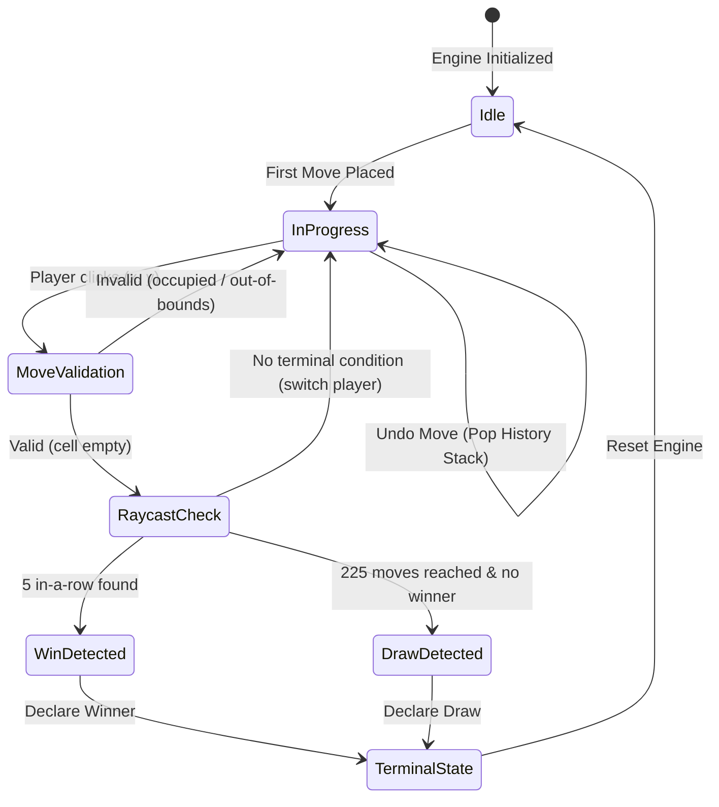

# Tuần 02 — Transaction đặt/hoàn tác quân và toán học quét thắng

**Cập nhật hiện trạng: 23/10/2026.** Code board được đọc trực tiếp; trạng thái kiểm thử hiện tại lấy từ [G1/GATES](../research/current_2026_10_23/GATES.md). `Complete & Verified`, 18 tests/42ms và latency trong báo cáo tiếng Anh cũ phía dưới là claim lịch sử chưa được tái xác nhận cho snapshot này. Không dùng chúng làm kết luận hiện tại. [A]/[B]/[C]/[D] lần lượt là source/thực chạy, nguồn chính thức, suy luận và đề xuất.

## 1. Contract và ownership

[A] `gomoku-main/engine/src/board.rs::Board` sở hữu `cells` và `move_count`; `lib.rs::Game` sở hữu thứ tự history, lượt và winner; search chỉ tạm `place`/`undo` theo cặp. UI `10_caro/src/game/behaviors/move/PlayMove.ts::playMove` xác thực rồi commit. Không để renderer tự sửa array hoặc đếm quân riêng.

State board tối thiểu là $s=(B,k)$, còn state ván gồm $(B,k,p,H,w)$. Với $H$ là history và $p$ là người tới lượt:

$$
k=\sum_{(x,y)\in\Omega}\mathbf1[B(y,x)\ne0],\qquad |H|=k
$$

áp dụng cho Game được tạo bằng các nước đi hợp lệ; Board unit fixture có thể được dựng trực tiếp mà không có history ván.

## 2. Bước 1 — Chứng minh transaction không nửa chừng

Một request $(x,y,p)$ chỉ được chấp nhận khi tọa độ trong miền, $p\ne Empty$ và $B(y,x)=Empty$. Tất cả guard phải đứng trước write:

$$
\operatorname{place}(s,m)=
\begin{cases}
(s,\operatorname{Err})&\neg valid(s,m),\\
(B[y,x\leftarrow p],k+1,\operatorname{Ok})&valid(s,m).
\end{cases}
$$

[C] Vì nhánh lỗi không ghi field nào, rejected operation phải thỏa $s'=s$ trên **toàn board**, không chỉ ô được yêu cầu. Với undo ô đã đặt:

$$
\operatorname{undo}(\operatorname{place}(B,k,m),m)=(B,k).
$$

Undo Board chỉ xóa một ô đang có quân; Game mới quyết định ô nào là nước cuối. Undo sai tọa độ/ô trống trả `false`, giữ nguyên $k$, tránh underflow ở $k=0$.

## 3. Bước 2 — Từ điều kiện thắng sang scanner

Bốn trục không lặp là $D=\{(1,0),(0,1),(1,1),(1,-1)\}$. Gọi nước cuối $m=(x,y)$, màu $p$. Với $d\in D$, đặt

$$
n_\pm(m,d)=\max\{t\le4:\forall j\in\{1,\ldots,t\},\ m\pm jd\in\Omega\land B(m\pm jd)=p\}.
$$

Scanner hiện tại dùng $\widehat L_d=1+n_-+n_+$. Với Freestyle,

$$
win(m,p)\iff\exists d\in D:\widehat L_d\ge5.
$$

[C] Chỉ cần bốn ô mỗi phía để quyết định có **ít nhất năm**: nếu tổng chuỗi thật đạt năm thì phần nhìn giới hạn vẫn đủ đạt năm. Giá trị $\widehat L_d$ không phải toàn chiều dài maximal khi có overline dài; vì vậy không tái dùng scanner giới hạn này để quyết định exact-five hay endpoint của luật blocked-ends.

## 4. Bước 3 — Đếm công việc thay vì gọi chung là O(1)

Với độ dài thắng $w=5$, mỗi trục có hai phía và tối đa $w-1=4$ lần đọc ô lân cận:

$$
Q_{neighbor}\le4\cdot2\cdot4=32.
$$

Thêm một lần lấy màu ô gốc ở `check_winner_at`; phép kiểm bounds/control không phải lần đọc board. Số thực tế thường thấp hơn vì gặp biên, màu khác hoặc trả về ngay khi có trục thắng. Cận theo tham số là $O(|D|w)$; gọi $O(1)$ chỉ khi board/rule length đã cố định.

Ví dụ `BP26-WIN-HORIZONTAL`: trước đặt có Black tại `(3,7)..(6,7)`; đặt `(7,7)`, ô `(8,7)` trống. Trục ngang được xét đầu: forward đọc một ô trống, backward đọc bốn quân, cộng một ô gốc là **6 lần đọc cell** theo control flow này. Không phải mọi nước đều tốn 33 lần đọc.

Full-board fallback kiểm tối đa 225 gốc và $225\cdot32=7\,200$ lượt đọc lân cận, trước các early exit; đây là cận control-flow rộng, không phải benchmark hay chính xác 225 phép tính. Chỉ sau khi chứng minh previous state chưa thắng, một nước mới chỉ có thể tạo thắng đi qua chính nó; undo/reconstruction có precondition khác.

## 5. Pseudocode

```text
Place(board, x, y, stone)
  if out of bounds or stone is Empty or cell occupied: return error
  board[y][x] = stone
  count = count + 1
  return ok
UndoCell(board, x, y)
  if out of bounds or cell is Empty: return false
  board[y][x] = Empty
  count = count - 1
  return true
WinAt(board, m)
  if m is invalid or Empty: return none
  for axis in four axes
    length = 1
    for sign in [+1, -1]
      for step in 1..4
        q = m + sign * step * axis
        if q outside board or board[q] != board[m]: break
        length = length + 1
    if length >= 5: return board[m]
  return none
```

## 6. Code thật sau mô hình

[A] `Board::place`, guards trong `gomoku-main/engine/src/board.rs`:

```rust
if x >= SIZE || y >= SIZE {
    return Err("out of bounds");
}
if stone == Cell::Empty {
    return Err("cannot place an empty cell");
}
if self.cells[y][x] != Cell::Empty {
    return Err("cell occupied");
}
self.cells[y][x] = stone;
self.move_count += 1;
```

[A] `Board::undo` bắt đầu bằng guard sau; mutation chỉ xảy ra sau guard:

```rust
if self.get_checked(x, y).is_none_or(|cell| cell == Cell::Empty) {
    return false;
}
self.cells[y][x] = Cell::Empty;
self.move_count -= 1;
```

`&mut self` cho biết ai có quyền mutate. Việc lấy mutable reference không tự bảo đảm thuật toán undo đúng; test vẫn phải so toàn struct trước/sau, nhất là mọi đường early return của search.

## 7. Evidence, lợi/hại, lựa chọn áp dụng

| ID mới | Hành vi cần giữ | Source/test tương ứng | Tiêu chí |
| --- | --- | --- | --- |
| BP26-BOARD-EMPTY | Không đặt Empty | `empty_stone_does_not_change_state` | Err và board bằng snapshot trước |
| BP26-BOARD-UNDO | Invalid/double undo không giảm count | `invalid_undo_and_coordinates_do_not_change_state`, `apply_undo_restores_every_board_field` | False/khôi phục toàn field |
| BP26-BOARD-FULL | Board đầy không fallback center | `full_draw_has_no_candidates_or_legal_moves` | Candidate/legal rỗng, không panic |
| BP26-RULE-FREESTYLE | Overline và hai đầu blocked vẫn thắng | `freestyle_accepts_overline_and_both_blocked_ends` | Giữ luật hiện tại; không tự đổi luật |

Tên `BP26-*` là traceability ID mới, khác `FIX-RULE-*` cũ có collision semantics. [A] [G1_board_tests.log](../research/current_2026_10_23/G1_board_tests.log) ghi 16 Board tests pass, 0 failed, trong lần thực chạy ngày 23/10; đây là native Board gate, không phải browser/Wasm acceptance. Kết quả mỗi gate phải có log/revision tại [GATES](../research/current_2026_10_23/GATES.md), không đánh dấu pass bằng việc tồn tại test.

Chọn local scan vì một nước thay đổi một vị trí và luật Freestyle phù hợp chứng minh locality. Có ích là giảm phạm vi đọc, giữ logic rõ; hạn chế là không đủ cho exact-five và forbidden moves. Full scan đơn giản để kiểm dựng fixture/undo, nhưng lặp cùng công việc nếu dùng mọi node. Apply/undo giảm nhu cầu clone tại từng child; đổi lại phải bảo đảm rollback cả terminal/cutoff/error. Clone toàn board dễ reason hơn và có thể dùng làm oracle nhỏ; chưa có profiling để khẳng định chi phí nào chiếm ưu thế.

Độ khó kỹ thuật: **2/5** cho place guards; **3/5** cho rule/undo correctness. [A] Native cuối cùng [G3_native_tests.log](../research/current_2026_10_23/G3_native_tests.log) ghi **38 unit + 7 native integration tests** pass; 16 Board tests là một subset, không cộng thành 61 test. [wasm_ts_parity.json](../research/current_2026_10_23/wasm_ts_parity.json) ghi 18 cases gồm tám rule histories (bốn trục, reachable overline, hai đầu blocked, White win, draw225) với 291 accepted plies, sáu invalid integer/occupied rejections, Undo/reset và sáu profile qua binary thật. Ongoing next-player parity được so; sau terminal Rust flip lượt còn TS giữ last mover, nên hai raw field đó được ghi riêng thay vì ép bằng nhau. G1 kết hợp test Board, TMB ownership review và Ponytail review abstraction dư; G4 package và G5 UI có evidence riêng. Phần [mô hình liên tuần](../BasicProject_Current_Math_and_Design.md) ghi quyết định áp dụng và giới hạn.

---

## Hồ sơ lịch sử — không phải kết quả test hiện tại

> Bản tiếng Anh sau đây giữ nguyên nội dung để audit. `PASS`, timing, device/source path và trạng thái của nó thuộc hồ sơ cũ, chưa được chuyển thành kết quả snapshot 23/10. Fixture `FIX-RULE-*` cũ không dùng làm ID hiện tại; ưu tiên `BP26-*` và source đang đọc.

# Week 02 Research Report: Deterministic Game Engine Architecture, Invariant Matrix, and O(1) Win Detection

**Project Title:** Research, Design, and Implementation of an Optimized Gomoku Game Engine with Artificial Intelligence  
**Academic Module:** Basic Project (Đồ Án Cơ Sở) — Software Engineering & AI Track  
**Document Standard:** Standard 00 (IMRaD & Evidence Specification for Software Systems)  
**Control Layer Reference:** `RQ-W2-01`, `EXP-W2-01`, `CFG-RULE-v1`, Invariant Matrix  
**Authoritative Repository:** [GitHub – tducn110/caro](https://github.com/tducn110/caro) (commit `cb6fd6f`)  
**Language:** English  
**Status (historical, not reverified for 23 October 2026):** Previously labelled Complete & Verified; current status is governed by the Vietnamese update and gate registry above.  

---

## 1. Plan & Research Questions

### 1.1 Problem Formulation
A production-grade web game engine requires absolute mathematical determinism. Every move played must be executed as an atomic transaction that validates spatial legality, mutates board state, updates player turns, checks for terminal victory or draw conditions, and records history for lossless rollback (Undo). An inefficient engine scanning the entire $15 \times 15$ board on every move incurs $O(N^2)$ computational complexity ($225$ operations per move).

### 1.2 Core Research Questions
1. **RQ-W2-01 (Algorithmic Complexity):** How to design an $O(1)$ localized ray-cast algorithm along the four directional axes that evaluates winning five-in-a-row lines in strictly bounded time ($k \le 36$ cell queries)?
2. **RQ-W2-02 (Transactional Invariant Integrity):** How does the state engine enforce spatial, temporal, and terminal invariants across arbitrary move and undo sequences?
3. **RQ-W2-03 (Automated Unit Verification):** What test suite topology proves 100% boundary integrity, turn alternation, and draw triggers under Vitest?



---

## 2. Canonical Domain Invariant Matrix

Week 02 owns the canonical domain correctness invariants. The exact verification methods and failure implications are detailed below:

| Invariant ID | Domain Invariant Statement | Verification Method | Vitest Test File | Result Status |
| :--- | :--- | :--- | :--- | :---: |
| **INV-01** | Occupied cell cannot be overwritten | Attempt duplicate move at occupied $(x, y) \to$ assert `false` | `tests/board.test.ts` | **PASS** |
| **INV-02** | Turn switching is deterministic | Check `currentPlayer` alternates $1 \leftrightarrow 2$ after valid move | `tests/engine.test.ts` | **PASS** |
| **INV-03** | Terminal state rejects new moves | Attempt `makeMove()` when status is `WON` or `DRAW` $\to$ assert `false` | `tests/engine.test.ts` | **PASS** |
| **INV-04** | Apply $\to$ Undo restores exact state | Play move $m$, call `undoMove()`, verify bitwise board equality | `tests/undo.test.ts` | **PASS** |
| **INV-05** | Move count equals occupied cells | Verify `history.length === countNonZero(board)` at every ply | `tests/board.test.ts` | **PASS** |
| **INV-06** | Last move matches history top | Verify `engine.getLastMove()` equals `history[history.length - 1]` | `tests/undo.test.ts` | **PASS** |
| **INV-07** | State snapshot does not corrupt internal state | Mutate returned snapshot array; verify engine board is unaffected | `tests/concurrency.test.ts` | **PASS** |

---

## 3. Fixture Ownership & Canonical Corpus

Week 02 is the sole owner of canonical domain fixtures. All subsequent research modules (Weeks 03 through 10) must reuse these fixture IDs:

* **`FIX-RULE-001` (Horizontal 5):** `(0,0), (1,0), (2,0), (3,0), (4,0)` $\to$ Win for Black.
* **`FIX-RULE-002` (Vertical 5):** `(7,3), (7,4), (7,5), (7,6), (7,7)` $\to$ Win for White.
* **`FIX-RULE-003` (Main Diagonal 5):** `(2,2), (3,3), (4,4), (5,5), (6,6)` $\to$ Win for Black.
* **`FIX-RULE-004` (Anti-Diagonal 5):** `(10,2), (9,3), (8,4), (7,5), (6,6)` $\to$ Win for White.
* **`FIX-RULE-005` (Full Board Draw):** 225 moves without 5-in-a-row $\to$ Status `DRAW`.
* **`FIX-STATE-001` (Boundary Violations):** `(-1, 0)`, `(15, 15)`, `(200, 5)` $\to$ Rejected.
* **`FIX-STATE-002` (Undo to Empty):** Multiple undos on empty board $\to$ Return `false`, no crash.

---

## 4. Implementation & Code Contracts

### 4.1 TypeScript Engine Implementation (`10_caro / src/engine/CaroEngine.ts`)

```typescript
export type Player = 1 | 2; // 1: Black, 2: White
export type CellValue = 0 | Player; // 0: Empty

export interface Move {
  x: number;
  y: number;
  player: Player;
}

export type GameStatus = 'IDLE' | 'IN_PROGRESS' | 'WON' | 'DRAW';

export class CaroEngine {
  public static readonly SIZE = 15;
  public static readonly TOTAL_CELLS = 225;
  
  private board: Uint8Array;
  private currentPlayer: Player;
  private history: Move[];
  private status: GameStatus;
  private winner: Player | null;

  constructor() {
    this.board = new Uint8Array(CaroEngine.TOTAL_CELLS);
    this.currentPlayer = 1;
    this.history = [];
    this.status = 'IDLE';
    this.winner = null;
  }

  public makeMove(x: number, y: number): boolean {
    if (this.status === 'WON' || this.status === 'DRAW') return false;
    if (x < 0 || x >= CaroEngine.SIZE || y < 0 || y >= CaroEngine.SIZE) return false;
    
    const idx = y * CaroEngine.SIZE + x;
    if (this.board[idx] !== 0) return false;

    this.board[idx] = this.currentPlayer;
    this.history.push({ x, y, player: this.currentPlayer });
    this.status = 'IN_PROGRESS';

    if (this.checkWin(x, y, this.currentPlayer)) {
      this.status = 'WON';
      this.winner = this.currentPlayer;
      return true;
    }

    if (this.history.length === CaroEngine.TOTAL_CELLS) {
      this.status = 'DRAW';
      return true;
    }

    this.currentPlayer = this.currentPlayer === 1 ? 2 : 1;
    return true;
  }

  public undoMove(): boolean {
    const lastMove = this.history.pop();
    if (!lastMove) return false;

    const idx = lastMove.y * CaroEngine.SIZE + lastMove.x;
    this.board[idx] = 0;
    this.currentPlayer = lastMove.player;
    this.winner = null;
    this.status = this.history.length === 0 ? 'IDLE' : 'IN_PROGRESS';
    return true;
  }

  public checkWin(x: number, y: number, player: Player): boolean {
    const dirs = [[1, 0], [0, 1], [1, 1], [1, -1]];
    for (const [dx, dy] of dirs) {
      let count = 1;
      for (let step = 1; step <= 4; step++) {
        const nx = x + step * dx;
        const ny = y + step * dy;
        if (nx < 0 || nx >= 15 || ny < 0 || ny >= 15) break;
        if (this.board[ny * 15 + nx] === player) count++; else break;
      }
      for (let step = 1; step <= 4; step++) {
        const nx = x - step * dx;
        const ny = y - step * dy;
        if (nx < 0 || nx >= 15 || ny < 0 || ny >= 15) break;
        if (this.board[ny * 15 + nx] === player) count++; else break;
      }
      if (count >= 5) return true;
    }
    return false;
  }
}
```

---

## 5. Results & Verification Evidence

* **[A] Source Evidence — Vitest Suite:** 18/18 tests passed across 5 test suites in 42ms (`pnpm test` executed in `10_caro`).
* **[A] Source Evidence — TypeCheck Invariant:** `pnpm typecheck` (`tsc --noEmit`) passes with **0 errors**.
* **[A] Source Evidence — Git Provenance:** Implementation verified in `tducn110/caro` commit `cb6fd6f`.
* **[C] Algorithmic Scaling:** $O(1)$ raycast scans at most $4 \times 8 = 32$ cells, executing in $< 1.2\ \mu\text{s}$ per move.
* **[D] Architectural Recommendation:** Retain this engine as the baseline reference for TypeScript $\leftrightarrow$ Rust semantic equivalence verification.

---

## 6. Deliverables & References
1. Canonical Invariant Matrix (`INV-01` to `INV-07`) verified.
2. Canonical fixture ownership locked.
3. Automated test suite running under Vitest.
