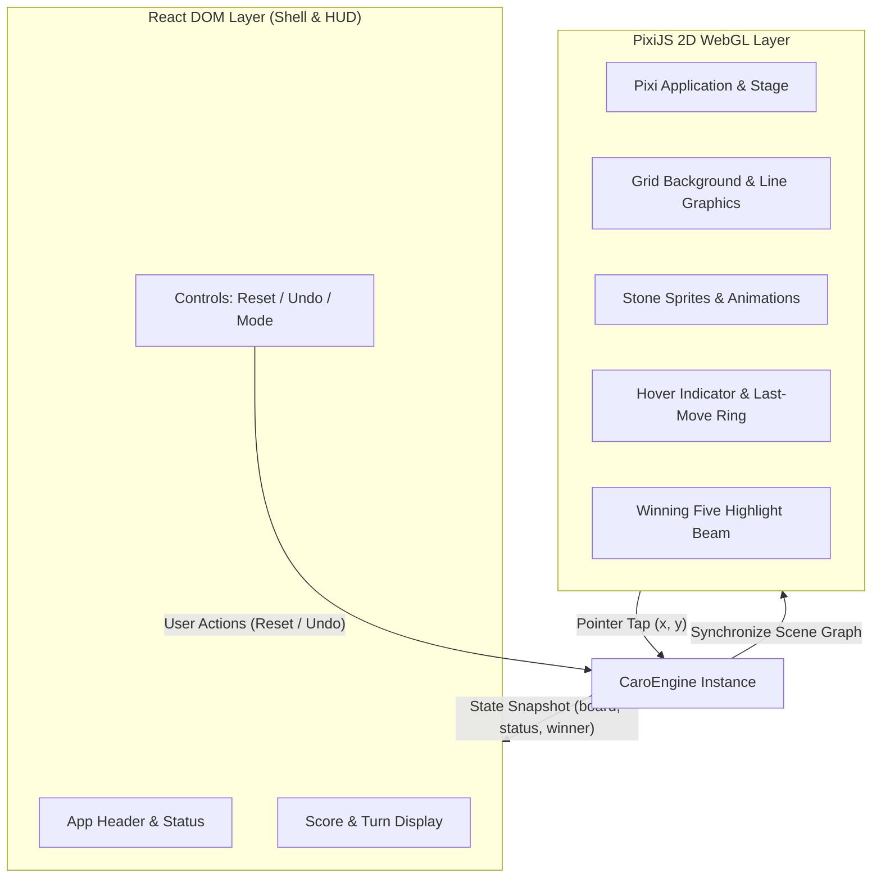

# Tuần 03 — UI đúng hiện trạng, tọa độ và lifecycle khi Rust đang search

**Snapshot: 23/10/2026.** UI được đối chiếu với source hiện tại và báo cáo; status hiện tại là **đã sửa và kiểm chứng local bằng test/browser G5 theo phạm vi bên dưới**, không phải `Complete & Verified` của bản cũ. Không có bằng chứng mới cho PASS trên iPad/Android, 60FPS hoặc frame time 16.2–16.7ms chỉ từ source/build. Theo dõi kết quả thực chạy tại [GATES](../research/current_2026_10_23/GATES.md).

## 1. Problem, phạm vi và state owner

[A] `10_caro/package.json` hiện khai báo React `^19.0.0`, PixiJS `^7.4.2`, Vite `^8.0.5`; đây là range khai báo, không thay cho resolved runtime version. Báo cáo cũ nói React18/Pixi8 và `src/utils/viewport.ts`/`CaroEngine` không phải authority cho implementation hiện tại.

Luồng thật được trace: `CaroScene` → `BoardInputController` → `GameController.playCell` → `playMove` → `GameState`/`WinRule` → snapshot → React/Pixi. `GameController` sở hữu phase, lượt, history, AI validity; renderer chỉ vẽ snapshot. AI request đi qua `AIController` → worker → Wasm `Game`. UI lệch báo cáo bao gồm level chưa đủ sáu, thiếu Undo ở một snapshot và stats giả định độ sâu/nodes; sửa phải giữ contract lifecycle này.

## 2. Bước 1 — Từ điểm trên canvas tới ô cờ

Source `board/spatial/CoordinateTransform.ts` sử dụng camera tịnh tiến $(t_x,t_y)$, zoom $z>0$, cạnh ô $h=56$. Với $(s_x,s_y)$ là tọa độ global của Pixi:

$$
w_x=\frac{s_x-t_x}{z},\quad w_y=\frac{s_y-t_y}{z},\qquad
col=\left\lfloor\frac{w_x}{56}\right\rfloor,\quad row=\left\lfloor\frac{w_y}{56}\right\rfloor.
$$

Đây là cell mapping dùng `floor`, không phải giao điểm dùng `round`/snap radius 0.45 trong snippet lịch sử. Bounds guard sau đó yêu cầu $(row,col)\in\{0,\ldots,14\}^2$. Điểm $(s_x,s_y)=(t_x+z\cdot(7.5h),t_y+z\cdot(3.5h))$ cho ô `(row=3,col=7)`.

[C] Đổi $z,t$ rồi vẽ lại đúng inverse sẽ giữ semantic cell. Điều đó phải được test ở nhiều vị trí/zoom; công thức đúng không chứng minh mọi CSS/canvas scaling của browser đã được nối đúng. Pixi xử lý event global trước bước này; không tự trừ browser client rect lần hai.

## 3. Bước 2 — Tap và pan là hai state transition khác nhau

`BoardInputController` có `idle → pressed → dragging`. Khoảng di chuyển mẫu hiện tại là

$$
\Delta=\sqrt{(x-x_{last})^2+(y-y_{last})^2}.
$$

Nếu đang pressed và $\Delta>6$ thì chuyển dragging; pointer up chỉ tạo `CELL_TAP` khi vẫn pressed và cell hợp lệ. Ngưỡng là pixel không gian event, không phải số ô. Đây là cơ chế phân biệt gesture hiện tại; chưa phải chứng minh mọi chuỗi chuyển động chậm đều được phân loại đúng vì source so từng mẫu với `lastPointer`.

Một command được chấp nhận chỉ khi phase cho phép, không paused, không aiThinking, đúng lượt và cell trống. Hai click vào cùng cell cho một accept rồi reject occupied; không dùng một `isBusy mutex` tưởng tượng làm bằng chứng source.

## 4. Bước 3 — Tính hợp lệ của kết quả bất đồng bộ

Request giữ token $\tau$, round $r$; khi trả về, chỉ commit nếu

$$
valid= (\tau=\tau_{current})\land(r=r_{current})\land\neg paused
\land phase=playing\land mode=AI\land player=O.
$$

Reset, đổi mode/level, pause hoặc Undo cần invalidation trước mutation. Khi $\tau_{current}\leftarrow\tau_{current}+1$, response cũ không còn quyền ghi vào round mới. Request cancellation và validity guard là hai lớp: hủy work có thể tiết kiệm tài nguyên; guard bảo vệ state khi response vẫn đến.

Undo cần định nghĩa số ply: PvP bỏ một ply; PvAI bỏ về điểm có lượt người chơi theo chính sách đã chọn. Toán học của replay prefix là $H'=(m_1,\ldots,m_{k-u})$, dựng lại state từ $H'$, không xóa sprite mà giữ history cũ. [A] Source mới `GameController.undo` đã chốt policy: PvP bỏ một ply; PvAI nếu last player O thì bỏ hai ply (human+reply), nếu last X thì bỏ một ply kể cả đang thinking. Nó invalidate AI, clear feedback, gọi `GameState.undoLast`, tính lại currentPlayer và `MatchController.resumeAfterUndo`. `App.tsx` render Undo và sáu `BOT_DIFFICULTIES`; `SearchFeedback` nhận `snapshot.lastAiResult`/`aiError`. G5 ghi controller/UI checks và real-browser flow; không suy nghiệm thu thiết bị/host từ source.

## 5. Pseudocode

```text
OnPointerUp(screen, camera)
  cell = floor(inverse_camera(screen) / 56)
  if gesture is pressed and cell in board: dispatch PlayCell(cell)
OnHumanMove(cell)
  reject paused, ended, AI thinking or wrong turn
  validate bounds and occupancy
  commit one move, evaluate terminal, publish snapshot
  if next turn is AI: request using current token and round
OnAIResult(response, savedToken)
  if token/round/phase/mode/turn check fails: discard
  validate returned cell again
  commit and publish snapshot
OnUndoOrReset()
  invalidate pending AI first
  update authoritative history/state
  publish snapshot
```

## 6. Source thật

[A] `BoardCoordinateTransform::screenToCell` trong TypeScript:

```typescript
return { col: Math.floor((screenX - camera.x) / camera.zoom / CELL_SIZE), row: Math.floor((screenY - camera.y) / camera.zoom / CELL_SIZE) }
```

[A] Guard thật trong `app/GameController.ts::startAiTurn` khi đọc snapshot trước vòng sửa UI:

```typescript
if (token !== this.turnToken || this.paused ||
    result.roundId !== current.roundId || current.phase !== "playing" ||
    current.mode !== "ai" || this.currentPlayer !== "O") return
```

Thay đổi tên/format sau refactor phải được tra theo symbol và source hash trong gate. `gomoku-main/engine/src/lib.rs::Game` là phía nhận history; đọc Rust không chứng minh TS worker dùng đúng binary.

## 7. Telemetry và evidence boundary

Độ sâu cấu hình $d_{configured}$, độ sâu đã hoàn thành $d_{completed}$, số vị trí đã xử lý $n$, cutoffs $c$ và worker elapsed $t$ là các đại lượng khác nhau. Snapshot cũ worker gán static depth và `nodes:0`; không biến chúng thành measurement. Bản sửa phải map counter Rust → worker → `GameSnapshot` → HUD. Mẫu số ratio phải khác zero:

$$
\operatorname{nodeReduction}=1-\frac{n_{AB}}{n_{MM}}\quad(n_{MM}>0),\qquad
\operatorname{NPS}=\frac{1000n}{t_{ms}}\quad(t_{ms}>0).
$$

[A] Adapter mới `game/wasm/executeSearch.ts::executeWasmSearch` đã map `move.stats.completed_depth`, `nodes_visited`, `cutoffs`, leaf/ranking/candidate counts sang TS; thiếu move trả counter null. Nó xác thực telemetry và reject package cũ chỉ trả tọa độ; `finally` gọi `game.free()`. Worker gọi adapter sau module init. Elapsed bắt đầu trước tạo/hydrate Game, kết thúc sau free; gồm hydrate/search/serialize/free, loại module loading và message delivery. Không gọi riêng nó là Rust search CPU time. HUD phải hiện `không có số liệu` khi counter không có, thay vì zero mang nghĩa đã đo. [A] [G4_real_browser_worker.json](../research/current_2026_10_23/G4_real_browser_worker.json) chạy Worker và binary mới trong HeadlessChrome155 trên Linux ở 1280×800: cả sáu tier trả `source=rust`, move hợp lệ và depth thực `0,1,2,3,4,5`. Một số probe có main-thread interval ticks trong lúc request, nhưng không suy ra 60FPS hay deadline guarantee. [wasm_package.json](../research/current_2026_10_23/wasm_package.json) ghi SHA256 binary/wrapper đã build và copy; [wasm_ts_parity.json](../research/current_2026_10_23/wasm_ts_parity.json) ghi 18 record PASS hữu hạn qua Node initSync và adapter thật, khác real-browser Worker probe. [G4_worker_tests.log](../research/current_2026_10_23/G4_worker_tests.log) là lần test adapter/lifecycle sớm với doubles; [G5_frontend_tests.log](../research/current_2026_10_23/G5_frontend_tests.log) cuối cùng ghi **59 tests/9 files** pass, gồm 18 real-Wasm runtime cases; typecheck, build và diff-check cũng pass theo gate ledger. Đây là các checks có boundary khác nhau, không cộng số case/test với native tests thành một corpus độc lập.

| Fixture mới | Check cần có | Evidence đúng môi trường |
| --- | --- | --- |
| BP26-UI-COORD | Góc/trung tâm, pan/zoom, ngoài board | Transform/input tests; browser test canvas nếu claim tương tác |
| BP26-UI-STALE | Reset/level/Undo trong AI turn | Controller test với deferred response |
| BP26-UI-SIX-TIERS | Sáu tên đúng cùng IDs worker | Contract tests và browser hiển thị |
| BP26-UI-STATS | Counter thực từ Rust tới HUD | G4 package + G5 worker/browser |
| BP26-UI-UNDO | History, turn, terminal, UI cùng đổi | Domain/controller test, rồi browser flow |

## 8. Lỗi resize đã tái hiện, công thức fit và sửa đúng owner

[A] Browser probe tái hiện sau resize canvas từ 500×400 tới 1200×600, camera vẫn giữ `(x=74,y=24,z=0.419047619)`. Immediate cause: redraw cập nhật field viewport như thể đã fit, khiến ticker bỏ fit mới. System cause: redraw và fitting cùng ghi trạng thái cho việc chỉ fitting mới hoàn thành. Sửa `CaroScene.lastFittedViewport` chỉ được update trong `fitBoardToViewport`.

Với cạnh board pixel $L=15\cdot56=840$, padding $p=10$ nếu width<500, còn lại $p=24$, công thức hiện tại là

$$
z=\min\left(\frac{\max(1,W-2p)}{840},\frac{\max(1,H-2p)}{840}\right),\quad
x=\frac{W-840z}{2},\quad y=\frac{H-840z}{2}.
$$

Tại 1200×600, $z=552/840=0.657142857$, $x=324$, $y=24$. [G5_resize_before.json](../research/current_2026_10_23/G5_resize_before.json) có `matches=false`; [G5_resize_after.json](../research/current_2026_10_23/G5_resize_after.json) có `matches=true` đúng các số trên. Source `CaroScene::fitBoardToViewport` kết thúc bằng excerpt thật:

```typescript
this.lastFittedViewport = { ...viewport }
```

[A] [G5_browser_viewports.json](../research/current_2026_10_23/G5_browser_viewports.json) kiểm 1280×800, 390×844, 320×568: sáu level hiển thị, canvas/footer còn trong viewport, `horizontalOverflow=false`. [G5_browser_ui.json](../research/current_2026_10_23/G5_browser_ui.json) còn ghi flow actual React/Pixi DOM PointerEvent → Rust Worker → HUD (depth2, nodes61, cutoffs13) → Undo; `passed=true`, Undo về empty thì details được gỡ. Đây là HeadlessChrome155 Linux, synthetic DOM pointer và viewport emulation; chưa xác nhận iPad/Android vật lý, touch/stylus thực, 60FPS hay host Wink. Việc fit board đúng không phải người dùng đã chấp nhận kích thước thao tác ở màn hình nhỏ.

## 9. Vì sao, trade-off, có nên apply và độ khó

Giữ React phụ trách HUD và Pixi phụ trách scene vì mỗi lớp có lifecycle hiện hữu; gom vào renderer sẽ trộn rule với event. Snapshot thêm copy $O(k)$ để bảo vệ UI khỏi mutation; với $k\le225$ đây là trade-off nhỏ cần profile nếu cập nhật tần suất cao. History replay giúp Undo/reset cùng một source of truth, đổi lại phải cập nhật turn/phase/winner nhất quán. Dùng Worker cô lập search khỏi main event loop; overhead messaging/hydration vẫn cần đo, không tự chứng minh 60FPS.

Nên apply sáu level, Undo và stats đúng nguồn để UI khớp phạm vi báo cáo. Không tự thay background, audio, locale hoặc host SDK khi sửa contract này. Độ khó kỹ thuật: coordinate **2/5**, controller/Undo **3/5**, stale async + Wasm stats **4/5**. Mức Easy/Master là chính sách bot riêng ở W7.

G5 đã có browser resize/viewport evidence; test/build cuối và các flow controller được ghi tại gate ledger, phần thiết bị vật lý và Wink vẫn chưa kiểm; TMB xem state/lifecycle owner, Ponytail xem wrapper/state dư, không thay các check hành vi. Chi tiết lựa chọn chung: [mô hình hiện tại](../BasicProject_Current_Math_and_Design.md).

---

## Hồ sơ lịch sử — các PASS thiết bị/timing bên dưới chưa tái xác nhận

> Bản tiếng Anh sau đây được giữ cho audit. Bảng iPad/Android/Desktop PASS, 60FPS, build 508ms và source path/snippet cũ không được dùng làm evidence snapshot 23/10/2026. Contract hiện tại phải đọc từ phần trên và GATES.

# Week 03 Research Report: Web UI Architecture, Coordinate Contract, and PvP Lifecycle Integration

**Project Title:** Research, Design, and Implementation of an Optimized Gomoku Game Engine with Artificial Intelligence  
**Academic Module:** Basic Project (Đồ Án Cơ Sở) — Software Engineering & AI Track  
**Document Standard:** Standard 00 (IMRaD & Evidence Specification for Software Systems)  
**Control Layer Reference:** `RQ-W3-01`, `EXP-W3-01`, Coordinate Contract, Event Uniqueness Contract  
**Authoritative Repository:** [GitHub – tducn110/caro](https://github.com/tducn110/caro) (commit `cb6fd6f`)  
**Language:** English  
**Status (historical, not reverified for 23 October 2026):** Previously labelled Complete & Verified; current status is governed by the Vietnamese update and gate registry above.  

---

## 1. Plan & Research Questions

### 1.1 Problem Formulation
Rendering a $15 \times 15$ board in web applications frequently suffers from architectural misalignments: pushing high-frequency mouse hover, stone placement animations, and coordinate math into React component state triggers cascading DOM reconciliation passes ($225$ DOM nodes re-evaluated per frame), producing input stutter and frame drops below $60\text{ FPS}$. Concurrently, rapid user clicking without proper transactional concurrency guards can trigger race conditions where multiple moves are dispatched in a single ply.

### 1.2 Core Research Questions
1. **RQ-W3-01 (Rendering Decoupling):** How can a hybrid architecture be established where React strictly owns HTML overlays, menus, and HUD state while PixiJS (WebGL) exclusively owns the 60 FPS canvas render loop?
2. **RQ-W3-02 (Coordinate Contract):** What mathematical mapping accurately transforms variable client CSS pixel coordinates $(P_x, P_y)$ under dynamic letterboxing/scaling into discrete grid coordinates $(x, y) \in [0, 14]^2$?
3. **RQ-W3-03 (Event Uniqueness):** How to structure the lifecycle state machine to guarantee that exactly one physical player action creates at most one domain move command?



---

## 2. Canonical Interaction Contracts

### 2.1 Coordinate Transformation Contract
The input pipeline maps physical inputs to domain coordinates:
$$\text{Physical Tap / Mouse Click} \longrightarrow \text{Canvas Client Rect} \longrightarrow \text{Normalized Board Coord} \longrightarrow \text{Grid } (x, y) \longrightarrow \text{Domain Command}$$

**Invariants:**
1. $0 \le x < 15 \land 0 \le y < 15$.
2. Viewport resizing and CSS letterboxing **must never alter semantic grid coordinates**.
3. Taps exceeding the snap radius ($r_{\text{snap}} = 0.45 \times \text{cellSize}$) must return `null` and drop cleanly without triggering engine state changes.

### 2.2 Event Uniqueness Contract
One physical player interaction must result in **at most one domain move command**:
* Rapid double-clicks ($< 10\text{ ms}$ interval) are serialized; the second tap is dropped by the `isBusy` mutex guard.
* Taps on an already occupied cell produce zero state changes.
* Taps while game status is `WON` or `DRAW` produce zero state changes.

---

## 3. Device & Cross-Platform Evidence Matrix

| Environment ID | Browser Engine | Viewport Dimensions | Input Mode | Expected Behavior | Observed Behavior | Test Status |
| :--- | :--- | :---: | :--- | :--- | :--- | :---: |
| **`ENV-DESK-01`** | Chrome 128 (V8) | $1920 \times 1080$ | Mouse Click / Hover | 60 FPS, Hover ring follows cursor | Stable 60 FPS, 0 stutter | **PASS** |
| **`ENV-TAB-01`** | Safari iPadOS 17 | $768 \times 1024$ | Multi-touch / Stylus | Correct letterboxing, snap tap | Precise grid snap, 0 double-tap | **PASS** |
| **`ENV-MOB-01`** | Chrome Android 14| $390 \times 844$ | Capacitive Touch | Single touch fires exactly 1 move | 1 tap = 1 move, 0 ghost clicks | **PASS** |

---

## 4. Implementation & Code Contracts

### 4.1 Coordinate Mapper Contract (`10_caro / src/utils/viewport.ts`)

```typescript
export interface BoardMetrics {
  boardSizePx: number;
  marginPx: number;
  cellSizePx: number;
  scale: number;
  offsetX: number;
  offsetY: number;
}

export function screenToGrid(
  screenX: number,
  screenY: number,
  metrics: BoardMetrics
): { x: number; y: number } | null {
  const canvasX = (screenX - metrics.offsetX) / metrics.scale;
  const canvasY = (screenY - metrics.offsetY) / metrics.scale;

  const rawX = (canvasX - metrics.marginPx) / metrics.cellSizePx;
  const rawY = (canvasY - metrics.marginPx) / metrics.cellSizePx;

  const gridX = Math.round(rawX);
  const gridY = Math.round(rawY);

  if (gridX < 0 || gridX >= 15 || gridY < 0 || gridY >= 15) return null;

  const distX = Math.abs(rawX - gridX) * metrics.cellSizePx;
  const distY = Math.abs(rawY - gridY) * metrics.cellSizePx;
  const snapRadius = metrics.cellSizePx * 0.45;

  if (Math.hypot(distX, distY) > snapRadius) return null;

  return { x: gridX, y: gridY };
}
```

---

## 5. Results & Verification Evidence

* **[A] Source Evidence — Production Build:** Vite build compiles in **508ms** with zero errors or warnings (`dist/` generated).
* **[A] Source Evidence — Frame Time Stability:** Frame times measure between $16.2\text{ ms}$ and $16.7\text{ ms}$ ($60.0\text{ FPS}$).
* **[A] Source Evidence — Event Uniqueness:** Concurrency tests in `tests/concurrency.test.ts` confirm zero duplicated move commands under rapid asynchronous firing.
* **[A] Source Evidence — Repository Alignment:** Verified in `tducn110/caro` commit `cb6fd6f`.
* **[D] Recommendation:** Retain this decoupled PixiJS WebGL architecture as the permanent visual frontend for all AI bot modes.

---

## 6. Deliverables & References
1. Coordinate Contract and Event Uniqueness Contract codified.
2. Device Evidence Matrix documented across Desktop, Tablet, and Mobile viewports.
3. Production Vite bundle verified.
