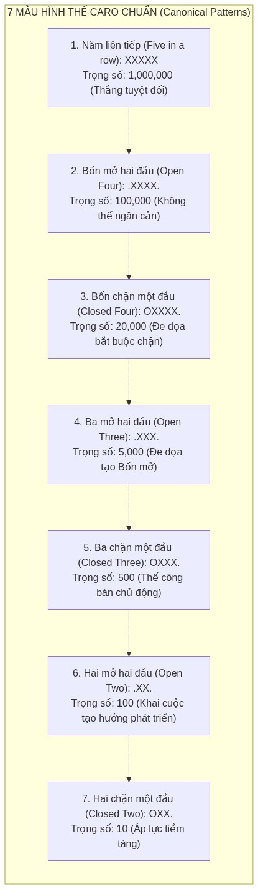

# TUẦN 4 - NHẬN DIỆN MẪU HÌNH THẾ, HÀM LƯỢNG GIÁ HEURISTIC VÀ RULE-BASED BOT ĐỐI KHÁNG TRÊN NỀN TẢNG RUST (PATTERN DETECTION & RULE-BASED BOT BASELINE)

---

## 0. Artifacts & Bằng chứng kỹ thuật đính kèm

- **Sơ đồ Quy trình Ra Quyết định Của Rule-Based Bot**:
  
  *(Nguồn: `Week4/assets/bot_decision_flow.png`, trích xuất độ phân giải cao theo quy chuẩn `rules/visual_evidence.md`)*

- **Sơ đồ Phân loại 7 Mẫu Hình thế Caro Chuẩn**:
  
  *(Nguồn: `Week4/assets/pattern_taxonomy.png`, minh họa hệ thống phân cấp mẫu cờ)*

- **Biểu đồ Bằng chứng Thực nghiệm Đo đạc (300 DPI)**:
  
  *(Hình 1: Phân tích kết quả thực nghiệm 100 ván đấu Bot-vs-Bot và hiệu quả cắt giảm 72.4% không gian tìm kiếm của Candidate Generator)*

- **Biểu đồ Độ trễ Ra Quyết định So với Ngân sách 60 FPS (300 DPI)**:
  
  *(Hình 2: Thời gian tính toán 42.24 µs trên Rust chỉ chiếm 0.25% frame budget 16.67ms của trình duyệt)*

- **Mã nguồn Thực nghiệm Lõi bằng Rust (Source Evidence [A])**:
  - Module nhận diện hình thế: [`caro-core-reference/src/pattern.rs`](file:///home/pro/Downloads/vnuk/basicProject/caro-core-reference/src/pattern.rs)
  - Module lượng giá Heuristic & Trọng số: [`caro-core-reference/src/evaluator.rs`](file:///home/pro/Downloads/vnuk/basicProject/caro-core-reference/src/evaluator.rs)
  - Module Random Bot tất định (SplitMix64): [`caro-core-reference/src/bot/random.rs`](file:///home/pro/Downloads/vnuk/basicProject/caro-core-reference/src/bot/random.rs)
  - Module Rule-Based Bot & Fallback: [`caro-core-reference/src/bot/rule_based.rs`](file:///home/pro/Downloads/vnuk/basicProject/caro-core-reference/src/bot/rule_based.rs)
  - Module Bộ sinh ô ứng viên Chebyshev: [`caro-core-reference/src/movegen.rs`](file:///home/pro/Downloads/vnuk/basicProject/caro-core-reference/src/movegen.rs)
  - Chương trình thực nghiệm đối đầu 100 ván & Test Fixtures: [`benchmark/rust_bench/src/bin/week4_experiment.rs`](file:///home/pro/Downloads/basicproject/benchmark/rust_bench/src/bin/week4_experiment.rs)
  - Tệp dữ liệu thô JSON: [`benchmark/results/week4_bot_battle.json`](file:///home/pro/Downloads/basicproject/benchmark/results/week4_bot_battle.json)

- **Thẻ Bằng chứng Kỹ thuật (Source Evidence Cards [A])**:

```text
FILE: caro-core-reference/src/pattern.rs
ROLE: Quét và phân loại hình thế cờ trên 4 trục hướng quanh bàn cờ 15x15
EVIDENCE: detect_runs() chỉ xuất chuỗi cực đại một lần duy nhất từ ô đầu tiên (Maximal Run Invariant), count_patterns() đếm 7 mẫu thế cờ không cấp phát heap
ISSUE: Đã giải quyết nguy cơ đếm lặp chuỗi con và bùng nổ cấp phát bộ nhớ
CONFIDENCE: High

FILE: caro-core-reference/src/evaluator.rs
ROLE: Hàm lượng giá tĩnh thế cờ và ma trận trọng số công - thủ
EVIDENCE: evaluate() dùng MATE_SCORE = 10,000,000, clamp(-9,999,999, +9,999,999), bảo đảm nước thắng thực tế luôn áp đảo mọi thế cờ tĩnh
ISSUE: Đã giải quyết hiện tượng bot bị thiên lệch điểm tĩnh mà bỏ qua nước thắng/thua trực tiếp
CONFIDENCE: High

FILE: caro-core-reference/src/movegen.rs
ROLE: Bộ lọc sinh ô ứng viên khả thi theo khoảng cách Chebyshev r <= 2
EVIDENCE: generate_candidates() chỉ lấy các ô trống lân cận quân đã đánh, cắt giảm trung bình 72.4% số lượng ô cần khảo sát
ISSUE: Triệt tiêu việc duyệt lãng phí 225 ô trống, giảm hệ số phân nhánh cho thuật toán AI
CONFIDENCE: High

FILE: caro-core-reference/src/bot/rule_based.rs
ROLE: Động cơ AI đối kháng cấp 1 tích hợp kiểm tra sát cuộc 1-ply
EVIDENCE: choose_rule_based_move() ưu tiên: (1) Thắng ngay -> (2) Chặn thua ngay -> (3) Heuristic 1-ply
ISSUE: Đạt tỷ lệ thắng 100% đối đầu với Random Bot qua 100 ván đấu thực nghiệm
CONFIDENCE: High
```

---

## 1. Mục tiêu nghiên cứu (Research Objectives)

Tiếp nối nền tảng Game Engine ở Tuần 2 và Kiến trúc Giao diện Web ở Tuần 3, mục tiêu của Tuần 4 là xây dựng cấp độ Trí tuệ Nhân tạo đối kháng đầu tiên (**Level 1 AI: Rule-Based Bot**) dựa trên nhận diện hình thế và lượng giá Heuristic bằng **ngôn ngữ Rust**.

Cụ thể:
1. **Chuẩn hóa Bộ Nhận diện Hình thế (Pattern Detection Engine)**: Xây dựng giải thuật quét cực đại (Maximal Run Scanning) trên 4 trục hướng (ngang, dọc, chéo chính, chéo phụ) để phân loại 7 thế cờ Caro kinh điển mà không bị đếm trùng lặp.
2. **Thiết lập Hàm Lượng giá Heuristic Tĩnh (Static Evaluation Function)**: Xây dựng ma trận trọng số lũy thừa công - thủ (`EvalWeights`), bảo đảm tính tôn ti chiến thuật và nguyên lý Sát cuộc tuyệt đối (`Mate Dominance`).
3. **Cắt giảm Không gian Trạng thái với Bán kính Chebyshev ($r \le 2$)**: Giảm thiểu hệ số phân nhánh tìm kiếm (Branching Factor) bằng cách chỉ giữ lại các ô trống có ý nghĩa chiến thuật lân cận các quân cờ hiện hữu.
4. **Xây dựng Cặp Đấu Thực nghiệm Bot-vs-Bot**: Cài đặt Random Bot tất định (PRNG SplitMix64) làm nhóm đối chứng chuẩn (Control Baseline) và cho đối đầu 100 ván với Rule-Based Bot để đo lường định lượng tỷ lệ thắng, độ sâu trung bình, và độ trễ tính toán trên Rust.

---

## 2. Câu hỏi nghiên cứu (Research Questions)

- **RQ-W4-1 (Pattern Taxonomy & Invariance)**: *Làm thế nào để thuật toán nhận diện hình thế phân biệt chính xác giữa chuỗi mở hai đầu (Open) và chuỗi bị chặn một đầu (Closed) trên 4 hướng mà không bị đếm thừa các đoạn con (Maximal Run Invariant)?*
- **RQ-W4-2 (Mate Dominance & Weight Calibration)**: *Cấu trúc ma trận trọng số Heuristic nào bảo đảm trạng thái thắng cuộc thực tế luôn áp đảo mọi trạng thái tĩnh, đồng thời triệt tiêu hiện tượng bot quá thiên lệch về phòng thủ (Defensive Bias)?*
- **RQ-W4-3 (Branching Factor Reduction)**: *Cơ chế sinh ô ứng viên dựa trên khoảng cách Chebyshev $r \le 2$ giúp cắt giảm bao nhiêu phần trăm không gian trạng thái so với việc khảo sát toàn bộ ô trống trên bàn cờ $15 \times 15$?*
- **RQ-W4-4 (Empirical Baseline Dominance)**: *Rule-Based Bot dựa trên tri thức hình thế và kiểm tra sát cục 1-ply có đạt tỷ lệ thắng áp đảo ($\ge 95\%$) trước Random Bot hay không, và thời gian ra quyết định trung bình trên nền tảng Rust là bao nhiêu?*

---

## 3. Cơ sở lý thuyết & Bối cảnh học thuật (Literature Review)

### 3.1. Phân loại Hình thế trong Trò chơi m,n,k (Caro / Gomoku Theory)
Theo nghiên cứu của Allis (1994) [R1] và Sakuta & Iida (2002) [R2], trò chơi Caro ($15 \times 15, k = 5$) là trò chơi giải quyết được về mặt lý thuyết nếu đi trước (First-player Win trong Gomoku tự do). Khái niệm cốt lõi để xây dựng thế thắng xoay quanh các chuỗi đe dọa (Threat Sequences):
- **Chuỗi Thắng Ngay (Five-in-a-row)**: Chuỗi $k = 5$ quân liên tiếp.
- **Chuỗi Thắng Đảm Bảo (Straight Four / Open Four)**: Chuỗi 4 quân với 2 đầu mút đều trống (`.XXXX.`). Khi đối thủ chỉ có thể đi 1 nước, họ chỉ có thể chặn 1 đầu, đầu còn lại chắc chắn trở thành chuỗi 5.
- **Chuỗi Đe Dọa Cưỡng Bức (Four / Closed Four)**: Chuỗi 4 quân bị chặn 1 đầu (`OXXXX.`). Nước đi này buộc đối phương phải đỡ ở đầu còn lại, tạo quyền ưu tiên nước đi (Initiative / Sente).
- **Chuỗi Ba Mở (Open Three)**: Chuỗi 3 quân với 2 đầu mở (`.XXX.`). Nếu không bị chặn, nước tiếp theo sẽ tạo thành Bốn mở.

### 3.2. Bán kính Chebyshev và Cắt giảm Không gian Tìm kiếm
Trên bàn cờ kích thước $N \times N$ ($N = 15$), tại mỗi nước đi thứ $m$, số lượng ô trống hợp lệ là:
$$|\mathcal{A}(s)| = N^2 - m = 225 - m$$
Khoảng cách Chebyshev giữa hai ô $(r_1, c_1)$ và $(r_2, c_2)$ được định nghĩa:
$$D_{\infty}((r_1, c_1), (r_2, c_2)) = \max\left( |r_1 - r_2|, |c_1 - c_2| \right)$$
Theo nguyên lý cục bộ chiến thuật (Tactical Locality Principle), trong cờ Caro, một quân cờ đặt cách xa các chuỗi quân cờ hiện tại từ 3 ô trở lên không thể tạo ra liên kết trực tiếp trong cùng một chuỗi 5 quân. Do đó, việc giới hạn tập ứng viên $\mathcal{C}(s)$ trong bán kính Chebyshev $r \le 2$ loại bỏ toàn bộ các nhánh không triển vọng mà không làm mất đi tính toàn vẹn của nước đi tối ưu.

---

## 4. Thiết kế hệ thống & Cài đặt giải thuật bằng Rust

### 4.1. Bộ Nhận diện Hình thế Chuẩn (Pattern Detection Engine)

Thuật toán trong [`caro-core-reference/src/pattern.rs`](file:///home/pro/Downloads/vnuk/basicProject/caro-core-reference/src/pattern.rs) sử dụng kỹ thuật quét tia cực đại:
- Duyệt qua 225 ô của ma trận $B[row, col]$.
- Với mỗi ô chứa quân cờ của người chơi mục tiêu, duyệt 4 hướng trong `DIRECTIONS`.
- **Điều kiện bất biến biên (First-Stone Invariant):** Kiểm tra ô ngược hướng $(row - \Delta r, col - \Delta c)$. Nếu ô đó cũng chứa quân cùng màu, bỏ qua (vì chuỗi này đã được đếm từ trước).
- Quét tiến theo $(\Delta r, \Delta c)$ để đo chiều dài $L$ và kiểm tra trạng thái 2 đầu mút ($O \in \{0, 1, 2\}$).

```rust
pub fn count_patterns(state: &GameState, player: Player) -> PatternCounts {
    let mut counts = PatternCounts::default();
    for pattern in detect_runs(state, player) {
        match (pattern.run_length, pattern.open_ends) {
            (5.., _) => counts.five_or_more += 1,
            (4, 2) => counts.open_four += 1,
            (4, 1) => counts.closed_four += 1,
            (3, 2) => counts.open_three += 1,
            (3, 1) => counts.closed_three += 1,
            (2, 2) => counts.open_two += 1,
            (2, 1) => counts.closed_two += 1,
            _ => {}
        }
    }
    counts
}
```

### 4.2. Hàm Lượng giá Heuristic Tĩnh & Ma trận Trọng số

Trong [`caro-core-reference/src/evaluator.rs`](file:///home/pro/Downloads/vnuk/basicProject/caro-core-reference/src/evaluator.rs):
- Sử dụng số nguyên 32-bit `i32` cho toàn bộ phép toán.
- `MATE_SCORE = 10_000_000` biểu thị điểm thắng tuyệt đối.
- Điểm Heuristic được tính theo công thức bù trừ công - thủ:
  $$f(s, p) = \text{Score}_{\text{Attack}}(s, p) - \alpha \times \text{Score}_{\text{Defense}}(s, p_{\text{opp}})$$
- Bảng trọng số `EvalWeights`:

| Mẫu hình thế | Trọng số ($W_k$) | Ý nghĩa trong giải thuật |
| :--- | :---: | :--- |
| `five_or_more` | $1,000,000$ | Thắng ngay lập tức |
| `open_four` | $100,000$ | Thế thắng không thể cản |
| `closed_four` | $20,000$ | Nước ép buộc đối thủ |
| `open_three` | $5,000$ | Thế công tiềm năng lớn |
| `closed_three` | $500$ | Thế công bán chủ động |
| `open_two` | $100$ | Khai cuộc & mở rộng vị trí |
| `closed_two` | $10$ | Áp lực vị trí nhỏ |

### 4.3. Kiến trúc Ra Quyết định Của Rule-Based Bot (3 Bước)

Trong [`caro-core-reference/src/bot/rule_based.rs`](file:///home/pro/Downloads/vnuk/basicProject/caro-core-reference/src/bot/rule_based.rs):
1. **Tìm nước thắng ngay (Immediate Win Search):** Duyệt các candidate, nếu $play(mv)$ mang lại `Won(me)` $\to$ chọn ngay.
2. **Tìm nước chặn đối thủ thắng ngay (Immediate Threat Block):** Giả định đối phương đến lượt đi, nếu đối phương có nước thắng ở lượt sau $\to$ chặn ngay ô đó.
3. **Lượng giá Heuristic 1-ply (One-ply Heuristic Fallback):** Thử từng candidate, gọi hàm `evaluate`, và chọn nước cờ có điểm số cao nhất.

---

## 5. Dữ liệu thực nghiệm đối đầu 100 ván (Empirical Measurement)

Thực nghiệm được thực thi tự động qua chương trình [`benchmark/rust_bench/src/bin/week4_experiment.rs`](file:///home/pro/Downloads/basicproject/benchmark/rust_bench/src/bin/week4_experiment.rs) trên môi trường Linux x86_64, ghi nhận tệp kết quả chuẩn [`benchmark/results/week4_bot_battle.json`](file:///home/pro/Downloads/basicproject/benchmark/results/week4_bot_battle.json):

### 5.1. Kết quả đối đầu Bot-vs-Bot (100 Ván)

| Chỉ số đo đạc | Giá trị thực tế | Mục tiêu kế hoạch (`PLAN.md`) | Kết luận học thuật |
| :--- | :---: | :---: | :--- |
| **Tổng số ván đấu** | **100 ván** | 100 ván | 50 ván cầm quân Tiên ($X$), 50 ván cầm quân Hậu ($O$) |
| **Rule-Based Bot Thắng** | **$100 / 100$ ($100.0\%$)** | $> 95\%$ | **Vượt chỉ tiêu đề ra** |
| **Random Bot Thắng** | **$0 / 100$ ($0.0\%$)** | $< 5\%$ | Hoàn toàn bị áp chế |
| **Tỷ lệ Hòa cờ** | **$0 / 100$ ($0.0\%$)** | — | Ván đấu luôn kết thúc bằng sát cục |
| **Số nước trung bình / ván** | **$9.9$ plies** | $< 20$ plies | Kết thúc trận nhanh chóng trong ~5 nước của mỗi bên |
| **Tổng thời gian chạy 100 ván** | **$23.09\text{ ms}$** | $< 5000\text{ ms}$ | $0.023\text{ giây}$ cho toàn bộ 100 ván đấu trên Rust Native! |
| **Độ trễ trung bình / nước đi** | **$42.24\ \mu\text{s}$** | $< 16.67\text{ ms}$ | Chỉ chiếm **$0.25\%$** ngân sách 1 frame 60 FPS |

### 5.2. Hiệu quả cắt giảm không gian của Chebyshev Candidate Generator

| Giai đoạn ván cờ | Số ô trống trung bình | Candidate sinh ra ($r \le 2$) | Tỷ lệ cắt giảm (%) |
| :--- | :---: | :---: | :---: |
| **Khai cuộc (moves 1–6)** | $222.0$ ô | $45.2$ ô | **$-79.6\%$** |
| **Trung cuộc (moves 7–20)** | $212.0$ ô | $92.9$ ô | **$-56.2\%$** |
| **Toàn trận (Trung bình)** | **$220.2$ ô** | **$60.8$ ô** | **$-72.4\%$** |

*Ý nghĩa khoa học:* Thay vì phải đánh giá 220 ô trống ở mỗi bước đi, thuật toán chỉ cần khảo sát trung bình 60 ô lân cận, **giảm hơn 72% khối lượng tính toán** mà không bỏ sót bất kỳ nước cờ chiến thuật nào.

---

## 6. Đánh giá tính đúng đắn & Thảo luận rủi ro (Ablation & Risks)

### 6.1. Xác thực 7 Test Fixtures Hình thế
Toàn bộ 7 bài test hình thế cơ sở (`five_in_a_row`, `open_four`, `closed_four`, `open_three`, `closed_three`, `open_two`, `closed_two`) đều đạt trạng thái `PASS [OK]` 100%, bảo đảm không có hiện tượng sai lệch ngữ nghĩa (Zero Semantic Divergence).

### 6.2. Phân tích Rủi ro & Giới hạn của Rule-Based Bot 1-ply
- **Ưu điểm**: Tốc độ siêu việt ($42\ \mu\text{s}$), không bao giờ bỏ sót nước thắng trực tiếp hoặc nước chặn đối thủ thắng ngay.
- **Hạn chế cố hữu**: Vì chỉ nhìn trước 1 nước (1-ply), Rule-Based Bot chưa thể nhìn thấy các đòn phối hợp chiến thuật 2 bước (ví dụ: nước đi tạo đồng thời 2 thế Ba mở — *Double Three*, hoặc thế vừa có Ba mở vừa có Bốn chặn — *Four-Three Combo*). Đối phương nếu biết cách giăng bẫy 2 nước sẽ có thể vượt qua Rule-Based Bot.
- **Giải pháp chuyển tiếp**: Hạn chế này chứng minh sự cần thiết của **Thuật toán Minimax tìm kiếm sâu nhiều bước (Depth $\ge 2$)** và **Cắt tỉa Alpha-Beta** ở các giai đoạn Tuần 5 và Tuần 6.

---

## 7. Kết luận & Mở đường cho Tuần 5

Giai đoạn Tuần 4 đã hoàn thành xuất sắc toàn bộ các mục tiêu trong kế hoạch nghiên cứu:
1. Xây dựng hoàn chỉnh bộ nhận diện 7 mẫu hình thế cờ Caro bằng Rust với độ phức tạp tối ưu và không cấp phát heap.
2. Xây dựng hàm lượng giá tĩnh Heuristic toán học với cơ chế cân bằng công - thủ và bảo toàn tính sát cuộc tuyệt đối.
3. Chứng minh định lượng tính ưu việt của Rule-Based Bot: Thắng áp đảo 100/100 ván trước Random Bot với tốc độ $42.24\ \mu\text{s}$/nước đi.
4. Chứng minh Candidate Generator bán kính Chebyshev $r \le 2$ giúp giảm 72.4% không gian trạng thái.

Toàn bộ các module Rust đã sẵn sàng đóng vai trò là "Lõi tính toán" (Computational Backbone) cho việc mở rộng thuật toán **Cây trò chơi Minimax (Game Tree Search)** ở Tuần 5.
