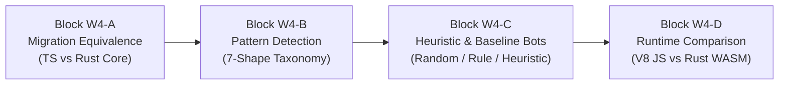

# Tuần 04 — Toán học pattern, heuristic và chiến lược baseline Rust

**Cập nhật: 23/10/2026.** Phân biệt rõ game `gomoku-main/engine`, native reference `caro-core-reference`, Wasm được build và browser dùng Wasm. G2 kiểm candidate/evaluator; G3 kiểm chiến lược/search; G4 kiểm package/adapter; chỉ [gate registry](../research/current_2026_10_23/GATES.md) ghi kết quả thực chạy mới. Phần tiếng Anh phía dưới là nghiên cứu trước snapshot này.

## 1. Bước 1 — Xác định một run để tránh đếm trùng

Với màu $p$ và trục $d\in\{(1,0),(0,1),(1,1),(1,-1)\}$, chỉ bắt đầu run tại $a$ nếu $B(a)=p$ và $a-d$ ngoài board hoặc không phải $p$. Từ đó lấy chiều dài maximal $\ell$ và hai endpoint. Số đầu mở là

$$
o=\mathbf1[a-d\in\Omega\land B(a-d)=0]
 +\mathbf1[a+\ell d\in\Omega\land B(a+\ell d)=0]\in\{0,1,2\}.
$$

[C] Mỗi maximal run theo một trục có đúng một điểm đầu nên không bị đếm từ từng quân. Một quân vẫn tham gia nhiều trục; đó là chủ đích, không phải duplicate cùng một run. Mép bàn không phải đầu mở. Gap `XX.XX` tạo hai run, nên detector contiguous chưa có broken-four taxonomy dù candidate có thể chứa ô gap.

## 2. Bước 2 — Chuyển hình học thành trọng số

[A] Game `eval.rs::pattern_score` hiện sử dụng:

$$
P(\ell,o)=\begin{cases}
1\,000\,000&\ell\ge5,\\
50\,000&\ell=4,o=2,\\
5\,000&\ell=4,o=1\ \text{hoặc}\ \ell=3,o=2,\\
500&\ell=3,o=1,\\
200&\ell=2,o=2,\\
50&\ell=2,o=1,\\
0&\text{còn lại}.
\end{cases}
$$

Đây là trọng số source, chưa được tournament calibration. `.XXXX.` cho 50,000; `OXXXX.` cho 5,000. Tên open/half-open nói endpoint theo board, không xác nhận ván có thể thắng sau bao nhiêu ply.

Với vị trí $(x,y)$, center bonus là

$$
c(x,y)=\max(14-|x-7|-|y-7|,0).
$$

Ví dụ trung tâm cho 14; góc `(0,0)` cho 0. Điểm nonterminal theo perspective root $p$:

$$
H(B,p)=\sum_{r\in Runs_p}P(\ell_r,o_r)
 -\sum_{r\in Runs_{opp}}P(\ell_r,o_r)
 +\sum_{B(y,x)=p}c(x,y)-\sum_{B(y,x)=opp}c(x,y).
$$

Game hiện có $\beta=1$ cho phần đối thủ; $\beta=1.15$ của narrative cũ là giả thuyết, không mặc nhiên là source. Reference dùng trọng số khác và không có center term mặc định.

## 3. Bước 3 — Không dùng heuristic thay terminal utility

Một pattern điểm cao không được phép lấn át trạng thái đã thắng/thua. Contract sửa lần này yêu cầu

$$
U(s,p,t)=\begin{cases}M-t&winner=p,\\-M+t&winner=opp,\\0&draw,\end{cases}
\qquad |H(s,p)|\le H_{max}<M-225.
$$

$t$ là ply từ root; ưu tiên thắng sớm và trì hoãn thua. [A] Source game mới `eval.rs` đã khai báo `MATE_SCORE=100_000_000`, `HEURISTIC_LIMIT=MATE_SCORE-225-1=99_999_774`, clamp heuristic và `terminal_utility`. Khi $0\le t\le225$, mate yếu nhất có độ lớn $99_999_775>H_{max}$; vì vậy một terminal win/loss không bị nonterminal heuristic lấn át. G2 kiểm hàm; [A] `search.rs::SearchContext::value` hiện gọi `terminal_utility` trước nhánh `depth==0`, được test tại G3. Source đã có không tự đồng nghĩa mọi integration đã pass.

## 4. Bước 4 — Random, rule-based, heuristic là policy khác nhau

Random chọn một phần tử từ tập đã công bố $A$; nếu sample đều thì $\Pr[m]=1/|A|$. Cần phân biệt random toàn legal với random trong candidate; seed/replay cho test phải ghi lại. Rule-based có thứ tự `own immediate win → opponent immediate win/block → greedy heuristic`. Có hai điểm thắng độc lập của đối thủ thì chọn một block không chứng minh sống sót. Greedy heuristic thử từng $m$, tính $H(T(s,m),p)$, rồi lấy argmax; đây là một ply, không phải minimax nhìn sâu.

Sáu level đang được map theo proposal W7; [A] Game mới đã tách Easy và Normal tại `ai.rs::choose_move`, xác nhận bằng tests trong [G3_native_tests.log](../research/current_2026_10_23/G3_native_tests.log) và sáu profile real-browser Worker. Easy dùng `Board::legal_moves`, SplitMix64 của seed rồi modulo số move; runtime Wasm tiêm seed từ `Math.random`, API seeded phục vụ tái lập. Không claim phép modulo cho phân phối đều chính xác hay dùng PRNG cho cryptography. Một lượt Easy ongoing ghi **nodes=2**: root và một selected position được evaluate sau lựa chọn; `completed_depth=0` vì lựa chọn không lookahead. Normal ghi depth1 theo policy own-win/block/greedy, không phải thuật toán minimax nhìn sâu.

## 5. Pseudocode

```text
EvaluateNonterminal(board, root)
  score = 0
  for each occupied cell a
    for each of four axes d
      if predecessor in direction -d has same stone: continue
      scan maximal run from a, count empty in-board endpoints
      add pattern score with + sign for root, - sign for opponent
    add signed center bonus
  return score clamped to declared nonterminal range
ChooseRuleBased(board, player)
  for each legal tactical coordinate: if wins now for player, choose it
  for each legal tactical coordinate: if opponent wins there, choose block
  otherwise evaluate legal candidates after temporary place, then undo
  choose first maximum under declared tie order
```

[A] Clamp đã có trong evaluator game; log G2 xác nhận hành vi đã test. Pattern scan là behavior đã đọc trong source; broken-pattern detector không tự được thêm bởi pseudocode này.

## 6. Code thật và evidence source

[A] `gomoku-main/engine/src/eval.rs::pattern_score`, trích một phần implementation hiện hữu:

```rust
match (count, open_ends) {
    (5.., _) => SCORE_FIVE,
    (4, 2) => SCORE_OPEN_FOUR,
    (4, 1) => SCORE_HALF_FOUR,
    (3, 2) => SCORE_OPEN_THREE,
    (3, 1) => SCORE_HALF_THREE,
    (2, 2) => SCORE_OPEN_TWO,
    (2, 1) => SCORE_HALF_TWO,
    _ => 0,
}
```

[A] `evaluate` bỏ điểm bắt đầu không maximal bằng kiểm predecessor cùng màu; `count_line` tính run và endpoint. `candidates.rs::assess` phục vụ ranking và immediate tactical classification, có bảng điểm riêng, không phải cùng $H$ ở trên. `lib.rs::Game::compute_ai_move` thực hiện choose→commit→history/winner/turn; `ai_move_seeded` serialize kết quả, còn `ai_move` tiêm seed. G4 build/copy và real-browser Worker đã xác nhận counter mới qua package thật.

[A] Terminal contract mới, trích `eval.rs`:

```rust
pub const MATE_SCORE: i32 = 100_000_000;
/// Reserve the entire possible 225-ply game below the weakest mate score.
pub const HEURISTIC_LIMIT: i32 = MATE_SCORE - (SIZE * SIZE) as i32 - 1;
```

`terminal_utility(winner, full, player, ply)` trả `Some` cho win/loss/draw và `None` cho ongoing; `evaluate` chỉ trả heuristic đã clamp. Tách hai hàm giúp caller không trộn trạng thái terminal với điểm pattern.

[A] Dispatch strategy thật tại `gomoku-main/engine/src/ai.rs::choose_move`:

```rust
let result = match difficulty {
    Difficulty::Easy | Difficulty::Normal => baseline(board, player, difficulty, seed),
    _ => search(board, player, difficulty.search_config()),
};
```

[A] Normal lấy tactic theo thứ tự thật ở `baseline`:

```rust
if let Some(mv) = candidates.immediate_win.or(candidates.immediate_block) {
    let score = evaluated_move(&mut owned, player, mv, &mut stats);
    debug_assert_eq!(&owned, board);
    return SearchResult { best_move: Some(mv), score, stats };
}
```

`evaluated_move` place→terminal/heuristic→undo. `Game::compute_ai_move` mới commit nước cuối một lần; search/baseline không tự sửa history Game. [engine_difficulty_runs.csv](../research/current_2026_10_23/engine_difficulty_runs.csv) ghi 18 lần chạy sáu tier trên ba fixture; không phải strength tournament.

| ID mới | Kiểm gì | Evidence cần lưu |
| --- | --- | --- |
| BP26-EVAL-RUN | Open/half-open/edge/crossing, không đếm lặp run | Fixture input và expected pattern/score |
| BP26-EVAL-TERMINAL | Mọi win/loss terminal nằm ngoài nonterminal range | Hằng số source + extreme-board test |
| BP26-STRATEGY-RANDOM | Hợp lệ, tái lập test khi có seed; không giả vờ search | Output strategy/counter/corpus |
| BP26-STRATEGY-RULE | Ưu tiên own win rồi block rồi fallback | Own-win, single-block, double-threat cases |
| BP26-WASM-PROVENANCE | Binary mới khớp source/build | Command, SHA256, package smoke result |

## 7. Chi phí, lý do, lựa chọn và mức khó

Với bốn trục cố định, duyệt gốc $O(N^2)$ và maximal runs mỗi trục phân hoạch quân; tổng scan theo trục cũng $O(N^2)$. Nếu evaluate lại toàn board tại $q$ ứng viên/node, chi phí xấp xỉ $q\,T_H$ cộng apply/undo, không chỉ sort $O(q\log q)$. Chưa có profile cho phép kết luận evaluator là bottleneck chính.

| Phương án | Lợi | Hại/khó | Quyết định |
| --- | --- | --- | --- |
| Contiguous run hiện tại | Dễ giải thích bằng toán, baseline tái lập | Bỏ qua broken patterns và chiến thuật sâu | Giữ, công bố limitation |
| Sliding window/gap-aware | Nhận `XX.XX`, `X.XXX` | Cần chống duplicate và rule-aware fixture | Thêm riêng sau gate đúng đắn |
| Incremental evaluator | Có thể tránh quét lại toàn board | Undo phải khôi phục score và cache mọi trục | Chỉ sau profile và differential test |
| Trait cho từng tiny score rule | Contract mở rộng | Một implementation dễ tạo abstraction dư | Enum/struct/functions trước; TMB/Ponytail kiểm scope |

Độ khó kỹ thuật **3/5** cho evaluator đúng và terminal separation; **4/5** cho gap-aware/incremental evaluation hoặc adapter Wasm. Không suy `Rust nhanh hơn TS` từ ngôn ngữ hoặc array: cần cùng corpus/algorithm/profile/runtime, warm-up và raw timings. [A] [G2_eval_tests.log](../research/current_2026_10_23/G2_eval_tests.log) ghi 5 evaluator tests pass; [G2_candidate_tests.log](../research/current_2026_10_23/G2_candidate_tests.log) ghi 5 selection/tactical tests pass. Đó là hai module gates; strategy-six-level sau đó được kiểm trong G3 và real-browser Worker G4. [G3_native_tests.log](../research/current_2026_10_23/G3_native_tests.log) ghi 38 unit + 7 native integration pass; [wasm_package.json](../research/current_2026_10_23/wasm_package.json) và [G4_real_browser_worker.json](../research/current_2026_10_23/G4_real_browser_worker.json) bổ sung package/browser evidence. Frontend cuối có 59 tests/9 files pass, gồm 18 real-Wasm cases; [wasm_ts_parity.json](../research/current_2026_10_23/wasm_ts_parity.json) lưu exact fixtures/board/moves thay vì chỉ đếm test. G2/G4 ghi review TMB, Ponytail và check hành vi riêng; [mô hình chung](../BasicProject_Current_Math_and_Design.md) giữ decision log.

---

## Hồ sơ lịch sử — nghiên cứu/reference và build trước ngày 23/10/2026

> Phần dưới phân biệt reference và game ở snapshot cũ. Các log, số test và hash của ngày 16–17/10 vẫn là evidence lịch sử, không tự thay kết quả của source đang sửa ngày 23/10.

# Week 04 Research Report: WebAssembly Migration, Four-Block Experimentation, Pattern Classification, and Heuristics

**Project Title:** Research, Design, and Implementation of an Optimized Gomoku Game Engine with Artificial Intelligence  
**Academic Module:** Basic Project (Đồ Án Cơ Sở) — Software Engineering & AI Track  
**Document Standard:** Standard 00 (IMRaD & Evidence Specification for Software Systems)  
**Control Layer Reference:** `RQ-W4-A01` to `RQ-W4-D01`, `EXP-W4-A01` to `EXP-W4-D01`, `CFG-EVAL-v1`  
**Implementation Sources:** [GitHub – tducn110/caro](https://github.com/tducn110/caro), the local `10_caro` and `gomoku-main` checkouts, and the separately labelled `caro-core-reference` crate  
**Language:** English  
**Status:** Local source review; migration parity, browser integration, and controlled benchmark gates remain pending  

**Current review and build workflow:** [Caro rules, heuristic, Rust and Wasm guide](../Caro_Rules_Heuristic_Rust_WASM_Review.md). The guide records current source provenance, actual commands/results, and the Rust-to-Wasm build path. This report separates implemented reference behavior from proposed experiments.

---

## 1. Plan & Four-Block Research Decomposition

To avoid conflating language migration, pattern classification, heuristic weights, and runtime environment, Week 04 defines **four experimental blocks**. These are a research plan; the diagram does not establish that the gates have passed:



---

## 2. Block W4-A: Migration Equivalence

### 2.1 Research Question
* **`RQ-W4-A01`:** Does the Rust computational state and raycast win detection preserve exact domain semantics of the TypeScript baseline with zero divergence?

### 2.2 Subtask Workflow
* `ST-W4-A01`: Map TypeScript `CaroEngine` state and rule contracts.
* `ST-W4-A02`: Map Rust `caro-core-reference` equivalents (`GameState`, `Player`, `play`).
* `ST-W4-A03`: Construct shared differential fixture corpus (`FIX-RULE-001` to `005`).
* `ST-W4-A04`: Execute differential tests comparing TS and Rust outputs.
* `ST-W4-A05`: Verify serialization round-trip across WebAssembly linear memory boundary.
* `ST-W4-A06`: Record migration evidence report (`EXP-W4-A01`).

### 2.3 Evidence & Results (`EXP-W4-A01`)
* **[A] Source evidence — Separate artifacts:** `caro-core-reference` is a local Rust reference crate, while the current game's Rust/Wasm source is a separate artifact in `gomoku-main`. The reference uses `Player::X=1`, `Player::O=-1`, a `[i8;225]` board, and `Move::new(row,col)`. None of those declarations alone proves compatibility with the TypeScript baseline or a Wasm adapter.
* **Pending gate — Differential parity:** The previously asserted 25-position corpus and 100% agreement have no supporting fixture run or raw output in this report. Build a shared corpus covering the rules in Week 01, explicitly normalize encoding and coordinates, and compare terminal results under the same rule profile. Native Rust unit tests and Rust search-equivalence tests are not a TS/Rust differential suite.
* **Pending gate — Runtime boundary:** Verify module initialization, board serialization, rejected input, returned move legality, and terminal statuses in the actual browser/worker path. A successful native test or Wasm compile does not establish these behaviors.

---

## 3. Block W4-B: Pattern Detection Correctness

### 3.1 Research Question
* **`RQ-W4-B01`:** What pattern taxonomy is recognized by each detector, how does it avoid duplicate runs, and what additional fixtures are needed for broken patterns and rule-dependent threats?

### 3.2 Reference Pattern Taxonomy and Weights (`CFG-PATTERN-v1`, reference defaults)

| Reference count | Canonical string (`X`: self, `O`: opponent, `.`: empty) | Implemented classification | Default score |
| :--- | :--- | :--- | :---: |
| **`five_or_more`** | `XXXXX` or a longer contiguous run | Any maximal run of length $\ge5$, regardless of endpoints | **$1,000,000$** |
| **`open_four`** | `.XXXX.` | Contiguous four, two empty endpoints | **$100,000$** |
| **`closed_four`** | `OXXXX.` or `.XXXXO` | Contiguous four, one empty endpoint | **$20,000$** |
| **`open_three`** | `.XXX.` | Contiguous three, two empty endpoints | **$5,000$** |
| **`closed_three`** | `OXXX.` or `.XXXO` | Contiguous three, one empty endpoint | **$500$** |
| **`open_two`** | `.XX.` | Contiguous two, two empty endpoints | **$100$** |
| **`closed_two`** | `OXX.` or `.XXO` | Contiguous two, one empty endpoint | **$10$** |

The current game's `gomoku-main/engine/src/eval.rs` has a different source profile. Its weights must not be copied from the reference table or called calibrated measurements:

| Current game pattern | Source score |
| :--- | :---: |
| Contiguous run $\ge5$ | $1,000,000$ |
| Open four | $50,000$ |
| Half-open four | $5,000$ |
| Open three | $5,000$ |
| Half-open three | $500$ |
| Open two | $200$ |
| Half-open two | $50$ |

**[A] Source evidence:** `caro-core-reference/src/pattern.rs::detect_runs()` emits a maximal contiguous run once per direction, from its first stone. `count_patterns()` classifies its length and empty endpoints. This is not the previously claimed six-cell sliding-window detector. `XX.XX`, `.XX.X.`, `.X.X.`, and `X.X.X` require a separate gap-aware detector and cannot be promoted to implemented shapes by listing them in a table. The source test `detects_open_three_once` checks one contiguous open-three case; it is not a proof for the full tactical taxonomy.

**Rule consistency gap:** Pattern counting always maps length $\ge5$ to `five_or_more` and counts an endpoint as open only when it is an in-board empty cell. That heuristic classification does not apply `RuleConfig` to distinguish exact-five, overlines, or a disqualified blocked five. Terminal status must come from the rule module, and any proposed Caro-aware threat detector must use the same profile. A high heuristic score alone is not a win.

### 3.3 Subtask Workflow & Double-Count Prevention
* `ST-W4-B01` — Plan: freeze the contiguous-run taxonomy separately from any proposed broken-pattern taxonomy.
* `ST-W4-B02` — Plan: create positive fixtures for each shape (`FIX-PATTERN-001` to `007`).
* `ST-W4-B03` — Plan: create negative edge/corner and rule-profile fixtures (`FIX-PATTERN-008` to `012`).
* `ST-W4-B04` — Source behavior / remaining gate: first-stone ownership prevents duplicate emission of the same maximal run in one direction. Verify overlapping, crossing, and gap patterns separately; do not claim a general no-double-counting proof from this implementation.

---

## 4. Block W4-C: Heuristic Evaluation & Baseline Bots

### 4.1 Research Question
* **`RQ-W4-C01`:** How do immediate-win/block rules and the evaluation formula $E(s)=\text{Attack}-\beta\cdot\text{Defense}$ affect tactical choices, and would a proposed defense multiplier or center bias improve measured play?

### 4.2 Evaluator Specification (`CFG-EVAL-v1`)
For a nonterminal position in the local reference:
$$E(s) = \sum_p W_p N_p(\text{Player}) - \frac{\text{defense\_num}}{\text{defense\_den}}\sum_p W_p N_p(\text{Opponent}).$$
**[A] Source evidence:** `evaluator.rs::EvalWeights::default()` uses the reference-default table in Section 3.2 with `defense_num=1` and `defense_den=1`, so the default $\beta=1$. There is no center-bias term in this reference evaluator. Integer division and a clamp below the terminal score are part of the implementation.

**[A] Current game source:** `gomoku-main/engine/src/eval.rs::evaluate()` also uses own pattern sum minus opponent pattern sum ($\beta=1$), with the distinct game weights above and an additional signed center score. A stone at $(x,y)$ contributes $\max(14-|x-7|-|y-7|,0)$ positively for the perspective player and negatively for the opponent. `ai.rs::quick_score()` is a separate candidate-ordering heuristic; its numbers are not the board evaluator's weights.

**Reference terminal utility is separate:** `caro-core-reference/src/evaluator.rs::evaluate()` first checks `GameStatus`: a win for the perspective returns `MATE_SCORE=10,000,000`, an opponent win returns its negative, and a draw returns zero. Only a playing position receives pattern scores, clamped to $[-9,999,999,9,999,999]$. This makes an already-recorded terminal win dominate the heuristic; it does not prove that every rule profile's nonterminal threats are scored correctly.

This terminal utility behavior belongs to the **reference** crate. In the current game engine, `ai.rs::minimax()` returns `evaluate(board, ai_player)` for a winner, full board, or depth limit. Its terminal search path therefore still needs a distinct win/loss/draw utility contract; the reference's behavior must not be presented as already implemented there. The linked review explains the source gap and proposed correction.

**[D] Proposed experiment:** $\beta=1.15$ (for example, integer ratio `115/100`) and a separately defined center term are tunable hypotheses. They have not been calibrated by a documented tournament or controlled experiment here, and cannot guarantee avoidance of defensive blunders. Keep the current game engine's profile, this reference default, and experimental weights as separate configurations.

### 4.3 Baseline Bot Tiers
1. **Tier 1 (Random Bot):** Selects a move from the generated candidate set (`ST-W4-C04`); candidate generation and random sampling must be described separately.
2. **Tier 2 (Rule-Based Bot):** `bot/rule_based.rs` tries an immediate own win, then the first candidate that would give the opponent an immediate win, then uses the heuristic fallback (`ST-W4-C05`). Choosing one block cannot save a position with multiple independent winning threats.
3. **Tier 3 (Heuristic Bot):** `bot/heuristic.rs::choose_heuristic_move()` applies each candidate, scores from the root player's perspective, undoes the move, and keeps the first maximum (`ST-W4-C06`). This is greedy one-ply evaluation; its choice is restricted by `CandidateConfig`.

---

## 5. Block W4-D: Runtime Comparison (TypeScript vs. Rust WASM)

### 5.1 Controlled Experiment Protocol (`EXP-W4-D01`)
* **Independent Variable:** Execution Runtime (V8 JIT JavaScript vs. Rust WebAssembly).
* **Controlled Variables:** Identical board state, identical 7-shape pattern weights, identical candidate move set, identical hardware.

### 5.2 Benchmark Status and Required Evidence

| Claim | Evidence status | Required measurement |
| :--- | :--- | :--- |
| TS versus Rust/Wasm evaluation throughput | Pending | Same board corpus, rule profile, weights, candidate set, runtime/hardware, warm-up, repetitions, and raw timings |
| End-to-end move latency | Pending | Include serialization, worker messaging, module initialization policy, and the actual search budget |
| Allocation / GC behavior | Pending | Profile JS and Rust/Wasm allocations and pauses separately; Wasm linear memory alone proves neither zero allocation nor zero browser GC |

The earlier values of 120,000 versus 1,840,000 evaluations/s, a 15.3x speedup, and 15–40 ms JS GC pauses are withdrawn: no supporting benchmark harness, raw data, or environment record accompanies them. `pattern.rs::detect_runs()` creates a `Vec`, so the reference does allocate while evaluating patterns.

**[A] Current bounded verification:** Native runs passed 6 unit plus 3 integration tests for `caro-core-reference`, and 19 unit plus 3 integration tests for the game engine. An isolated locked/offline release build of the game engine with `wasm-pack --target web` succeeded. Seven rule fixtures plus one API fixture passed against both the existing and rebuilt Wasm packages through Node `initSync`. These checks establish the tested native/package behaviors, not full search parity, browser/worker integration, controlled throughput, or provenance of the existing binary. Exact commands, tool versions, output hashes, and limitations are recorded in the linked current review.

### 5.3 Rust-to-Wasm Compilation Boundary

**[A] Source evidence:** The local `caro-core-reference/Cargo.toml` declares `crate-type=["rlib"]` and no dependencies; `lib.rs` contains no `wasm_bindgen` exports. It is a native Rust reference library as checked, not an existing JavaScript-facing Wasm package.

The build workflow in the linked guide distinguishes the existing `gomoku-main` engine's package from a proposed adapter for the reference crate. For an adapter, explicitly define the exported board encoding, rule configuration, input validation, returned move/status, `cdylib` output, and `wasm-bindgen`/`wasm-pack` setup. Installing a Rust target or running `cargo build --target wasm32-unknown-unknown` alone does not generate the JavaScript wrapper or integrate the module into a browser worker. Keep native tests, Wasm package generation, browser integration, and performance measurement as separate gates.

**[D] Architectural recommendation:** Keep rule checking, candidate generation, and evaluation in the same Rust core, with a coarse browser/worker adapter. Promote this recommendation to application evidence only after the relevant build and runtime checks.

---

## 6. Deliverables & References
1. Four-block research plan defined (`W4-A` through `W4-D`), with parity/runtime/benchmark gates explicitly pending.
2. Actual contiguous-run taxonomy and default weights recorded; broken-pattern support remains a gap.
3. Terminal utility distinguished from nonterminal heuristic scores; $\beta=1.15$ remains an experiment proposal.
4. Rust-to-Wasm compilation and integration boundary linked to the current local guide. No test success is inferred from `cargo test eval`, which may match no tests in the current reference crate.
