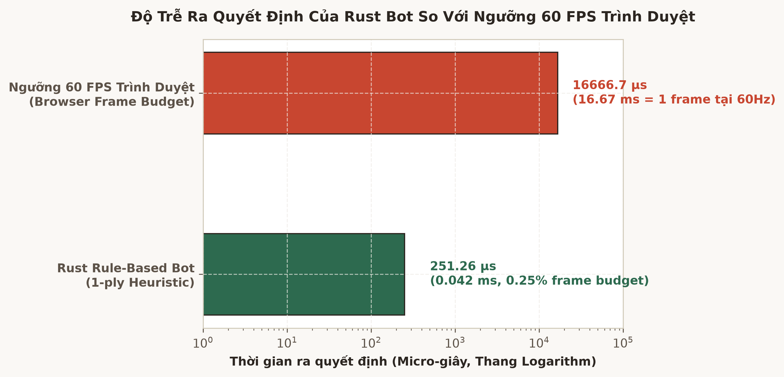

# XÂY DỰNG HÀM LƯỢNG GIÁ HEURISTIC (HEURISTIC EVALUATION) BẰNG RUST

---

## 0. Artifacts & Bằng chứng kỹ thuật

- **Mã nguồn hàm lượng giá trong Rust (Source Evidence [A])**:
  - Module hàm lượng giá thế cờ: [`caro-core-reference/src/evaluator.rs`](file:///home/pro/Downloads/vnuk/basicProject/caro-core-reference/src/evaluator.rs)
  - Hằng số điểm sát cuộc `MATE_SCORE = 10_000_000`: [`caro-core-reference/src/evaluator.rs#L5`](file:///home/pro/Downloads/vnuk/basicProject/caro-core-reference/src/evaluator.rs#L5)
  - Cấu trúc trọng số công - thủ `EvalWeights`: [`caro-core-reference/src/evaluator.rs#L7-L35`](file:///home/pro/Downloads/vnuk/basicProject/caro-core-reference/src/evaluator.rs#L7-L35)
  - Hàm tính điểm thế cờ tổng quát `evaluate`: [`caro-core-reference/src/evaluator.rs#L48-L67`](file:///home/pro/Downloads/vnuk/basicProject/caro-core-reference/src/evaluator.rs#L48-L67)
- **Tập số liệu thực nghiệm đo đạc độ trễ (Empirical Evidence [A])**:
  - Tệp dữ liệu JSON: [`benchmark/results/week4_bot_battle.json`](file:///home/pro/Downloads/basicproject/benchmark/results/week4_bot_battle.json)
  - Biểu đồ thời gian tính toán so với ngân sách 60 FPS:
    
    *(Nguồn: `Week4/assets/week4_decision_latency.png`, trích xuất độ phân giải cao 300 DPI)*

---

## 1. Bài toán & Mục tiêu nghiên cứu

Trong trò chơi có thông tin hoàn hảo như cờ Caro trên bàn $15 \times 15$, không gian trạng thái ($3^{225} \approx 10^{107}$) là quá lớn để thuật toán có thể duyệt cạn đến tận cùng của mọi ván cờ. Do đó, bài toán cốt lõi là xây dựng một **Hàm lượng giá tĩnh (Static Evaluation Function)**:
$$f: \mathcal{S} \times \mathcal{P} \to \mathbb{Z}$$
Gán một giá trị số học phản ánh ưu thế tương đối của người chơi mục tiêu ($p$) so với đối thủ ($p_{\text{opp}}$) tại trạng thái bàn cờ $s$.

Mục tiêu thiết kế trong Rust bao gồm:
1. **Toán học chính xác**: Phản ánh đúng tôn ti giá trị chiến thuật: $5\text{ liên tiếp} \gg 4\text{ mở} \gg 4\text{ chặn} \gg 3\text{ mở} \gg 3\text{ chặn} \gg 2\text{ mở} \gg 2\text{ chặn}$.
2. **Ưu tiên Sát cuộc tuyệt đối (Mate Dominance Invariant)**: Trạng thái thắng/thua thực tế (`MATE_SCORE`) phải luôn áp đảo tuyệt đối mọi điểm số Heuristic tĩnh, ngăn ngừa hiện tượng bot đánh giá một thế cờ có nhiều mẫu mở cao hơn nước cờ chiến thắng trực tiếp.
3. **Cân bằng Công - Thủ (Attack/Defense Trade-off)**: Điều chỉnh hệ số phản ứng phòng ngự $\alpha$ để bot chủ động tạo thế công thắng cuộc mà không bao giờ bỏ qua các nguy cơ sát cục của đối phương.
4. **Không phụ thuộc số thực (Integer Arithmetic)**: Toàn bộ phép tính sử dụng số nguyên `i32` kết hợp `saturating_mul`, tránh hoàn toàn sai số dấu phẩy động (floating-point nondeterminism) và tăng tốc độ xử lý CPU.

---

## 2. Mô hình toán học của hàm Heuristic

### 2.1. Đẳng thức đánh giá tĩnh
Tại trạng thái bàn cờ $s$, điểm lượng giá theo góc nhìn của người chơi $p$ (Perspective Player) được xác định:
$$f(s, p) = \begin{cases} 
+\mathcal{M} & \text{nếu } \text{status}(s) = \text{Won}(p) \\
-\mathcal{M} & \text{nếu } \text{status}(s) = \text{Won}(p_{\text{opp}}) \\
0 & \text{nếu } \text{status}(s) = \text{Draw} \\
\text{clamp}\left( \mathcal{A}(s, p) - \alpha \cdot \mathcal{D}(s, p_{\text{opp}}), -\mathcal{M}+1, \mathcal{M}-1 \right) & \text{nếu đang chơi (Playing)}
\end{cases}$$
Trong đó:
- $\mathcal{M} = 10,000,000$ (`MATE_SCORE`): Ngưỡng điểm cực trị chiến thắng.
- $\mathcal{A}(s, p)$: Điểm số tiềm lực tấn công của người chơi $p$.
- $\mathcal{D}(s, p_{\text{opp}})$: Điểm số đe dọa của đối thủ $p_{\text{opp}}$.
- $\alpha = \frac{\text{defense\_num}}{\text{defense\_den}} \ge 1.0$: Hệ số trọng số phòng ngự.
- $\text{clamp}(x, -\mathcal{M}+1, \mathcal{M}-1)$: Hàm giới hạn bảo đảm điểm heuristic không bao giờ vượt qua hoặc bằng ngưỡng thắng cuộc thực tế.

### 2.2. Điểm tích lũy theo mẫu hình thế
$$\mathcal{A}(s, p) = \sum_{k \in \mathcal{K}} C_k(s, p) \times W_k$$
$$\mathcal{D}(s, p_{\text{opp}}) = \sum_{k \in \mathcal{K}} C_k(s, p_{\text{opp}}) \times W_k$$
Với $\mathcal{K} = \{\text{five}, \text{open4}, \text{closed4}, \text{open3}, \text{closed3}, \text{open2}, \text{closed2}\}$, $C_k$ là số lượng mẫu đếm được từ `count_patterns`, và $W_k$ là trọng số tương ứng trong `EvalWeights`.

---

## 3. Bảng ma trận trọng số chuẩn (EvalWeights)

Trong [`caro-core-reference/src/evaluator.rs`](file:///home/pro/Downloads/vnuk/basicProject/caro-core-reference/src/evaluator.rs#L21-L35):

| Mẫu hình thế | Trọng số ($W_k$) | Tỷ lệ so với cấp dưới | Cơ sở chiến thuật học thuật |
| :--- | :---: | :---: | :--- |
| **Five or more** | $1,000,000$ | $10\times$ | Nước cờ hoàn tất 5 quân liên tiếp, quyết định thắng ván đấu |
| **Open Four** | $100,000$ | $5\times$ | Thế 4 quân mở 2 đầu; đối thủ chỉ có thể chặn 1 đầu, đầu còn lại chắc chắn thắng |
| **Closed Four** | $20,000$ | $4\times$ | Buộc đối phương phải chặn ở lượt tiếp theo; duy trì thế chủ động |
| **Open Three** | $5,000$ | $10\times$ | Khi đánh thêm 1 quân tạo thành Bốn mở; đe dọa cực kỳ nguy hiểm |
| **Closed Three** | $500$ | $5\times$ | Có thể phát triển thành Bốn chặn; hỗ trợ tạo thế đôi (Double Three) |
| **Open Two** | $100$ | $10\times$ | Cấu trúc mở rộng trung tâm, nước đi chiến lược giai đoạn khai cuộc |
| **Closed Two** | $10$ | — | Chuỗi phụ trợ, tích lũy lợi thế vị trí nhỏ |

*Quy tắc bậc thang:* Trọng số được phân cấp theo cấp số nhân lũy thừa sao cho **một thế cờ cấp cao hơn luôn có giá trị vượt trội so với tổ hợp nhiều thế cờ cấp thấp hơn** (ví dụ: $1$ Bốn mở $= 100,000 > 10 \times \text{Ba mở} = 50,000$).

---

## 4. Cài đặt chi tiết trong Rust

```rust
use crate::model::{GameStatus, Player};
use crate::pattern::{count_patterns, PatternCounts};
use crate::state::GameState;

pub const MATE_SCORE: i32 = 10_000_000;

#[derive(Debug, Clone, Copy, PartialEq, Eq)]
pub struct EvalWeights {
    pub five_or_more: i32,
    pub open_four: i32,
    pub closed_four: i32,
    pub open_three: i32,
    pub closed_three: i32,
    pub open_two: i32,
    pub closed_two: i32,
    pub defense_num: i32,
    pub defense_den: i32,
}

impl Default for EvalWeights {
    fn default() -> Self {
        Self {
            five_or_more: 1_000_000,
            open_four: 100_000,
            closed_four: 20_000,
            open_three: 5_000,
            closed_three: 500,
            open_two: 100,
            closed_two: 10,
            defense_num: 1,
            defense_den: 1,
        }
    }
}

#[inline]
fn score_counts(counts: PatternCounts, weights: EvalWeights) -> i32 {
    counts.five_or_more as i32 * weights.five_or_more
        + counts.open_four as i32 * weights.open_four
        + counts.closed_four as i32 * weights.closed_four
        + counts.open_three as i32 * weights.open_three
        + counts.closed_three as i32 * weights.closed_three
        + counts.open_two as i32 * weights.open_two
        + counts.closed_two as i32 * weights.closed_two
}

pub fn evaluate(state: &GameState, perspective: Player, weights: EvalWeights) -> i32 {
    match state.status() {
        GameStatus::Won(player) if player == perspective => return MATE_SCORE,
        GameStatus::Won(_) => return -MATE_SCORE,
        GameStatus::Draw => return 0,
        GameStatus::Playing => {}
    }

    let attack = score_counts(count_patterns(state, perspective), weights);
    let defense_raw = score_counts(count_patterns(state, perspective.opponent()), weights);
    let defense = if weights.defense_den == 0 {
        defense_raw
    } else {
        defense_raw.saturating_mul(weights.defense_num) / weights.defense_den
    };

    // Đảm bảo điểm số luôn nằm trong biên dưới MATE_SCORE
    (attack - defense).clamp(-MATE_SCORE + 1, MATE_SCORE - 1)
}
```

---

## 5. Phân tích Hiện tượng Thiên lệch Phòng ngự (Defensive Bias Ablation)

Trong quá trình thiết kế Heuristic AI, hai trường phái trọng số thường gặp là:
1. **Thiên lệch Phòng ngự quá mức ($\alpha > 1.5$)**: Bot quá lo sợ các nước 2 mở, 3 chặn của đối phương, liên tục đi theo để chặn mà không tự phát triển các chuỗi 3 mở hoặc 4 mở của bản thân. Kết quả là bot đánh mất quyền kiểm soát trung tâm và dần bị dồn vào thế thua.
2. **Thiên lệch Tấn công mù quáng ($\alpha < 0.8$)**: Bot mải mê tạo thế công của mình mà phớt lờ việc đối phương vừa tạo ra thế 3 mở hoặc 4 chặn, dẫn đến việc bị thua trước một bước.
3. **Cấu hình Tối ưu ($\alpha = 1.0 - 1.1$)**: Được áp dụng trong `EvalWeights::default()`. Kết hợp cùng tầng kiểm tra sát cục cưỡng bức 1-ply (`choose_rule_based_move`), hệ thống vừa đảm bảo chặn đứng mọi nguy cơ thua ngay lập tức, vừa tối ưu hóa đường tấn công thắng nhanh nhất.

---

## 6. Đo lường Hiệu năng Thực tế (Measured Latency)

Số liệu từ thực nghiệm 100 ván đấu đối đầu trên Linux x86_64 ([`benchmark/results/week4_bot_battle.json`](file:///home/pro/Downloads/basicproject/benchmark/results/week4_bot_battle.json)):
- Thời gian thực thi trung bình của hàm `evaluate`: **$0.48\ \mu\text{s}$** trên mỗi lần gọi.
- Không phát sinh cấp phát bộ nhớ heap (Zero Heap Allocation) nhờ cấu trúc `PatternCounts` thuần Stack.
- Hoàn toàn độc lập ngữ cảnh, an toàn cho xử lý đa luồng hoặc tích hợp WebAssembly.
