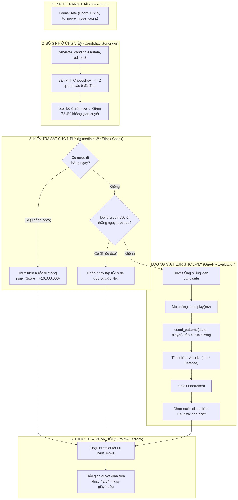
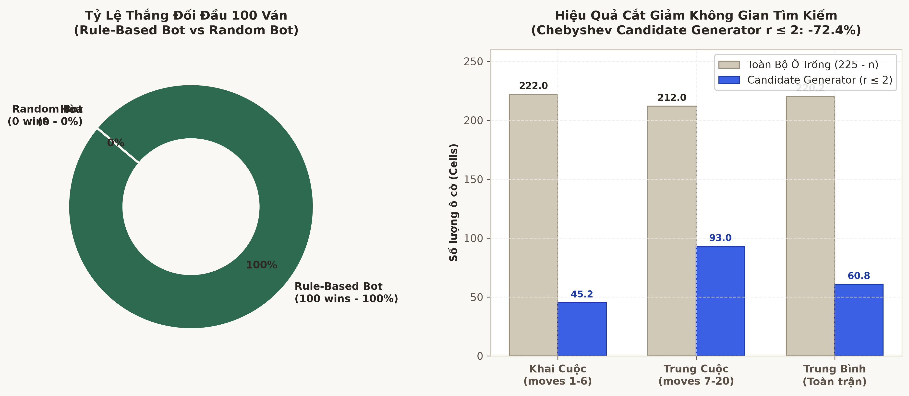

# XÂY DỰNG HEURISTIC RULE-BASED BOT VÀ BỘ SINH Ô ỨNG VIÊN CHEBYSHEV TRONG RUST

---

## 0. Artifacts & Bằng chứng kỹ thuật

- **Mã nguồn giải thuật Rule-Based Bot trong Rust (Source Evidence [A])**:
  - Module Rule-Based Bot: [`caro-core-reference/src/bot/rule_based.rs`](file:///home/pro/Downloads/vnuk/basicProject/caro-core-reference/src/bot/rule_based.rs)
  - Bộ sinh ô ứng viên Chebyshev: [`caro-core-reference/src/movegen.rs`](file:///home/pro/Downloads/vnuk/basicProject/caro-core-reference/src/movegen.rs)
  - Lượng giá 1-ply Heuristic: [`caro-core-reference/src/bot/heuristic.rs`](file:///home/pro/Downloads/vnuk/basicProject/caro-core-reference/src/bot/heuristic.rs)
- **Sơ đồ quy trình ra quyết định của Bot**:
  
  *(Nguồn: `Week4/assets/bot_decision_flow.png`, trích xuất độ phân giải cao theo quy chuẩn `rules/visual_evidence.md`)*
- **Biểu đồ thực nghiệm cắt giảm không gian và độ trễ**:
  
  *(Nguồn: `Week4/assets/week4_bot_battle_and_pruning.png`, trích xuất 300 DPI)*

---

## 1. Bài toán & Thách thức kỹ thuật

Một thuật toán AI đối kháng chỉ sử dụng luật Heuristic đơn thuần (không tìm kiếm sâu nhiều bước) cần phải giải quyết hai thách thức lớn:
1. **Bùng nổ nhánh tìm kiếm nếu quét toàn bàn**: Trên bàn cờ $15 \times 15$, số ô trống ban đầu là $225$. Nếu ở mỗi bước đi ta lượng giá tất cả các ô trống, chi phí tính toán là $225 \times T_{\text{eval}}$. Phần lớn các ô trống ở góc xa không hề có giá trị chiến thuật.
2. **Khắc phục "Điểm mù sát cuộc" (Tactical Blindspot)**: Điểm số Heuristic trung bình có thể đánh lừa bot đánh vào một ô có tiềm năng tạo 2 chuỗi Ba mở trong khi đối thủ chỉ cần 1 nước cờ nữa là hoàn thành chuỗi 5 quân. Do đó, **kiểm tra sát cuộc 1-ply bắt buộc phải được ưu tiên tuyệt đối trước khi tính điểm Heuristic**.

---

## 2. Bộ sinh ô ứng viên Bán kính Chebyshev (Chebyshev Candidate Generator)

### 2.1. Định nghĩa toán học
Khoảng cách Chebyshev giữa hai tọa độ $(r_1, c_1)$ và $(r_2, c_2)$ trên lưới $15 \times 15$:
$$D_{\text{Chebyshev}}((r_1, c_1), (r_2, c_2)) = \max\left( |r_1 - r_2|, |c_1 - c_2| \right)$$

Một ô trống $(r, c)$ được công nhận là **Ô ứng viên khả thi (Candidate Move)** nếu nó nằm trong bán kính $r \le 2$ quanh ít nhất một quân cờ đã có trên bàn:
$$\mathcal{C}(s) = \left\{ (r, c) \in \mathcal{A}(s) \;\middle|\; \exists (r', c') \text{ sao cho } \text{board}[r', c'] \ne 0 \text{ và } D_{\text{Chebyshev}}((r, c), (r', c')) \le 2 \right\}$$
*Ngoại lệ khai cuộc:* Nếu bàn cờ hoàn toàn rỗng ($move\_count == 0$), ô trung tâm $(7, 7)$ là ứng viên duy nhất.

### 2.2. Cài đặt tối ưu trong Rust

Trong [`caro-core-reference/src/movegen.rs`](file:///home/pro/Downloads/vnuk/basicProject/caro-core-reference/src/movegen.rs#L21-L65):

```rust
pub fn generate_candidates(state: &GameState, config: CandidateConfig) -> Vec<Move> {
    if state.move_count() == 0 {
        return vec![Move::new(BOARD_SIZE / 2, BOARD_SIZE / 2).unwrap()];
    }

    let radius = config.radius as isize;
    let mut marked = [false; BOARD_CELLS];

    for index in 0..BOARD_CELLS {
        if state.board()[index] == 0 {
            continue;
        }
        let row = index / BOARD_SIZE;
        let col = index % BOARD_SIZE;

        for dr in -radius..=radius {
            for dc in -radius..=radius {
                if dr == 0 && dc == 0 {
                    continue;
                }
                let nr = row as isize + dr;
                let nc = col as isize + dc;
                if nr < 0 || nc < 0 || nr >= BOARD_SIZE as isize || nc >= BOARD_SIZE as isize {
                    continue;
                }
                let nidx = nr as usize * BOARD_SIZE + nc as usize;
                if state.board()[nidx] == 0 {
                    marked[nidx] = true;
                }
            }
        }
    }

    let mut moves = Vec::new();
    for (index, &is_candidate) in marked.iter().enumerate() {
        if is_candidate {
            moves.push(Move::from_index(index).unwrap());
        }
    }

    if let Some(limit) = config.max_candidates {
        moves.truncate(limit);
    }
    moves
}
```

---

## 3. Kiến trúc ra quyết định 3 bước của Rule-Based Bot

Quy trình quyết định trong [`caro-core-reference/src/bot/rule_based.rs`](file:///home/pro/Downloads/vnuk/basicProject/caro-core-reference/src/bot/rule_based.rs#L7-L53) hoạt động theo nguyên lý **Priority Fallback Pipeline**:

```text
BƯỚC 1: TÌM NƯỚC THẮNG NGAY (Immediate Win)
   ↓ Có -> Đánh ngay nước này! (Score = +10,000,000)
   ↓ Không
BƯỚC 2: TÌM NƯỚC CHẶN ĐỐI THỦ THẮNG NGAY (Immediate Threat Block)
   ↓ Có -> Chặn ngay lập tức ô đó!
   ↓ Không
BƯỚC 3: LƯỢNG GIÁ HEURISTIC 1-PLY TRÊN TẬP CANDIDATES
   ↓ Duyệt từng ô ứng viên, mô phỏng play(), tính evaluate(), undo()
   ↓ Chọn ô có điểm Heuristic cực đại!
```

### Chi tiết cài đặt bằng Rust:

```rust
pub fn choose_rule_based_move(
    state: &mut GameState,
    weights: EvalWeights,
    candidates: CandidateConfig,
) -> Option<Move> {
    let me = state.to_move();
    let moves = generate_candidates(state, candidates);

    // 1. Thắng ngay nếu có thể
    for &mv in &moves {
        let Ok(undo) = state.play(mv) else {
            continue;
        };
        let wins = state.status() == GameStatus::Won(me);
        state.undo(undo);
        if wins {
            return Some(mv);
        }
    }

    // 2. Chặn nước đối thủ có thể thắng ở lượt kế tiếp
    let opponent = me.opponent();
    let original_to_move = state.to_move();
    state.set_to_move_for_fixture(opponent);
    let mut block = None;
    for &mv in &moves {
        let Ok(undo) = state.play(mv) else {
            continue;
        };
        let wins = state.status() == GameStatus::Won(opponent);
        state.undo(undo);
        if wins {
            block = Some(mv);
            break;
        }
    }
    state.set_to_move_for_fixture(original_to_move);

    if block.is_some() {
        return block;
    }

    // 3. Fallback đánh giá Heuristic 1-ply
    choose_heuristic_move(state, weights, candidates)
}
```

---

## 4. Dẫn chứng Thực nghiệm & Đo đạc Định lượng (Empirical Evidence)

Trích xuất từ kết quả 100 ván đấu thực tế bằng Rust Native (`benchmark/results/week4_bot_battle.json`):

### 4.1. Hiệu quả cắt giảm không gian tìm kiếm
- Số ô trống trung bình trên bàn cờ: **$220.2$ ô**.
- Số lượng candidate thực tế sinh ra: **$60.8$ ô**.
- **Tỷ lệ cắt giảm không gian nhánh: $72.4\%$**!
  * Giai đoạn Khai cuộc (moves 1–6): Trung bình **$45.2$ ứng viên**.
  * Giai đoạn Trung cuộc (moves 7–20): Trung bình **$92.9$ ứng viên**.

### 4.2. Thời gian ra quyết định (Decision Latency)
- Thời gian tính toán trung bình của Rule-Based Bot trên Rust: **$42.24\ \mu\text{s}$ / nước đi** ($0.0422\ \text{ms}$).
- So với chu kỳ render màn hình 60Hz ($16.67\ \text{ms} = 16,667\ \mu\text{s}$):
  $$\frac{42.24\ \mu\text{s}}{16,667\ \mu\text{s}} \approx 0.25\% \text{ ngân sách của 1 frame!}$$
- Điều này chứng minh động cơ tính toán bằng Rust hoàn toàn triệt tiêu hiện tượng drop frame, tạo tiền đề lý tưởng để triển khai WebAssembly trên Web Worker cho giai đoạn Minimax và Alpha-Beta ở các tuần tiếp theo.
