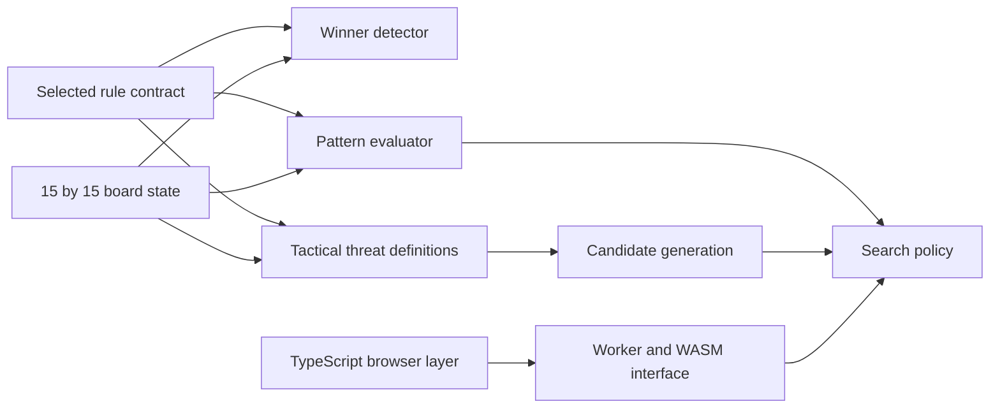

# Week 01 Rule and Language Boundary Diagram

**Interpretation.** Rule semantics are upstream of both evaluation and search. TypeScript owns browser-facing integration; the worker/WASM interface is a separate execution boundary. This diagram describes the intended evidence model and does not prove a benchmark result.

