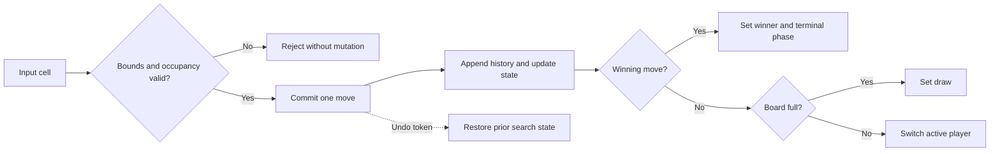

# Week 02 Core Move Transaction Diagram

**Interpretation.** The diagram distinguishes validation, mutation, terminal evaluation, turn progression, and undo. Test fixtures should target these transitions independently of the UI.

