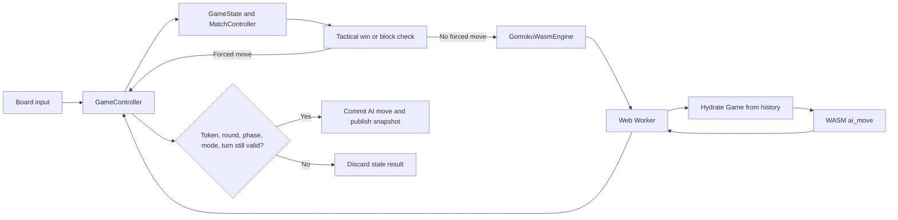

# Week 03 UI to WASM Lifecycle Diagram

**Interpretation.** The worker boundary is asynchronous. A returned move is not automatically valid; the controller checks round and lifecycle state before commit.

