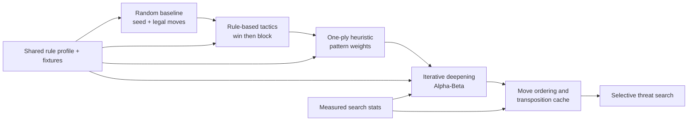

# Week 04 Bot Baseline Ladder Diagram

**Interpretation.** Each stronger policy must be compared against a fixed baseline on the same rule profile and fixtures. Search optimizations require measured statistics; they are not inferred from code complexity.

