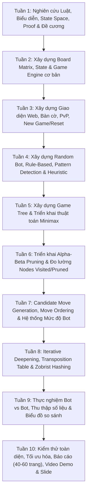

# 📑 BÁO CÁO ĐỀ CƯƠNG ĐỒ ÁN CƠ SỞ
## ĐỀ TÀI: XÂY DỰNG WEBSITE CỜ CARO ỨNG DỤNG CÁC THUẬT TOÁN TÌM KIẾM ĐỂ XÂY DỰNG BOT VỚI NHIỀU MỨC ĐỘ KHÓ

* **Sinh viên thực hiện:** Nguyễn Tâm Đức
* **Lớp:** 24CSE
* **Chuyên ngành:** Khoa học & Kỹ thuật Máy tính (CSE)

> [!IMPORTANT]
> **Tài liệu PDF Đề cương Gốc đính kèm:**
> ![[00_De_Cuong_PDF/ĐỀ CƯƠNG ĐỒ ÁN CƠ SỞ .pdf]]
> *(File PDF chính thức đã được tích hợp trong thư mục [[00_De_Cuong_PDF/README|00_De_Cuong_PDF/]])*

---

## 1. MỤC TIÊU ĐỀ TÀI

### 1.1. Mục tiêu tổng quát
* Xây dựng một website trò chơi Cờ Caro hoàn chỉnh cho phép người dùng chơi game ở chế độ hai người (Player vs Player) hoặc chơi với các Bot có nhiều mức độ khó khác nhau (Player vs Bot).
* Ứng dụng các thuật toán tìm kiếm đối kháng và các kỹ thuật tối ưu không gian tìm kiếm kinh điển trong Trí tuệ nhân tạo (AI) để xây dựng cơ chế lựa chọn nước đi thông minh cho Bot.
* Phân tích, đo lường và so sánh hiệu năng thực tế (thời gian tính toán, số trạng thái duyệt, số trạng thái cắt tỉa, tỷ lệ thắng) giữa các thuật toán trong quá trình xử lý trạng thái bàn cờ.
* Website đóng vai trò là giao diện trực quan, hiển thị các thông số đo lường thuật toán theo thời gian thực (Algorithm Statistics HUD) phục vụ mục đích học thuật và thực nghiệm.

### 1.2. Mục tiêu cụ thể
1. **Nghiên cứu và triển khai các thuật toán cốt lõi:**
   * Random Move (Nước đi ngẫu nhiên).
   * Heuristic / Rule-Based (Hệ chuyên gia dựa trên luật và tri thức cục diện).
   * Minimax (Thuật toán tìm kiếm vét cạn hai người chơi tổng bằng không).
   * Alpha-Beta Pruning (Kỹ thuật cắt tỉa nhánh cây trò chơi).
2. **Nghiên cứu và áp dụng các kỹ thuật tối ưu nâng cao:**
   * **Pattern Detection:** Bộ quét nhận diện chuỗi quân chiến thuật (Five, Open 4, Blocked 4, Open 3, Blocked 3...).
   * **Candidate Move Generation:** Bộ sinh nước đi tiềm năng theo bán kính lân cận ($r=1, 2$) nhằm giảm bùng nổ tổ hợp.
   * **Move Ordering:** Sắp xếp thứ tự nước đi ưu tiên trước khi đưa vào Alpha-Beta để tối đa hóa số nhánh bị cắt tỉa.
   * **Iterative Deepening:** Tìm kiếm sâu dần có kiểm soát thời gian ra nước đi.
   * **Transposition Table & Zobrist Hashing:** Bảng chuyển vị băm vị trí bàn cờ nhằm tái sử dụng kết quả đã tính toán, tránh duyệt lặp lại cùng một trạng thái.
3. **Biểu diễn và xử lý ma trận bàn cờ:**
   * Kiểm tra tính hợp lệ, quản lý lượt đi, phát hiện thắng/thua 4 hướng (ngang, dọc, 2 đường chéo) cho cả luật Gomoku tự do và luật Cờ Caro Việt Nam (chặn 2 đầu).
4. **Hệ thống 6 Mức độ khó của Bot:**
   * **Easy:** Random Move.
   * **Normal:** Heuristic / Rule-Based.
   * **Hard:** Minimax (Depth giới hạn).
   * **Very Hard:** Minimax kết hợp Alpha-Beta Pruning.
   * **Expert:** Alpha-Beta Pruning kết hợp Candidate Move Generation và Move Ordering.
   * **Master:** Alpha-Beta Pruning kết hợp đầy đủ Candidate Moves, Move Ordering, Iterative Deepening và Transposition Table (Zobrist Hashing).
5. **Đo lường & So sánh:**
   * Thời gian xử lý (Search Time).
   * Số trạng thái được duyệt (Nodes Visited).
   * Số trạng thái được cắt bỏ (Nodes Pruned).
   * Độ sâu tìm kiếm thực tế đạt được (Achieved Depth).
   * Khả năng lựa chọn nước đi (Tỷ lệ thắng trong các trận đấu tự động Bot vs Bot).

---

## 2. BẰNG CHỨNG TOÁN HỌC & CƠ SỞ LÝ THUYẾT NỀN TẢNG

### 2.1. Bằng chứng giải mã Gomoku (Victor Allis, 1994)
* **Luận án L. Victor Allis (1994):** Chứng minh Gomoku tự do $15 \times 15$ là **First-Player Win** (Quân Đen đi trước thắng tuyệt đối nếu chơi hoàn hảo).
* **Lập luận cướp chiến thuật (Strategy-Stealing Argument của John Nash):** Chứng minh Người đi sau (Trắng) không bao giờ có chiến lược thắng độc quyền.
* **Victoria Engine & Bộ đôi thuật toán:**
  * **Threat-Space Search (TSS):** Tìm kiếm không gian đe dọa (chuỗi nước ép buộc Four, Open Three).
  * **Proof-Number Search (PN-Search):** Tìm kiếm cây AND/OR dựa trên số bằng chứng ($pn$) và số bác bỏ ($dn$).
* **Trường hợp Bàn cờ 10×10:** Không gian trạng thái $3^{100} \approx 5.15 \times 10^{47}$, áp lực trung tâm càng lớn, người đi trước cũng nắm chiến thắng ép buộc với độ sâu ít hơn.
* **Luật Cờ Caro Việt Nam (Chặn 2 đầu):** Triệt tiêu đòn ép Four thông thường, buộc người chơi phải tạo Open Four hoặc đòn tấn công kép (Double Threat), giúp cân bằng thế trận.
* *Đọc chi tiết toàn văn tại:* [[Tuan_01/02_Bang_Chung_Toan_Hoc_Gomoku_Va_10Caro|02. Bằng chứng toán học Gomoku & 10Caro]]

---

## 3. LỘ TRÌNH 10 TUẦN CHI TIẾT (THEO ĐỀ CƯƠNG CHÍNH THỨC)

---

## 4. BẢN ĐỒ TÀI LIỆU TRONG OBSIDIAN THEO TỪNG TUẦN

| Tuần | Chủ đề trọng tâm | Liên kết tài liệu Obsidian |
| :---: | :--- | :--- |
| **Tuần 1** | Nghiên cứu Lý thuyết, Proof & Đề cương | [[Tuan_01/00_Tong_Quan_Tuan_1\|Tổng quan Tuần 1]] • [[Tuan_01/01_Nghien_Cuu_Luat_Co_Caro\|01. Nghiên cứu luật Cờ Caro]] • [[Tuan_01/02_Bang_Chung_Toan_Hoc_Gomoku_Va_10Caro\|02. Bằng chứng toán học Gomoku & 10Caro]] • [[Tuan_01/03_Cach_Bieu_Dien_Ban_Co\|03. Cách biểu diễn bàn cờ]] • [[Tuan_01/04_State_Space_Va_Game_Tree\|04. State Space & Game Tree]] • [[Tuan_01/05_Xac_Dinh_Pham_Vi_De_Tai\|05. Phạm vi đề tài]] • [[Tuan_01/06_Hoan_Thien_De_Cuong\|06. Hoàn thiện đề cương]] |
| **Tuần 2** | Xây dựng Game Engine cơ bản | [[Tuan_02/00_Tong_Quan_Tuan_2\|Tổng quan Tuần 2]] • [[Tuan_02/01_Xay_Dung_Board_Matrix\|01. Xây dựng Board Matrix]] • [[Tuan_02/02_Xay_Dung_Game_State\|02. Quản lý Game State]] • [[Tuan_02/03_Xu_Ly_Nuoc_Di\|03. Xử lý nước đi makeMove]] • [[Tuan_02/04_Kiem_Tra_Nuoc_Di_Hop_Le\|04. Kiểm tra hợp lệ]] • [[Tuan_02/05_Kiem_Tra_Dieu_Kien_Thang_Va_Hoa\|05. Kiểm tra thắng 4 hướng & hòa]] • [[Tuan_02/06_Hoan_Thien_Game_Engine_Co_Ban\|06. Hoàn thiện Engine & Test suite]] |
| **Tuần 3** | Xây dựng Giao diện Website | [[Tuan_03/00_Tong_Quan_Tuan_3\|Tổng quan Tuần 3]] • [[Tuan_03/01_Xay_Dung_Giao_Dien_Website\|01. Thiết kế Giao diện Website]] • [[Tuan_03/02_Hien_Thi_Ban_Co\|02. Hiển thị bàn cờ & Highlight]] • [[Tuan_03/03_Che_Do_Player_vs_Player\|03. Chế độ Player vs Player]] • [[Tuan_03/04_Chuc_Nang_New_Game_Va_Reset\|04. Chức năng New Game, Reset, Undo]] |
| **Tuần 4** | Xây dựng Bot Cơ bản & Heuristic | [[Tuan_04/00_Tong_Quan_Tuan_4\|Tổng quan Tuần 4]] • [[Tuan_04/01_Xay_Dung_Random_Bot\|01. Xây dựng Random Bot]] • [[Tuan_04/02_Xay_Dung_Rule_Based_Bot\|02. Xây dựng Rule-Based Bot]] • [[Tuan_04/03_Xay_Dung_Pattern_Detection\|03. Xây dựng Pattern Detection]] • [[Tuan_04/04_Xay_Dung_Heuristic_Evaluation\|04. Xây dựng Heuristic Evaluation]] |
| **Tuần 5** | Thuật toán Minimax & Cây trò chơi | [[Tuan_05/00_Tong_Quan_Tuan_5\|Tổng quan Tuần 5]] • [[Tuan_05/01_Nguyen_Ly_Thuat_Toan_Minimax\|01. Nguyên lý thuật toán Minimax]] • [[Tuan_05/02_Xay_Dung_Game_Tree_Trong_Caro\|02. Xây dựng Game Tree trong Caro]] • [[Tuan_05/03_Ap_Dung_Gioi_Han_Do_Sau_Depth_Limit\|03. Giới hạn độ sâu Depth Limit]] • [[Tuan_05/04_Kiem_Thu_Thuat_Toan_Minimax\|04. Kiểm thử thuật toán Minimax]] |
| **Tuần 6** | Thuật toán Alpha-Beta Pruning | [[Tuan_06/00_Tong_Quan_Tuan_6\|Tổng quan Tuần 6]] • [[Tuan_06/01_Nguyen_Ly_Alpha_Beta_Pruning\|01. Nguyên lý Alpha-Beta Pruning]] • [[Tuan_06/02_Do_Luong_Nodes_Visited_Va_Pruned\|02. Đo lường Nodes Visited & Nodes Pruned]] • [[Tuan_06/03_Do_Luong_Thoi_Gian_Search_Time\|03. Đo lường Search Time]] • [[Tuan_06/04_So_Sanh_Hieu_Nang_Minimax_vs_AlphaBeta\|04. So sánh Minimax vs Alpha-Beta]] |
| **Tuần 7** | Tối ưu Nước đi & Phân cấp Độ khó | [[Tuan_07/00_Tong_Quan_Tuan_7\|Tổng quan Tuần 7]] • [[Tuan_07/01_Candidate_Move_Generation\|01. Sinh nước đi tiềm năng Candidate Moves]] • [[Tuan_07/02_Move_Ordering\|02. Sắp xếp thứ tự nước đi Move Ordering]] • [[Tuan_07/03_Tich_Hop_He_Thong_Muc_Do_Kho\|03. Cấu hình 6 mức độ khó của Bot]] • [[Tuan_07/04_Hoan_Thien_Cac_Cap_Do_Bot_Co_Ban\|04. Hoàn thiện các cấp độ Bot]] |
| **Tuần 8** | Tối ưu Nâng cao: ID, TT & Zobrist | [[Tuan_08/00_Tong_Quan_Tuan_8\|Tổng quan Tuần 8]] • [[Tuan_08/01_Iterative_Deepening\|01. Tìm kiếm sâu dần Iterative Deepening]] • [[Tuan_08/02_Zobrist_Hashing\|02. Bảng băm Zobrist Hashing]] • [[Tuan_08/03_Transposition_Table\|03. Bảng chuyển vị Transposition Table]] • [[Tuan_08/04_Dashboard_Thong_Ke_Thuat_Toan\|04. Bảng thông số thống kê thuật toán]] |
| **Tuần 9** | Thực nghiệm & Đấu giải Tự động | [[Tuan_09/00_Tong_Quan_Tuan_9\|Tổng quan Tuần 9]] • [[Tuan_09/01_Kich_Ban_Thuc_Nghiem_Bot_vs_Bot\|01. Kịch bản đấu tự động Bot vs Bot]] • [[Tuan_09/02_Thu_Thap_Va_Xu_Ly_So_Lieu\|02. Thu thập số liệu thực nghiệm]] • [[Tuan_09/03_Bieu_Do_So_Sanh_Hieu_Nang\|03. Biểu đồ và bảng phân tích hiệu năng]] • [[Tuan_09/04_Bao_Cao_Danh_Gia_Ket_Qua\|04. Đánh giá kết quả thực nghiệm]] |
| **Tuần 10** | Đóng gói, Báo cáo & Bảo vệ | [[Tuan_10/00_Tong_Quan_Tuan_10\|Tổng quan Tuần 10]] • [[Tuan_10/01_Kiem_Thu_He_Thong_Toan_Dien\|01. Kiểm thử hệ thống & Tối ưu cuối]] • [[Tuan_10/02_De_Cuong_Chi_Tiet_Bao_Cao_40_60_Trang\|02. Khung báo cáo chính thức (40-60 trang)]] • [[Tuan_10/03_Kich_Ban_Quay_Video_Demo_5_10_Phut\|03. Kịch bản video demo (5-10 phút)]] • [[Tuan_10/04_Noi_Dung_Slide_Bao_Ve_Do_An\|04. Nội dung slide thuyết minh bảo vệ]] |

---

## 5. SẢN PHẨM ĐẦU RA KỲ VỌNG

1. **Phần mềm (Website Cờ Caro AI):**
   * Công nghệ: React, TypeScript, HTML5, CSS3, Tailwind CSS (hoặc PixiJS nếu cần hiệu ứng).
   * Chế độ: Player vs Player, Player vs Bot với 6 mức độ khó.
   * Dashboard hiển thị thời gian thực: Thời gian tìm kiếm (ms), số nút đã duyệt, số nút bị cắt, độ sâu tìm kiếm.
2. **Báo cáo chuyên đề Đồ án cơ sở (40 – 60 trang):**
   * Trình bày chi tiết lý thuyết, kiến trúc, cài đặt thuật toán, kết quả thực nghiệm và đối sánh hiệu năng.
3. **Video Demo (5 – 10 phút):**
   * Giới thiệu giao diện, tính năng PvP, thi đấu PvBot, minh họa Minimax & Alpha-Beta, trực quan hóa thông số xử lý.
4. **Bộ Slide thuyết minh bảo vệ:**
   * Súc tích, mạch lạc, làm nổi bật kết quả giải mã và sức mạnh của thuật toán tối ưu.
