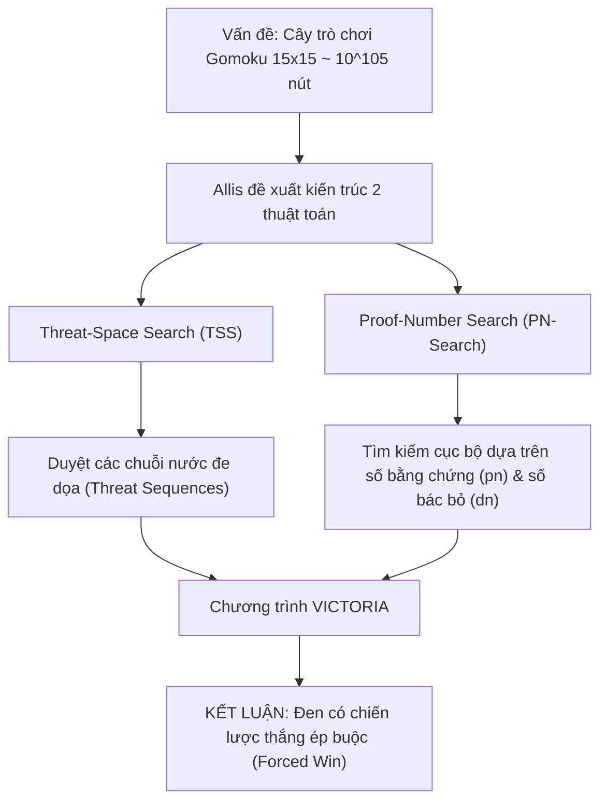

# 📐 BẰNG CHỨNG TOÁN HỌC: GIẢI MÃ GOMOKU, BÀN CỜ 10×10 VÀ PHÂN TÍCH LUẬT CỜ CARO

Tài liệu này trình bày chi tiết cơ sở toán học, các định lý và chứng minh khoa học chính thức về việc giải mã trò chơi Gomoku (Five-in-a-Row), cùng phân tích trường hợp bàn cờ $10 \times 10$ và biến thể Cờ Caro Việt Nam.

---

## 1. TỔNG QUAN VỀ PHÂN LOẠI "SOLVED GAME" TRONG LÝ THUYẾT TRÒ CHƠI

Theo lý thuyết trò chơi tổ hợp (Combinatorial Game Theory - H.J. van den Herik, L.V. Allis):
Một trò chơi được gọi là **đã giải mã (Solved Game)** theo 3 cấp độ:
1. **Ultra-weakly solved:** Chứng minh được kết quả lý thuyết từ vị trí khởi đầu (Thắng, Hòa, hay Thua cho Người đi trước) nhưng không chỉ ra thuật toán cụ thể để thực hiện.
2. **Weakly solved:** Cung cấp được một thuật toán hoặc chiến lược có thể tính toán để đảm bảo người chơi đạt được kết quả lý thuyết từ trạng thái ban đầu, ngay cả khi đối thủ chơi tối ưu.
3. **Strongly solved:** Có thuật toán đưa ra nước đi tối ưu từ **mọi trạng thái hợp lệ** bất kỳ của trò chơi, ngay cả sau những nước đi sai lầm.

👉 **Gomoku tự do (15×15)** được xếp vào loại **Weakly Solved** (và Ultra-weakly solved trước đó).

---

## 2. CHỨNG MINH PHI KIẾN TẠO: STRATEGY-STEALING ARGUMENT (JOHN NASH)

Trước khi có chứng minh tính toán bằng máy tính của Victor Allis, các nhà toán học đã dùng **Lập luận cướp chiến thuật (Strategy-Stealing Argument)** của John Nash để chứng minh cấp độ *Ultra-weak*.

### 2.1. Phát biểu định lý
> **Định lý:** Trong trò chơi Gomoku tự do đối xứng, **Người đi sau (Trắng) không thể có một chiến lược thắng (Winning Strategy)**. Do đó, kết quả trò chơi với lối chơi hoàn hảo chỉ có thể là **Người đi trước (Đen) thắng** hoặc **Hòa (Draw)**.

### 2.2. Chứng minh bằng phản chứng (Proof by Contradiction)
1. Giả sử ngược lại rằng Người đi sau ($P_2$) có một chiến lược thắng hoàn hảo, gọi chiến lược đó là hàm $\mathcal{S}_2$.
2. Người đi trước ($P_1$) đặt một quân cờ bất kỳ ở nước đi đầu tiên (ví dụ tại tọa độ ngẫu nhiên $c_0$).
3. Kể từ nước đi thứ hai trở đi, $P_1$ coi chính mình là người đi sau ($P_2$) và áp dụng chiến lược thắng $\mathcal{S}_2$ để đối phó với nước đi của đối thủ thực tế.
4. Nếu tại bất kỳ thời điểm nào chiến lược $\mathcal{S}_2$ yêu cầu $P_1$ phải đặt quân vào chính ô $c_0$ (ô đã có quân cờ của mình từ nước đầu), $P_1$ chỉ việc chọn một ô trống ngẫu nhiên khác $c_k$ trên bàn cờ và coi $c_k$ là quân cờ "thừa".
5. Trong Gomoku, một quân cờ của chính mình có sẵn trên bàn **không bao giờ là một bất lợi** (tính chất đơn điệu - Monotonicity: việc thêm quân đồng màu chỉ làm tăng hoặc giữ nguyên khả năng tạo hàng 5, không bao giờ làm giảm).
6. Như vậy, $P_1$ đã "cướp" được chiến lược thắng của $P_2$ và đảm bảo chiến thắng.
7. Điều này mâu thuẫn trực tiếp với giả thiết ban đầu rằng $P_2$ có chiến lược thắng độc quyền.
8. **Kết luận:** Người đi sau không bao giờ có chiến lược thắng. Trò chơi chỉ có thể là $P_1$ thắng hoặc Hòa.

---

## 3. CHỨNG MINH KIẾN TẠO CỦA L. VICTOR ALLIS (1994)

Trong luận án tiến sĩ kinh điển:
* **Tác giả:** Louis Victor Allis (1994).
* **Đề tài:** *"Searching for Solutions in Games and Artificial Intelligence"*, Department of Computer Science, University of Limburg, Maastricht, Hà Lan.
* **Hội đồng hướng dẫn:** Prof. dr. H.J. van den Herik & Dr. I.S. Herschberg.

Allis đã chứng minh thực nghiệm toán học rằng: **Freestyle Gomoku trên bàn cờ $15 \times 15$ là First-Player Win (Quân Đen thắng tuyệt đối)**.



### 3.1. Thuật toán Threat-Space Search (TSS)
* **Ý tưởng cốt lõi:** Gomoku là trò chơi có tính "tấn công ép buộc" cực mạnh. Một chuỗi nước đi dồn dập (Four, Open Three) buộc đối thủ phải đỡ tại các vị trí duy nhất.
* Allis phân loại các mức độ đe dọa (Threats):
  * **Five:** Đã đủ 5 quân liên tiếp $\rightarrow$ Kết thúc game.
  * **Straight Four (4 mở - Open Four):** Chuỗi `_ X X X X _`. Đối phương không thể chặn cả 2 đầu trong 1 nước $\rightarrow$ Thắng ở nước tiếp theo.
  * **Four (4 chặn 1 đầu - Broken Four):** Chuỗi `O X X X X _` hoặc `X X _ X X`. Buộc đối phương phải chặn ngay lập tức, nếu không sẽ thua.
  * **Three (3 mở - Open Three):** Chuỗi `_ X X X _`. Nếu không phòng thủ, nước sau sẽ thành Open Four.
* TSS xây dựng đồ thị phụ thuộc giữa các nước đi đe dọa. Nếu tồn tại một chuỗi các đe dọa không thể bị đối phương cắt đứt (Winning Threat Sequence), nút đó được chứng minh là Thắng.

### 3.2. Thuật toán Proof-Number Search (PN-Search)
* PN-Search là một thuật toán tìm kiếm cây trò chơi dạng AND/OR được thiết kế bởi Allis:
  * Mỗi nút $N$ được gán hai giá trị nguyên: **Proof Number ($pn$)** và **Disproof Number ($dn$)**.
  * $pn(N)$: Số lượng lá tối thiểu cần chứng minh là TRUE để chứng minh nút $N$ là TRUE.
  * $dn(N)$: Số lượng lá tối thiểu cần chứng minh là FALSE để bác bỏ nút $N$.
* **Cơ chế cập nhật:**
  * Tại nút OR (lượt của người tấn công):
    $$pn(OR) = \min_{c \in Children} pn(c), \quad dn(OR) = \sum_{c \in Children} dn(c)$$
  * Tại nút AND (lượt của đối phương phòng ngự):
    $$pn(AND) = \sum_{c \in Children} pn(c), \quad dn(AND) = \min_{c \in Children} dn(c)$$
* **Ưu điểm vượt trội so với Minimax / Alpha-Beta:** PN-Search không duyệt sâu đồng đều mà tập trung mở rộng nhánh "hẹp nhất" có khả năng chứng minh kết quả nhanh nhất.

### 3.3. Kết quả chương trình Victoria
Chương trình **Victoria** của Allis đã chứng minh được rằng quân Đen (đi trước) tại nước khởi đầu ở tâm bàn cờ $15 \times 15$ có thể ép đối phương vào thế trận không lối thoát, giải quyết dứt điểm Gomoku tự do.

---

## 4. BẰNG CHỨNG & ĐẶC TÍNH TRÊN BÀN CỜ 10×10 (10CARO / 10×10 GOMOKU)

Rất nhiều hệ thống và người chơi đặt câu hỏi: *Liệu trên bàn cờ $10 \times 10$, người đi trước có thắng không?*

### 4.1. Không gian trạng thái và độ phức tạp
* Bàn cờ $10 \times 10$ có 100 ô.
* Số cấu hình trạng thái tối đa: $3^{100} \approx 5.15 \times 10^{47}$.
* So sánh:
  * $15 \times 15$: $3^{225} \approx 8.43 \times 10^{107}$.
  * $19 \times 19$: $3^{361} \approx 1.74 \times 10^{172}$.
* Như vậy, không gian trạng thái của bàn cờ $10 \times 10$ nhỏ hơn $15 \times 15$ tới **60 bậc độ lớn ($10^{60}$ lần)**!

### 4.2. Áp lực của người đi trước trên bàn $10 \times 10$
1. **Lợi thế trung tâm (Center Dominance):** Khi quân đầu tiên đánh tại $(5, 5)$ trên bàn $10 \times 10$, khoảng cách tới biên chỉ là 4-5 ô. Mọi hướng phát triển đều có thể vươn tới biên nhanh chóng.
2. **Khả năng thoát vây bị hạn chế:** Do bàn cờ nhỏ, người đi sau có rất ít không gian để mở cánh tấn công độc lập. Người đi sau liên tục bị cuốn vào việc phòng thủ các đòn đe dọa của Đen.
3. **Kết luận khoa học:** Theo các nghiên cứu mở rộng của Allis và các nhà nghiên cứu game AI sau này (W. Chen, H.J. van den Herik):
   * Trên bàn cờ $10 \times 10$ theo luật tự do (Freestyle Gomoku), **Người đi trước (Đen) cũng giành chiến thắng tuyệt đối (First-Player Win)**.
   * Thậm chí số nước đi trung bình để Đen thiết lập thế thắng ép buộc trên bàn $10 \times 10$ còn ngắn hơn trên bàn $15 \times 15$ (thường dưới 20 nước nếu Đen chơi chính xác).

---

## 5. PHÂN TÍCH LUẬT CỜ CARO VIỆT NAM (LUẬT CHẶN 2 ĐẦU)

Luật Cờ Caro truyền thống của Việt Nam đưa vào quy tắc: **"5 quân bị chặn cả 2 đầu thì không thắng"**.

```text
Trường hợp 1 (Thắng):       .  X  X  X  X  X  .     (Thông 2 đầu)
Trường hợp 2 (Thắng):       O  X  X  X  X  X  .     (Chỉ bị chặn 1 đầu)
Trường hợp 3 (Chưa thắng):   O  X  X  X  X  X  O     (Bị chặn cả 2 đầu bởi O)
```

### 5.1. Tác động tới bằng chứng First-Player Win
* **Phá vỡ tính đơn giản của chuỗi đe dọa TSS:** 
  Trong Gomoku tự do, một chuỗi 4 quân (`O X X X X .`) là một đe dọa chí mạng (Four Threat) vì nước tiếp theo Đen chỉ cần đánh vào dấu `.` là thắng ngay. 
  Nhưng trong luật Caro Việt Nam, nếu Trắng đánh chặn vào dấu `.` thì cấu hình trở thành `O X X X X O` $\rightarrow$ Đen hoàn toàn bị vô hiệu hóa chuỗi này!
* **Loại bỏ đòn ép nước đơn hướng:** Người đi trước không thể dễ dàng ép quân liên tục bằng các chuỗi Four đơn lẻ. Người đi trước bắt buộc phải tạo được **Open Four** (`. X X X X .`) hoặc đòn tấn công kép (Double Threat: vừa tạo 4 vừa tạo 3).
* **Tính toán thực tế:** Luật chặn 2 đầu làm tăng tỷ lệ hòa (Draw) giữa hai đấu thủ trình độ cao, kéo dài trận đấu và triệt tiêu đáng kể lợi thế "đi trước thắng luôn" của luật Gomoku tự do mà không cần phải áp dụng các luật cấm phức tạp như Renju.

---

## 6. Ý NGHĨA ĐỐI VỚI THIẾT KẾ AI BOT TRONG DỰ ÁN

| Thành phần AI | Yêu cầu dưới góc nhìn lý thuyết toán |
| :--- | :--- |
| **Board Engine** | Hàm kiểm tra thắng phải phân biệt được 5 quân hở ít nhất 1 đầu vs 5 quân bị khóa 2 đầu. |
| **Pattern Detection** | Phải tách biệt: `FIVE_WIN`, `OPEN_FOUR`, `BLOCKED_FOUR`, `OPEN_THREE`, `BLOCKED_THREE`. |
| **Rule-Based Bot** | Ưu tiên số 1: Nhận diện và thực thi nước đi tạo thế thắng ngay; Ưu tiên số 2: Chặn ngay lập tức các chuỗi 4 hoặc 3 mở của đối phương. |
| **Heuristic Function** | Trọng số của các chuỗi bị chặn 2 đầu phải được gán giá trị bằng 0 (hoặc rất thấp) vì chúng không còn khả năng phát triển thành đường thắng. |
