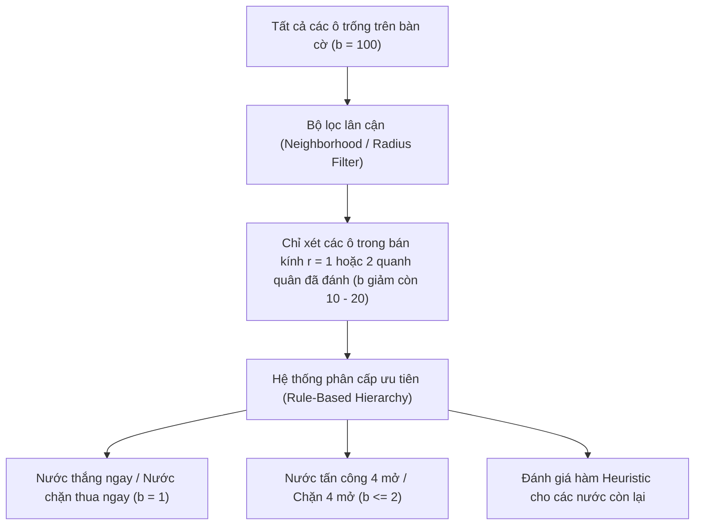

# 🌳 NGHIÊN CỨU STATE SPACE VÀ GAME TREE TRONG CỜ CARO

Tài liệu này phân tích cấu trúc toán học của không gian trạng thái (State Space) và cây trò chơi (Game Tree), chỉ ra nguyên nhân gây ra bùng nổ tổ hợp (Combinatorial Explosion) và các kỹ thuật cắt tỉa không gian tìm kiếm.

---

## 1. ĐỊNH NGHĨA TOÁN HỌC

### 1.1. Không gian trạng thái (State Space)
Không gian trạng thái $\mathcal{S}$ của một trò chơi đối kháng là tập hợp tất cả các cấu hình bàn cờ có thể đạt tới được thông qua một chuỗi các nước đi hợp lệ bắt đầu từ trạng thái rỗng ban đầu $s_0$.
* Mỗi ô trên bàn cờ có 3 trạng thái có thể có:
  $$\text{Cell} \in \{\text{Trống}, \text{Quân X}, \text{Quân O}\}$$
* Giới hạn trên thô (Upper bound) của kích thước không gian trạng thái cho bàn cờ kích thước $N \times N$:
  $$|\mathcal{S}_{\text{raw}}| \le 3^{N^2}$$

### 1.2. Cây trò chơi (Game Tree)
Cây trò chơi là một đồ thị có hướng dạng cây mô phỏng toàn bộ diễn biến của trận đấu:
* **Gốc (Root):** Trạng thái bàn cờ ban đầu $s_0$ (bàn cờ trống hoặc trạng thái hiện tại trước khi AI tính toán).
* **Nút (Nodes):** Các trạng thái trung gian của bàn cờ.
* **Cạnh (Edges):** Các nước đi hợp lệ chuyển đổi trạng thái $s \xrightarrow{a} s'$.
* **Lá (Leaves / Terminal Nodes):** Các trạng thái kết thúc trận đấu (Thắng, Thua, hoặc Hòa).

---

## 2. BẢNG SO SÁNH ĐỘ PHỨC TẠP GIỮA CÁC TRÒ CHƠI KINH ĐIỂN

| Trò chơi | Kích thước bàn cờ | Không gian trạng thái ($\log_{10}|\mathcal{S}|$) | Kích thước cây trò chơi ($\log_{10}|\mathcal{T}|$) | Tình trạng giải mã (Status) |
| :--- | :--- | :--- | :--- | :--- |
| **Tic-Tac-Toe** | $3 \times 3$ | $10^3$ (Chính xác: 5,478) | $10^5$ | **Strongly Solved** (Hòa) |
| **Connect Four** | $6 \times 7$ | $10^{13}$ | $10^{21}$ | **Strongly Solved** (Người 1 thắng - Allis 1988) |
| **Cờ Caro 10×10** | $10 \times 10$ | $\approx 10^{47}$ | $\approx 10^{70}$ | **Weakly Solved** (với Gomoku tự do) |
| **Cờ Caro 15×15 (Gomoku)**| $15 \times 15$ | $\approx 10^{107}$ | $\approx 10^{105 \sim 140}$ | **Weakly Solved** (Allis 1994) |
| **Cờ Vua (Chess)** | $8 \times 8$ | $\approx 10^{43 \sim 47}$ | $\approx 10^{123}$ (Số Shannon) | **Chưa giải mã** (AI siêu việt) |
| **Cờ Vây (Go)** | $19 \times 19$ | $\approx 10^{172}$ | $\approx 10^{360}$ | **Chưa giải mã** (AI siêu việt) |

---

## 3. VẤN ĐỀ BÙNG NỔ TỔ HỢP (COMBINATORIAL EXPLOSION)

Số lượng nút của một cây trò chơi có hệ số phân nhánh trung bình $b$ và độ sâu tìm kiếm $d$ được tính bằng:
$$N_{\text{nodes}} = 1 + b + b^2 + b^3 + \dots + b^d \approx \frac{b^{d+1} - 1}{b - 1} \approx O(b^d)$$

### 3.1. Phân tích hệ số phân nhánh $b$ trong Cờ Caro
* Trên bàn cờ $10 \times 10$:
  * Nước 1: $100$ ô trống $\implies b_1 = 100$.
  * Nước 2: $99$ ô trống $\implies b_2 = 99$.
  * Nếu duyệt vét cạn (Brute-force) với độ sâu $d = 4$ nước:
    $$N_{\text{nodes}} \approx 100 \times 99 \times 98 \times 97 \approx 94,109,400 \text{ nút}$$
  * Con số gần 100 triệu nút là bất khả thi để thực thi trong 1 giây trên trình duyệt Web bằng JavaScript!

---

## 4. CÁC CHIẾN LƯỢC CẮT TỈA KHÔNG GIAN TÌM KIẾM CHO DỰ ÁN

Để AI có thể phản hồi tức thì ($< 50 \text{ ms}$) mà vẫn đưa ra nước đi thông minh, dự án áp dụng các kỹ thuật sau:

1. **Bộ lọc vùng lân cận (Move Candidate Generation with Radius):**
   * Trong thực tế thi đấu cờ Caro, một nước đi cách xa tất cả các quân cờ hiện có từ 3 ô trở lên hầu như không có giá trị chiến thuật.
   * Ta chỉ đưa vào danh sách ứng viên các ô trống nằm trong bán kính $r = 1$ hoặc $r = 2$ của các quân cờ đã xuất hiện trên bàn.
   * Nhờ đó, $b$ giảm mạnh từ $80 - 100$ xuống chỉ còn $10 - 25$.
2. **Quy tắc ép buộc (Forcing Move Pruning):**
   * Nếu phát hiện đối phương có hàng 4 đang thông 1 đầu, không cần tìm kiếm các nhánh khác: nước chặn là bắt buộc ($b = 1$).
   * Tương tự, nếu ta có cơ hội tạo chuỗi 5 thắng ngay: đánh ngay lập tức ($b = 1$).
3. **Hàm lượng giá Heuristic tĩnh (Static Heuristic Evaluation):**
   * Thay vì tìm kiếm quá sâu làm treo trình duyệt, ta lượng giá các mẫu thế cờ ngay tại độ sâu thấp kết hợp nhận diện mẫu nhanh.
