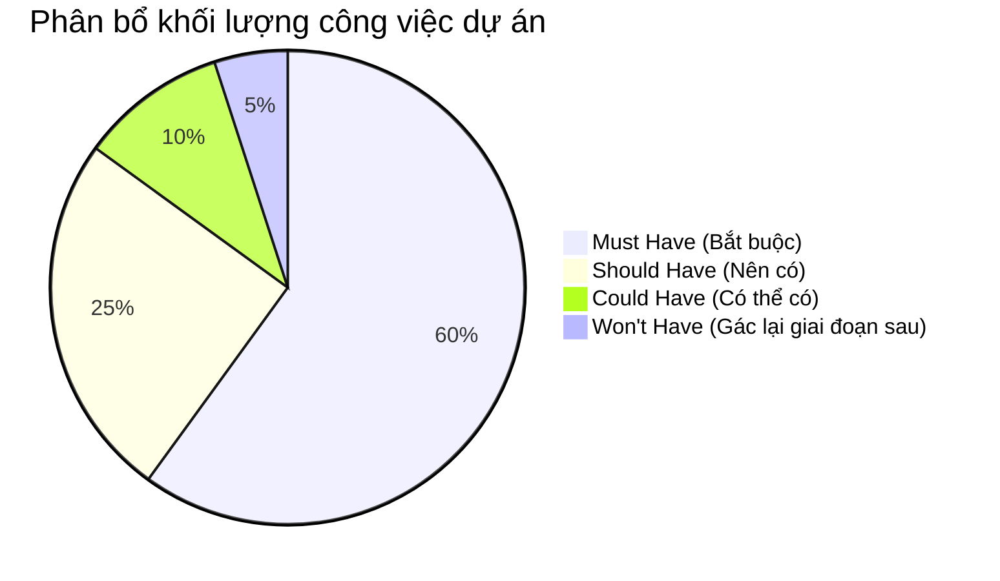

# 🎯 XÁC ĐỊNH PHẠM VI ĐỀ TÀI VÀ RANH GIỚI DỰ ÁN

Để đảm bảo dự án hoàn thành đúng tiến độ trong 4 tuần với chất lượng kỹ thuật cao nhất, tài liệu này thiết lập rõ ràng ranh giới phạm vi đề tài (Project Scope Boundary).

---

## 1. MỤC TIÊU CỐT LÕI (CORE OBJECTIVES)

1. **Xây dựng một Game Engine độc lập (Headless Game Engine):** 
   - Không phụ thuộc vào giao diện hiển thị (Decoupled from DOM/UI).
   - Xử lý trọn vẹn toàn bộ quy tắc bàn cờ, logic nước đi, phát hiện thắng/thua/hòa cho cả luật Gomoku quốc tế và luật Cờ Caro Việt Nam (chặn 2 đầu).
2. **Xây dựng Giao diện Web hiện đại, mượt mà (Modern Web UI):**
   - Trực quan, tinh gọn, tương thích tốt trên cả máy tính (Desktop) và điện thoại di động (Mobile).
   - Đầy đủ các phản hồi thị giác: đánh dấu nước đi gần nhất (Last Move indicator), tô màu đường thắng 5 quân (Winning Line Highlight).
3. **Phát triển hệ thống AI Bot đa tầng (Multi-tier AI Bots):**
   - **Tầng 1 - Random Bot:** Đóng vai trò làm mốc đối chuẩn (Baseline benchmark).
   - **Tầng 2 - Rule-Based Bot:** Ứng dụng hệ chuyên gia dựa trên luật ưu tiên chiến thuật thực tế.
   - **Tầng 3 - Pattern & Heuristic Bot:** Tích hợp bộ quét mẫu thế cờ (Pattern Detection) và hàm lượng giá điểm số (Evaluation Function).

---

## 2. PHÂN LOẠI YÊU CẦU THEO MÔ HÌNH MOSCOW

### 2.1. MUST HAVE (Bắt buộc phải hoàn thành trong 4 tuần)
- [x] Board Matrix $10 \times 10$ và $15 \times 15$ chuẩn xác.
- [x] Logic kiểm tra nước đi hợp lệ (`isValidMove`) và thực thi nước đi (`makeMove`).
- [x] Thuật toán kiểm tra thắng 4 hướng với 2 bộ luật: Gomoku tự do & Caro Việt Nam chặn 2 đầu.
- [x] Kiểm tra điều kiện hòa khi hết ô trống.
- [x] Giao diện Web hiển thị lưới bàn cờ, quân cờ X/O, trạng thái ván đấu.
- [x] Chế độ chơi 2 người tại chỗ (Player vs Player - Pass & Play).
- [x] Nút chức năng: Ván mới (New Game), Đặt lại (Reset), Đi lại (Undo).
- [x] Triển khai Random Bot và Rule-Based Bot có khả năng nhận biết đòn hiểm.

### 2.2. SHOULD HAVE (Nên có để nâng cao chất lượng)
- [x] Thuật toán nhận diện thế cờ nâng cao (Pattern Detection): Đếm chính xác số lượng hàng 4 mở, 4 bị chặn 1 đầu, 3 mở, 3 bị chặn 1 đầu.
- [x] Hàm lượng giá Heuristic tính điểm công/thủ cho từng ô trống trên bàn cờ.
- [x] Hiệu ứng âm thanh nhẹ khi đặt quân và khi kết thúc ván đấu.
- [x] Lưu trữ cấu hình cài đặt (Kích thước bàn cờ, luật chơi) vào `localStorage`.

### 2.3. COULD HAVE (Tính năng mở rộng nếu còn thời gian)
- [ ] Tích hợp thuật toán tìm kiếm Minimax với Alpha-Beta Pruning ở độ sâu 2 - 3 nước.
- [ ] Thống kê lịch sử đối đầu (Win / Loss / Draw Counter) giữa Người và các cấp độ Bot.

### 2.4. WON'T HAVE (Rõ ràng nằm ngoài phạm vi 4 tuần này)
- ❌ Đấu trực tuyến thời gian thực nhiều người chơi qua mạng (Real-time Online Multiplayer qua WebSocket/WebRTC).
- ❌ Hệ thống tài khoản người dùng, đăng nhập, cơ sở dữ liệu đám mây (Cloud Database).
- ❌ Mạng nơ-ron tích chập sâu (Deep CNN) hoặc học tăng cường AlphaZero cần GPU huấn luyện hàng tuần.

---

## 3. TIÊU CHUẨN KỸ THUẬT VÀ CÔNG NGHỆ LỰA CHỌN

* **Ngôn ngữ phát triển:** TypeScript / JavaScript hiện đại (ES6+).
* **Nền tảng chạy:** Trình duyệt Web (Client-side Execution 100%, không cần cài đặt server phức tạp).
* **Quản lý mã nguồn:** Kiến trúc Module hóa (Separation of Concerns):
  * `core/`: Chứa Game Engine độc lập hoàn toàn.
  * `ai/`: Chứa các thuật toán Bot (Random, Rule-Based, Pattern, Heuristic).
  * `ui/`: Chứa lớp tương tác DOM/Canvas và sự kiện người dùng.
