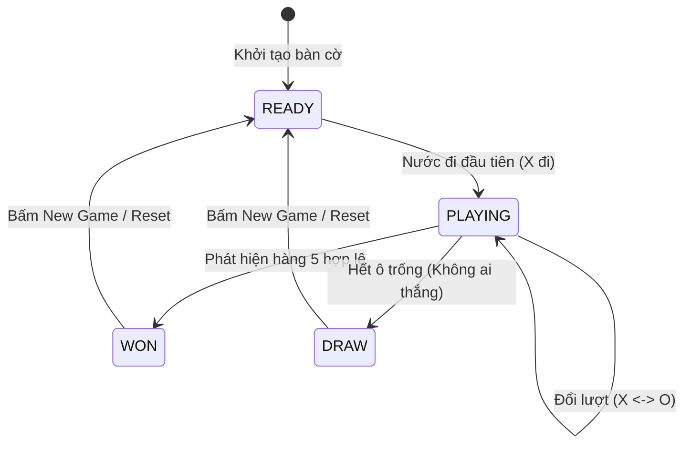

# 🔄 XÂY DỰNG GAME STATE VÀ QUẢN LÝ VÒNG ĐỜI VÁN ĐẤU

Tài liệu này đặc tả máy trạng thái hữu hạn (Finite State Machine - FSM) quản lý toàn bộ vòng đời của một ván cờ Caro từ lúc khởi tạo đến khi phân định thắng thua.

---

## 1. MÔ HÌNH TRẠNG THÁI HỮU HẠN (FINITE STATE MACHINE)



---

## 2. ĐỊNH NGHĨA KIỂU DỮ LIỆU STATE (TYPESCRIPT)

```typescript
export enum GameStatus {
  READY = 'READY',       // Bàn cờ rỗng, sẵn sàng bắt đầu
  PLAYING = 'PLAYING',   // Ván cờ đang diễn ra
  WON = 'WON',           // Đã có người chơi chiến thắng
  DRAW = 'DRAW',         // Ván cờ kết thúc với kết quả hòa
}

export interface Position {
  row: number;
  col: number;
}

export interface MoveRecord {
  position: Position;
  player: number;        // CellValue.PLAYER_X hoặc PLAYER_O
  moveNumber: number;    // Nước cờ thứ mấy trong ván
  timestamp: number;     // Thời điểm đánh nước đi
}

export interface GameRules {
  boardSize: number;                                // 10 hoặc 15
  mode: 'GOMOKU_FREESTYLE' | 'CARO_VIETNAM_BLOCK_2'; // Gomoku tự do vs Caro chặn 2 đầu
}

export interface GameStateSnapshot {
  board: number[][];
  currentTurn: number;
  status: GameStatus;
  winner: number | null;
  winningLine: Position[] | null;
  moveHistory: MoveRecord[];
  rules: GameRules;
}
```

---

## 3. CƠ CHẾ QUẢN LÝ LỊCH SỬ NƯỚC ĐI VÀ HOÀN TÁC (UNDO / REDO)

1. **Move History Stack:**
   * Mỗi khi một nước đi hợp lệ được thực hiện, một bản ghi `MoveRecord` được đẩy (push) vào mảng `history`.
   * Thông tin này cho phép:
     - Đánh dấu nước đi vừa đánh trên giao diện UI (Last Move Marker).
     - Xem lại biên bản ván đấu (Match Notation).
     - Phục vụ cơ chế quay lui (Backtracking) trong thuật toán AI.
2. **Cơ chế Undo (Đi lại):**
   * Lấy nước đi gần nhất ra khỏi stack: `const last = history.pop()`.
   * Đặt lại ô đó về rỗng: `board.set(last.position.row, last.position.col, CellValue.EMPTY)`.
   * Trả lượt chơi về cho người vừa đánh: `currentTurn = last.player`.
   * Chuyển trạng thái game trở lại `PLAYING` (nếu trước đó vừa có thông báo thắng).
   * Trong chế độ đấu với AI (Người vs Máy), thao tác Undo thường sẽ rút lại **2 nước cờ** liên tiếp (1 nước của Bot và 1 nước của Người).
