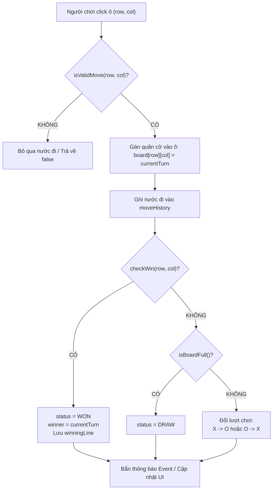

# 🎯 XỬ LÝ NƯỚC ĐI (MAKE MOVE) TRONG GAME ENGINE

Tài liệu này chi tiết hóa luồng xử lý (Execution Flow) của một nước cờ từ thời điểm người chơi click chuột đến khi trạng thái bàn cờ được cập nhật hoàn tất.

---

## 1. SƠ ĐỒ LUỒNG THỰC THI (SEQUENCE FLOW)



---

## 2. HIỆN THỰC HÓA MÃ NGUỒN `makeMove`

```typescript
public makeMove(row: number, col: number): boolean {
  // 1. Kiểm tra tính hợp lệ
  if (!this.isValidMove(row, col)) {
    return false;
  }

  // 2. Chuyển trạng thái sang PLAYING nếu là nước đầu tiên
  if (this.status === GameStatus.READY) {
    this.status = GameStatus.PLAYING;
  }

  // 3. Đặt quân cờ vào ma trận
  const player = this.currentTurn;
  this.board.set(row, col, player);

  // 4. Lưu lại lịch sử nước đi
  const moveRecord: MoveRecord = {
    position: { row, col },
    player: player,
    moveNumber: this.history.length + 1,
    timestamp: Date.now(),
  };
  this.history.push(moveRecord);

  // 5. Kiểm tra điều kiện thắng
  const winResult = this.checkWin(row, col);
  if (winResult.hasWon) {
    this.status = GameStatus.WON;
    this.winner = player;
    this.winningLine = winResult.line;
    this.emitChange();
    return true;
  }

  // 6. Kiểm tra điều kiện hòa (hết ô trống)
  if (this.history.length >= this.board.size * this.board.size) {
    this.status = GameStatus.DRAW;
    this.emitChange();
    return true;
  }

  // 7. Chuyển đổi lượt chơi cho đối phương
  this.currentTurn = (player === CellValue.PLAYER_X) 
    ? CellValue.PLAYER_O 
    : CellValue.PLAYER_X;

  // 8. Bắn sự kiện thay đổi trạng thái
  this.emitChange();
  return true;
}
```

---

## 3. PHÂN BIỆT THỰC THI TRÊN UI VÀ TRONG CÂY TÌM KIẾM AI

* **Trên UI (Người dùng chơi thật):**
  * Nước đi phải đầy đủ validation, cập nhật âm thanh, hiệu ứng, lịch sử nước đi.
* **Trong thuật toán AI Bot (Duyệt hàng ngàn nước giả định):**
  * Không tạo ra đối tượng thừa để tránh thu gom rác (Garbage Collection lag).
  * Sử dụng cơ chế `applyMove` và `undoMove` ngay trên cùng một ma trận (In-place Mutation & Backtracking) thay vì clone toàn bộ bàn cờ.
