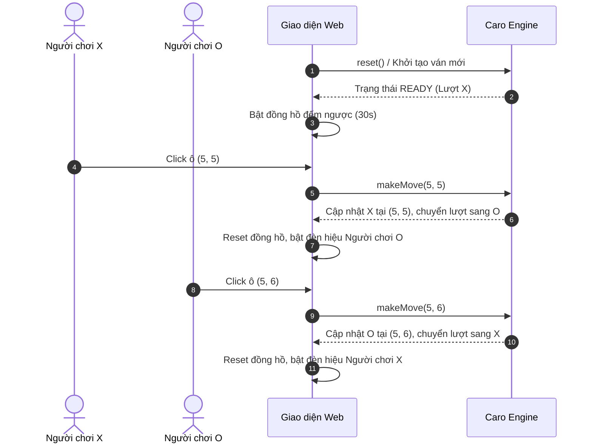

# 👥 XÂY DỰNG CHẾ ĐỘ PLAYER VS PLAYER (PVP PASS & PLAY)

Tài liệu này đặc tả luồng tương tác và các tính năng hỗ trợ cho chế độ chơi đối kháng 2 người trực tiếp trên cùng một thiết bị (Pass & Play).

---

## 1. QUY TRÌNH VẬN HÀNH TRẬN ĐẤU PVP



---

## 2. BẢNG HIỂN THỊ LƯỢT CHƠI (TURN HUD) VÀ BẢNG TỈ SỐ

### 2.1. Đèn báo hiệu lượt chơi động
Giao diện phản hồi rõ ràng ai đang đến lượt thông qua màu sắc và biểu tượng động:
```typescript
function updateTurnHUD(turn: number): void {
  const indicator = document.getElementById('turnIndicator')!;
  if (turn === CellValue.PLAYER_X) {
    indicator.innerHTML = `<span class="badge badge-x">🔴 Lượt của: Người chơi X</span>`;
  } else {
    indicator.innerHTML = `<span class="badge badge-o">🔵 Lượt của: Người chơi O</span>`;
  }
}
```

### 2.2. Đồng hồ đếm ngược mỗi lượt (Turn Timer)
* Mỗi lượt đi được cấp thời gian quy định (ví dụ: $30$ giây).
* Đồng hồ đếm ngược từ 30 về 0:
  * Khi thời gian $< 10$ giây: Đồng hồ chuyển sang màu đỏ cảnh báo.
  * Nếu hết giờ: Người chơi bị xử thua thời gian (Time Out Loss) hoặc tự động chuyển lượt tùy cài đặt.

```typescript
class TurnTimer {
  private duration: number = 30;
  private remaining: number = 30;
  private timerId: any = null;
  private onTimeOut: () => void;
  private onTick: (seconds: number) => void;

  constructor(onTick: (s: number) => void, onTimeOut: () => void) {
    this.onTick = onTick;
    this.onTimeOut = onTimeOut;
  }

  public start(): void {
    this.reset();
    this.timerId = setInterval(() => {
      this.remaining--;
      this.onTick(this.remaining);
      if (this.remaining <= 0) {
        this.stop();
        this.onTimeOut();
      }
    }, 1000);
  }

  public stop(): void {
    if (this.timerId) clearInterval(this.timerId);
    this.timerId = null;
  }

  public reset(): void {
    this.stop();
    this.remaining = this.duration;
    this.onTick(this.remaining);
  }
}
```

---

## 3. THÔNG BÁO CHIẾN THẮNG VÀ BẢNG TỈ SỐ (LEADERBOARD)

* Khi ván đấu kết thúc:
  * Một hộp thoại Modal xuất hiện với tiêu đề: *"Chúc mừng! Người chơi X đã giành chiến thắng!"*.
  * Tỉ số được tự động cộng thêm $1$ điểm cho người thắng và lưu vào `localStorage`:
    ```typescript
    localStorage.setItem('caro_pvp_score', JSON.stringify({ scoreX, scoreO, draws }));
    ```
  * Cung cấp 2 nút bấm nhanh: **Chơi ván tiếp theo** hoặc **Đổi lượt đi trước**.
