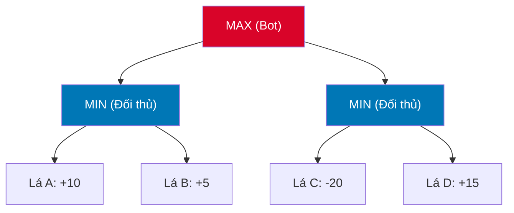

# ♟️ NGUYÊN LÝ THUẬT TOÁN MINIMAX TRONG TRÒ CHƠI ĐỐI KHÁNG

Minimax là thuật toán ra quyết định cơ bản nhất trong lý thuyết trò chơi dành cho các trò chơi đối kháng 2 người, thông tin hoàn hảo (Perfect Information) và có tổng lợi ích bằng không (Zero-Sum Game).

---

## 1. MÔ HÌNH TOÁN HỌC CỦA MINIMAX

Giả sử có hai người chơi:
* **MAX (Bot):** Luôn lựa chọn nước đi dẫn tới trạng thái có giá trị lượng giá cao nhất ($\max$).
* **MIN (Đối thủ):** Luôn phản xạ bằng nước đi tối ưu của họ, tức là đưa trạng thái về giá trị nhỏ nhất đối với MAX ($\min$).

Giá trị Minimax của một trạng thái $s$ được định nghĩa bằng hàm đệ quy:

$$V(s) = \begin{cases} 
\text{Utility}(s) & \text{nếu } s \text{ là trạng thái kết thúc (Terminal State)} \\
\text{Heuristic}(s) & \text{nếu đạt giới hạn độ sâu } \text{depth} = 0 \\
\max_{a \in \text{Actions}(s)} V(\text{Result}(s, a)) & \text{nếu là lượt của MAX} \\
\min_{a \in \text{Actions}(s)} V(\text{Result}(s, a)) & \text{nếu là lượt của MIN}
\end{cases}$$


* MIN1 chọn $\min(10, 5) = 5$.
* MIN2 chọn $\min(-20, 15) = -20$.
* MAX1 chọn $\max(5, -20) = 5$ (Đi theo nhánh trái).

---

## 2. HIỆN THỰC HÓA MÃ NGUỒN CƠ BẢN (TYPESCRIPT)

```typescript
export class MinimaxSearch {
  private evaluator: HeuristicEvaluator;
  public nodesVisited: number = 0;

  constructor(evaluator: HeuristicEvaluator) {
    this.evaluator = evaluator;
  }

  public minimax(
    board: Board, 
    depth: number, 
    isMaximizing: boolean, 
    botPlayer: number
  ): number {
    this.nodesVisited++;

    const opponent = (botPlayer === CellValue.PLAYER_X) 
      ? CellValue.PLAYER_O 
      : CellValue.PLAYER_X;

    // 1. Kiểm tra trạng thái kết thúc hoặc chạm trần độ sâu
    if (depth === 0 || board.isFull()) {
      return this.evaluator.evaluate(board, botPlayer);
    }

    const availableMoves = this.getCandidateMoves(board);
    if (availableMoves.length === 0) {
      return this.evaluator.evaluate(board, botPlayer);
    }

    if (isMaximizing) {
      let maxEval = -Infinity;
      for (const move of availableMoves) {
        board.set(move.row, move.col, botPlayer);
        
        // Kiểm tra nếu nước đi này thắng ngay
        if (this.evaluator.checkWin(board, move.row, move.col)) {
          board.set(move.row, move.col, CellValue.EMPTY);
          return 100000 + depth; // Ưu tiên thắng càng sớm càng tốt
        }

        const evaluation = this.minimax(board, depth - 1, false, botPlayer);
        board.set(move.row, move.col, CellValue.EMPTY); // Backtracking
        maxEval = Math.max(maxEval, evaluation);
      }
      return maxEval;
    } else {
      let minEval = Infinity;
      for (const move of availableMoves) {
        board.set(move.row, move.col, opponent);

        // Kiểm tra nếu đối thủ thắng ngay
        if (this.evaluator.checkWin(board, move.row, move.col)) {
          board.set(move.row, move.col, CellValue.EMPTY);
          return -100000 - depth;
        }

        const evaluation = this.minimax(board, depth - 1, true, botPlayer);
        board.set(move.row, move.col, CellValue.EMPTY); // Backtracking
        minEval = Math.min(minEval, evaluation);
      }
      return minEval;
    }
  }
}
```

---

## 3. ĐỘ PHỨC TẠP VÀ THÁCH THỨC CỦA MINIMAX THUẦN TÚY

* **Độ phức tạp thời gian:** $O(b^d)$
  * Với $b = 20$ (ứng viên) và $d = 3$: Duyệt $20^3 = 8,000$ nút (mất khoảng $50 \text{ ms}$).
  * Khi tăng lên $d = 4$: Duyệt $20^4 = 160,000$ nút (mất khoảng $1 - 2$ giây).
  * Khi tăng lên $d = 5$: Duyệt $20^5 = 3,200,000$ nút (treo trình duyệt Web!).
* **Kết luận:** Minimax thuần túy không thể vươn tới độ sâu cao nếu không có kỹ thuật cắt tỉa nhánh. Đây là lý do ra đời của **Alpha-Beta Pruning** ở Tuần 6.
