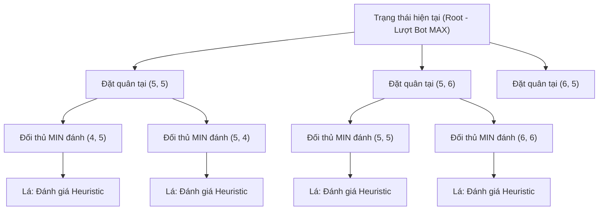

# 🌲 XÂY DỰNG GAME TREE TRONG CỜ CARO

Tài liệu này phân tích cấu trúc cây trò chơi (Game Tree) trong Cờ Caro và kỹ thuật hiện thực hóa duyệt đệ quy hiệu năng cao thông qua cơ chế quay lui (Backtracking).

---

## 1. MÔ HÌNH CÂY TRÒ CHƠI DẠNG ĐỒ THỊ CÓ HƯỚNG



---

## 2. KỸ THUẬT QUAY LUI TRÊN CÙNG MỘT MA TRẬN (IN-PLACE BACKTRACKING)

Trong lập trình Web bằng TypeScript / JavaScript, nếu mỗi khi đi xuống một nhánh cây ta lại sao chép toàn bộ bàn cờ (`board.clone()`), bộ nhớ heap sẽ bị phân mảnh và trình gom rác (Garbage Collector) sẽ làm gián đoạn luồng xử lý (GC Pause).

**Giải pháp tối ưu:** Chỉ sử dụng duy nhất một đối tượng `Board`, thực hiện đặt quân và hoàn tác ngay lập tức:

```typescript
// 1. Thử đi nước cờ (Apply Move)
board.set(move.row, move.col, player);

// 2. Gọi đệ quy duyệt nhánh sâu hơn
const score = this.search(board, depth - 1, ...);

// 3. Hoàn tác trạng thái như cũ (Undo / Backtrack)
board.set(move.row, move.col, CellValue.EMPTY);
```

Nhờ giải pháp này, chi phí cấp phát bộ nhớ cho mỗi bước duyệt cây giảm từ $O(N^2)$ xuống đúng $O(1)$, cho phép duyệt hàng chục ngàn nút mỗi giây mượt mà trên trình duyệt.
