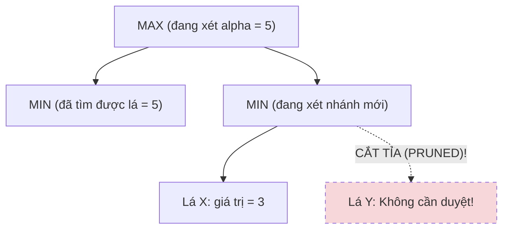

# ✂️ NGUYÊN LÝ THUẬT TOÁN CẮT TỈA ALPHA-BETA (ALPHA-BETA PRUNING)

Alpha-Beta Pruning là một kỹ thuật tối ưu hóa tìm kiếm mà không làm mất tính chính xác toán học của kết quả Minimax. Kỹ thuật này cho phép bỏ qua các nhánh cây mà chắc chắn không ảnh hưởng đến quyết định cuối cùng của người chơi.

---

## 1. MÔ HÌNH TOÁN HỌC VÀ ĐIỀU KIỆN CẮT NHÁNH

Thuật toán duy trì hai tham số trong suốt quá trình đệ quy:
* $\alpha$: Điểm số tối thiểu tốt nhất mà người chơi MAX được đảm bảo (Khởi tạo: $\alpha = -\infty$).
* $\beta$: Điểm số tối đa tốt nhất mà người chơi MIN được đảm bảo (Khởi tạo: $\beta = +\infty$).


* **Phân tích:** Tại nút MIN2, ngay khi gặp lá có giá trị $3$, nút MIN2 sẽ chỉ có giá trị $\le 3$. Nhưng ở nhánh trước đó, MAX đã có lựa chọn chắc chắn đạt điểm $5$ ($\alpha = 5$). Do đó, MAX sẽ không bao giờ đi vào nhánh dẫn tới MIN2. Toàn bộ các nhánh con còn lại của MIN2 lập tức bị **cắt tỉa (Cutoff)**!

---

## 2. HIỆN THỰC HÓA MÃ NGUỒN (TYPESCRIPT)

```typescript
export class AlphaBetaSearch {
  public nodesVisited: number = 0;
  public nodesPruned: number = 0;

  public search(
    board: Board, 
    depth: number, 
    alpha: number, 
    beta: number, 
    isMaximizing: boolean, 
    botPlayer: number
  ): number {
    this.nodesVisited++;

    const opponent = (botPlayer === CellValue.PLAYER_X) 
      ? CellValue.PLAYER_O 
      : CellValue.PLAYER_X;

    // Điều kiện dừng đệ quy
    if (depth === 0 || board.isFull()) {
      return this.evaluator.evaluate(board, botPlayer);
    }

    const moves = this.getCandidateMoves(board);

    if (isMaximizing) {
      let maxEval = -Infinity;
      for (let i = 0; i < moves.length; i++) {
        const move = moves[i];
        board.set(move.row, move.col, botPlayer);

        const evaluation = this.search(board, depth - 1, alpha, beta, false, botPlayer);
        board.set(move.row, move.col, CellValue.EMPTY); // Backtrack

        maxEval = Math.max(maxEval, evaluation);
        alpha = Math.max(alpha, evaluation);

        // ĐIỀU KIỆN CẮT TỈA BETA (Beta Cutoff)
        if (beta <= alpha) {
          // Ghi nhận số lượng nhánh con đã được bỏ qua không cần duyệt
          this.nodesPruned += (moves.length - 1 - i);
          break; // Cắt tỉa!
        }
      }
      return maxEval;
    } else {
      let minEval = Infinity;
      for (let i = 0; i < moves.length; i++) {
        const move = moves[i];
        board.set(move.row, move.col, opponent);

        const evaluation = this.search(board, depth - 1, alpha, beta, true, botPlayer);
        board.set(move.row, move.col, CellValue.EMPTY); // Backtrack

        minEval = Math.min(minEval, evaluation);
        beta = Math.min(beta, evaluation);

        // ĐIỀU KIỆN CẮT TỈA ALPHA (Alpha Cutoff)
        if (beta <= alpha) {
          this.nodesPruned += (moves.length - 1 - i);
          break; // Cắt tỉa!
        }
      }
      return minEval;
    }
  }
}
```

---

## 3. HIỆU QUẢ CẮT TỈA LÝ THUYẾT

* **Trường hợp tệ nhất (Worst Case):** Nước đi tồi tệ nhất luôn bị duyệt trước $\rightarrow$ Không cắt được nhánh nào:
  $$O(b^d)$$
* **Trường hợp lý tưởng (Best Case):** Nước đi tốt nhất luôn được duyệt đầu tiên $\rightarrow$ Số nút duyệt giảm xuống căn bậc hai:
  $$O(b^{d/2})$$
  *(Điều này có nghĩa là với cùng một khoảng thời gian tính toán, Alpha-Beta có thể tìm kiếm **sâu gấp đôi** so với Minimax thuần túy!)*
